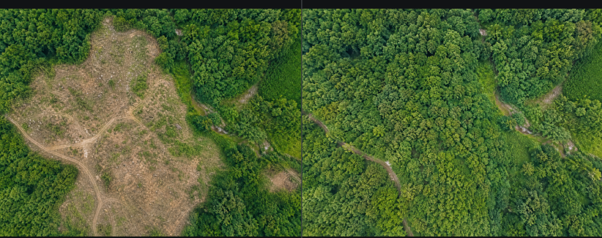
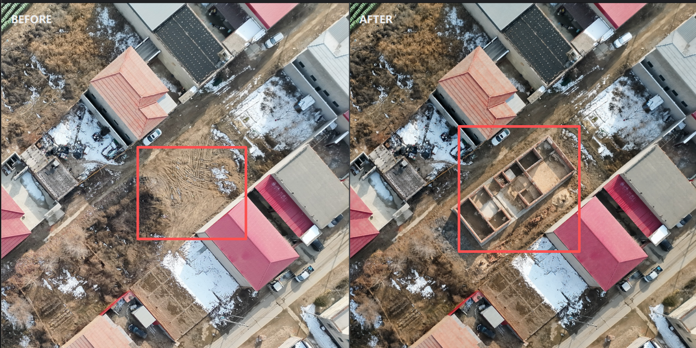
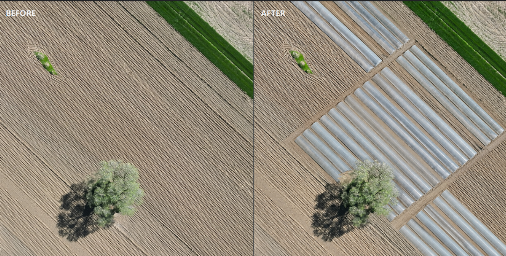
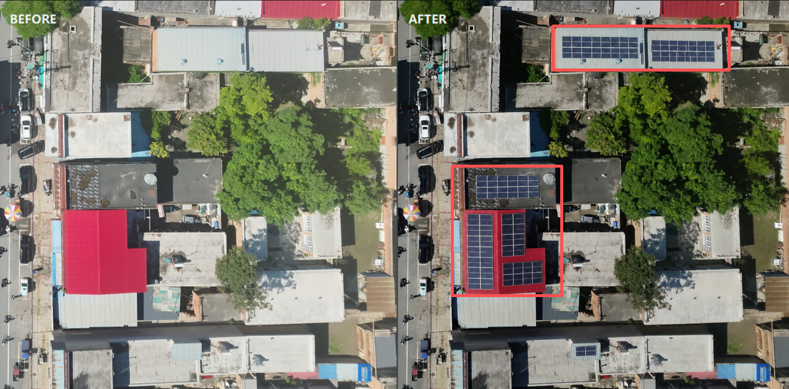
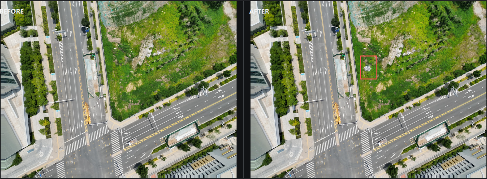
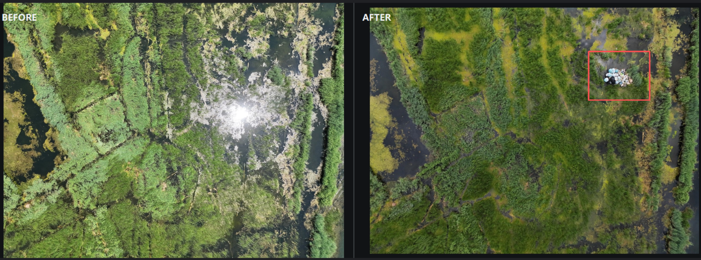
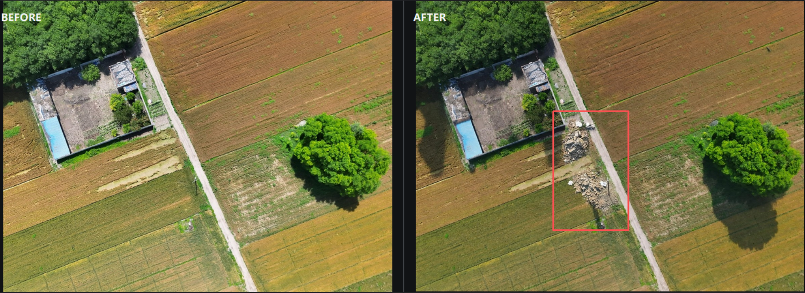
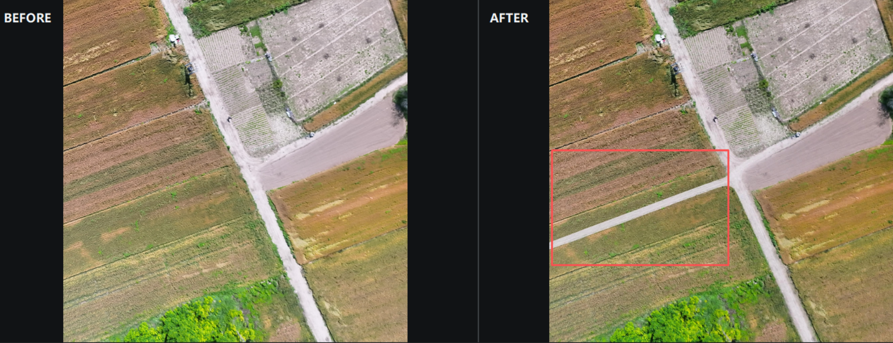

# 图片制作提示词

## 单时刻→第二时刻

#### 一：森林→荒地

```
PROMPT = """
请基于输入的无人机正射航拍图进行真实遥感风格图像编辑，将图中森林、林地、树冠密集区域自然转化为荒地、裸地或采伐后空地。

荒地变化可以是局部区域，也可以是大面积区域，比例随机但要自然合理。被改变的森林区域应去除树冠覆盖，呈现黄褐色、灰褐色或浅土黄色裸露地表，可包含干燥泥土、砂石、碎石、稀疏枯草、低矮灌木残留、树桩、枯枝、车辙、土路痕迹、局部湿润暗色土斑、采伐后不规则空地等细节。

允许荒地区域周边背景随之发生合理变化，例如林缘变稀疏、裸土与草地过渡、地表颜色和纹理发生变化、阴影减少或改变、局部出现不规则空隙和自然斑块，使画面看起来像真实航拍中的森林退化、采伐、干旱或土地裸露结果。

必须保持无人机高空正射俯视视角，保持原图的地形走向、道路、水体、田块边界、建筑轮廓、河沟、山体坡向和整体空间布局基本不变。不要改变相机角度，不要裁剪图片，不要旋转图片，不要改变原始分辨率比例。生成结果应与原图的光照方向、阴影强度、清晰度、压缩噪声、航拍质感和遥感影像风格一致。

荒地区域边界要自然、不规则、有过渡，不要像规则矩形或人工涂抹。整体画面必须真实、自然、可信，像同一地点经过森林减少或地表裸露后的真实无人机正射影像。
"""

NEGATIVE_PROMPT = """
卡通，插画，油画，3D渲染，游戏地图，卫星地图标注，文字，水印，logo，边框，比例尺，图例，网格线，地图标注，明显人工涂抹，规则矩形荒地，重复纹理，复制粘贴感，过度锐化，过度模糊，低清晰度，颜色过饱和，荧光色，不真实的沙漠化效果。

不要改变正射俯视视角，不要生成天空、地平线、侧视角、倾斜透视。不要新增大型建筑，不要删除原有道路，不要改变道路走向，不要改变河流和水体形状，不要改变建筑轮廓，不要生成车辆、人物、动物、机械设备。不要把整张图变成城市、农田、沙漠或纯色地面。不要产生明显断裂边缘、错误阴影、不合理比例、漂浮物体、伪影、畸变。
"""
NEGATIVE_PROMPT_FIELD = "negativePrompt"
```



#### 二：空地→地基

提示词1

```
PROMPT = "请基于输入的无人机正射航拍图进行局部编辑，只允许在图中明确的空地、裸土地、荒地、村庄道路旁空地、农田边缘空地或已有建筑附近但未被占用的地面上新增1到3处农村自建房未完工地基。已有房屋、屋顶、院墙、棚子、道路和树木必须作为不可编辑背景，保持原样，严禁修改、覆盖、替换、扩建或重绘任何已有建筑。新增地基必须与已有建筑保持明显间距，不能贴在屋顶上，不能跨到已有房屋、院墙或道路上。新增地基要明显可见，尺寸不要太小，单个地基的占地规模应接近真实农村自建房，比普通小标记大很多，约等于附近小型房屋或院落的一部分大小。每处地基应像真实航拍图中正在施工早期的房屋基础：由低矮灰黑色或深灰色混凝土地梁、红褐色砖砌基础墙、土黄色夯土地面、灰褐色水泥面、浅褐色基槽、碎石、砂土和裸土扰动组成，形成清晰的矩形或近矩形房屋平面。内部应有几道明显的房间分隔基础墙或格子状地基结构，类似已经砌出房间格局但尚未建墙体和屋顶的施工状态。地基颜色以深灰色、灰褐色、红褐色、土黄色、浅棕色、砂石色为主，可以有少量白灰或水泥残留，但不能整体变成纯白色线条。地基应贴合地面，略高于地面或呈浅沟槽状态，带有真实阴影、开挖痕迹、翻土、压平地面、砂石堆和周围裸土颜色变化。整体效果要像真实无人机正射航拍影像中新出现的农村未完工房屋地基，清晰、自然、可信。保持原图相机视角、光照方向、阴影、分辨率、压缩噪声和整体空间结构不变。"

NEGATIVE_PROMPT = "修改已有房屋，改变已有建筑，覆盖已有屋顶，把屋顶变成地基，把已有楼房改成未完工建筑，扩建已有建筑，删除已有建筑，改变院墙，改变棚子，改变屋顶颜色，改变屋顶纹理，改变建筑阴影，在已有建筑上生成地基，地基贴着屋顶，地基跨到道路上，地基跨到院墙上，在树冠上生成地基，在水体上生成地基，地基太小，像小白框，像标注框，白色放线，纯白线条，发光线条，只有轮廓线，没有地基实体，没有内部隔间，完整房屋，屋顶，高墙，楼房，彩钢棚，大型工地，大量机械，挖掘机，车辆，人物，改变道路，改变树木，改变水体，改变相机视角，倾斜透视，地基漂浮，像贴纸，边缘过于锐利，颜色过亮，荧光色，3D渲染感，游戏地图感，严重变形。"

NEGATIVE_PROMPT_FIELD = "negativePrompt"
```

效果图


提示词2

```
PROMPT = "请基于输入的无人机正射航拍图进行真实遥感风格局部编辑。优先在图中已有的未完工房屋、老旧房屋、低矮农村自建房、破旧院落、简易棚屋或建筑旁空地上进行自然扩建；如果图中没有明显适合扩建的房屋，则可以在明确的空地、裸土地、村庄道路旁空地或农田边缘空地上新建一处农村自建房早期施工结构。每幅图随机生成1到3处变化。扩建效果应像真实农村建筑改造或自建房加建：可以新增低矮砖墙、灰褐色混凝土地梁、红褐色砖砌墙体、未封顶房间格局、半成型院墙、浅灰水泥地面、土黄色施工地面、裸土扰动、砂石堆、少量建筑材料和开挖痕迹。扩建部分应与原有房屋自然连接或位于旁边空地，尺寸要符合农村建筑比例，不能过小，也不能覆盖大片区域。若是在空地新建，应生成类似农村未完工房屋地基或低矮基础墙，带有清晰房间分隔结构。新增或扩建部分的颜色应以红褐色砖块、灰褐色水泥、深灰色地梁、土黄色裸土、浅棕色砂石和旧建筑相近色为主，避免纯白色或过亮颜色。建筑结构必须贴合地面和原图透视，符合无人机正射航拍视角，有自然阴影和真实施工痕迹。保持原图道路、树木、农田、水体、已有完整建筑、相机视角、光照方向、阴影、分辨率和整体空间结构基本不变。最终效果必须像真实航拍图中农村房屋正在扩建、翻建或新建早期施工状态。"

NEGATIVE_PROMPT = "改变相机视角，倾斜透视，生成天空，生成地平线，大型城市建筑，高楼，完整豪华别墅，现代商业楼，大型厂房，大面积工地，过度施工，挖掘机，吊车，大量车辆，大量人物，覆盖大片农田，改变道路走向，改变树木，改变水体，删除已有建筑，严重重绘整张图，改变完整房屋屋顶颜色，改变无关建筑纹理，扩建部分漂浮，像贴纸，边缘过于锐利，比例过大，比例过小，纯白色线条，白色放线，发光颜色，荧光色，亮蓝色，亮绿色，塑料感，3D渲染感，游戏地图感，卡通，插画，文字，水印，logo，红色标注框，箭头，地图标注，严重变形，重复纹理。"

NEGATIVE_PROMPT_FIELD = "negativePrompt"
```

效果图



#### 三：地基→成品房子

提示词

```
PROMPT = "请基于输入的无人机正射航拍图进行真实遥感风格局部编辑。识别图中所有未完工房屋地基、裸露地基、格子状基础墙、施工中的房屋基础、土黄色或灰褐色的矩形地基区域，并将这些地基全部自然改造成已经建成的农村房屋或低矮民房。必须处理图中所有类似地基区域，不要遗漏。只允许修改这些未完工地基区域及其紧邻施工裸土区域，其他已有房屋、道路、树木、院墙、车辆、水体和农田必须保持原样。生成的新房子应与周围已有房屋风格相近，符合农村航拍正射影像：可以是灰色平屋顶、红色或红褐色瓦屋顶、浅灰色金属屋顶、蓝灰色彩钢屋顶、水泥平顶或低矮砖混民房。每栋新房子的占地范围应基本覆盖原来的地基位置，形状和朝向与原地基一致，可以保留合理院墙边界或小院结构，但地基裸土和内部格子基础应被屋顶、墙体或完整建筑表面替代。新房子高度和体量要与附近民房相近，不要变成高楼、大厂房或豪华别墅。为增强真实感，请为新生成的房屋添加与原图光照一致的自然阴影，也可以适度调整局部阴影方向和长度，使画面呈现不同拍摄时刻的感觉，例如早晨或傍晚的斜向阴影、屋檐阴影、院墙阴影和建筑投影。但阴影必须真实、柔和、方向一致，不能影响整张图的结构。新房子的屋顶颜色、亮度、纹理、边缘清晰度、压缩噪声和航拍质感应与周围建筑融合。保持无人机正射俯视视角、原始分辨率、道路走向、已有建筑形状和整体空间布局不变。最终效果必须像真实航拍图中这些地基已经建成房屋后的状态。"

NEGATIVE_PROMPT = "遗漏地基，只改一个地基，不处理全部地基，修改已有完整房屋，改变周围已有屋顶，改变道路，改变树木，改变车辆，改变院墙，改变水体，改变整张图光照，重绘整张图，新增大面积建筑群，高楼，商业楼，厂房，豪华别墅，现代玻璃建筑，过高建筑，屋顶漂浮，建筑比例错误，房子超出原地基太多，覆盖道路，覆盖树木，覆盖已有房屋，保留裸露地基，保留格子状基础墙，仍然像施工现场，屋顶没有阴影，阴影方向混乱，阴影过黑，阴影像贴纸，强烈不真实光斑，倾斜透视，生成天空，地平线，3D渲染感，游戏地图感，卡通，插画，文字，水印，logo，红色标注框，箭头，地图标注，边缘过锐，模糊变形，重复纹理。"

NEGATIVE_PROMPT_FIELD = "negativePrompt"
```

效果图：


#### 四：空地→农业大棚

提示词：

```
PROMPT = """
请基于输入的无人机正射航拍图进行真实遥感风格的局部编辑，在图中明显适合建设农业大棚的农田、裸土田块、规则空闲地、现有农业用地区域，自然生成若干农业温室大棚。

农业大棚应符合真实农村航拍影像特征：从正上方俯视，整体呈长条形、拱棚形、并列条带形或连栋温室形态；方向应顺着原有田块、田垄、道路、沟渠或地块边界排列，多个大棚之间可以平行分布，并保留合理的窄路、间距、排水沟或田埂。大棚数量、长度、宽度和占地范围要与周围田块尺度一致，不要过密、过大或过于整齐机械。

大棚类型可以有自然差异：常见的白色或灰白色塑料薄膜拱棚、浅灰色旧棚、银灰色温室棚、少量蓝灰色或浅绿色棚顶、较宽的连栋温室。棚顶不能纯白发光，不能像新贴上去的图形；应带有真实航拍中的轻微灰尘、老化、压缩噪声、柔和边缘、薄膜纹理、纵向筋线、局部反光和亮暗不均。部分棚可以略旧、略脏或局部偏暗，但整体仍应像真实农业设施。

只允许修改适合建棚的农田、裸地或空闲农业地块，以及这些地块内部的局部纹理。不要修改已有完整房屋、道路、树木、水体、车辆、院墙、沟渠主线和重要地物；不要覆盖道路、房屋、树木、水体和车辆。如果某处不适合建设大棚，请保持原样。生成后应像这些地块原本后来新建了农业大棚，而不是把整张图重新绘制。

可以加入由于拍摄时间不同造成的轻微真实变化：大棚附近可出现柔和阴影、棚顶反光强弱变化、轻微色温差异、局部亮度变化、田地湿润程度或植被颜色的轻微变化。阴影方向必须与整张图光照一致，阴影长度和强度要符合无人机正射影像，不能过黑、不能方向混乱，也不能改变整张图的季节、地块结构、道路走向或建筑布局。

保持无人机正射俯视角度、原始分辨率、真实遥感影像质感、周围空间关系和整体画面风格。最终效果必须像真实航拍图中自然存在的农业大棚。
"""
NEGATIVE_PROMPT = """
卡通，插画，3D渲染，游戏地图，模型感，贴纸感，透视视角，斜拍视角，低空近景，生成天空，地平线，文字，水印，logo，地图标注，红色标注框，箭头，整图重绘，改变整张图光照，改变季节，改变道路走向，改变建筑布局，破坏田块边界，覆盖道路，覆盖房屋，覆盖树木，覆盖水体，覆盖车辆，覆盖院墙，覆盖沟渠主线，大棚悬浮，大棚边缘过锐，大棚比例过大，大棚比例过小，大棚排列方向混乱，大棚过度密集，大棚颜色纯白发光，强烈塑料反光，重复纹理，阴影方向混乱，阴影过黑，高楼，厂房，豪华建筑，现代玻璃建筑，太阳能板阵列，停车场，城市建筑
"""
NEGATIVE_PROMPT_FIELD = "negativePrompt"
```

效果图：



#### 五：空地有垃圾

生活垃圾：

提示词

```
PROMPT = """
请基于输入的无人机正射航拍图进行真实遥感风格的局部编辑，在图中合理位置自然生成少量生活垃圾或混合杂物堆。请根据原图环境判断适合出现垃圾的位置，例如村庄边缘、房屋院墙旁、厂房空地、路边空闲地、树下、裸土地、施工边角、废弃院落角落或已有杂物附近；如果某个区域不适合堆放垃圾，请保持原样，不要强行生成。

垃圾应呈现真实航拍影像中的生活垃圾堆放状态：包含白色、灰色、蓝色、红色、黄色等零散塑料袋、编织袋、纸箱、泡沫箱、废弃包装物、破布、瓶罐、杂物碎片、少量木棍或建筑废料。整体应是不规则堆积，大小不一，颜色杂乱但不过度鲜艳，边缘散落，局部有灰尘、泥土覆盖、阴影和压缩噪声。垃圾堆不能像规则图案，也不能像贴上去的彩色颗粒。

垃圾规模要符合无人机正射图比例，可以是一小堆、中等堆或几处零散堆放，不要铺满大面积区域。垃圾应贴合地面，和裸土、水泥地、院墙边、草地边缘或道路边自然融合。可以有少量散落垃圾沿路边或空地边缘分布，但主体不要过度扩散。

只允许修改垃圾堆所在的小范围区域及其紧邻地面纹理。不要修改已有完整房屋、道路主体、树木主体、水体、车辆、院墙和重要地物；不要覆盖道路通行区域、房屋屋顶、车辆或明显农田主体。垃圾应避开不合理位置，例如房顶中央、水面中央、树冠顶部、道路正中间或整齐农田中央。

可以加入由于拍摄时间不同造成的轻微真实变化：垃圾附近可有柔和阴影、轻微亮度变化、尘土色差、局部潮湿或干燥痕迹。光照和阴影方向必须与原图一致，变化要自然克制，不要改变整张图季节、建筑布局、道路走向或整体色调。

保持无人机正射俯视角度、原始分辨率、真实遥感影像质感和整体空间关系。最终效果应像真实航拍图中自然存在的生活垃圾堆、杂物堆或村边废弃物堆放点。
"""
NEGATIVE_PROMPT = """
卡通，插画，3D渲染，游戏地图，模型感，贴纸感，规则图案，彩色圆点，彩色噪点，过度鲜艳，垃圾像花纹，垃圾像马赛克，垃圾边缘过锐，垃圾悬浮，垃圾比例过大，垃圾比例过小，大面积铺满垃圾，垃圾覆盖整条道路，垃圾覆盖房屋，垃圾覆盖树冠，垃圾覆盖水体，垃圾覆盖车辆，垃圾出现在屋顶中央，垃圾出现在水面中央，垃圾出现在道路正中间，垃圾出现在整齐农田中央，改变道路走向，改变建筑布局，改变树木形状，改变整张图光照，改变季节，整图重绘，生成垃圾桶，生成大型垃圾车，生成人物特写，生成火焰，浓烟，夸张污染，危险化学品标志，医疗废物标志，文字，水印，logo，地图标注，红色标注框，箭头，透视视角，斜拍视角，低空近景，生成天空，地平线，重复纹理，阴影方向混乱，阴影过黑
"""
NEGATIVE_PROMPT_FIELD = "negativePrompt"
```

效果图


#### 六：屋顶光伏新增

提示词

```
PROMPT = """
请基于输入的无人机正射航拍图进行真实遥感风格的局部编辑，在图中选择少量适合安装光伏的屋顶，自然生成真实屋顶分布式太阳能光伏板阵列。请优先选择面积较大、无遮挡、结构清晰的平屋顶、厂房屋顶、彩钢瓦屋顶或农村房屋屋顶；不适合安装的位置保持原样，不要强行生成。

光伏板不能是一整块单调黑色平面，必须呈现真实组件阵列结构：由多块独立矩形太阳能板拼接组成，有清晰但不过锐利的行列分块、细密电池片网格、浅灰或银灰色金属边框、面板之间的窄缝、阵列边缘框架和局部支架阴影。每块组件应有轻微亮暗差异、蓝黑色或深灰蓝色玻璃质感、细微反光、压缩噪声和航拍模糊，整体看起来像真实航拍照片中的光伏组件，而不是贴上去的黑色矩形。

光伏阵列应有足够的细节和厚度感：面板边缘可以有轻微投影，阵列下方可有很浅的阴影或支架暗线，部分区域可受到树影、屋顶女儿墙、烟囱、天窗、屋脊或屋面结构影响，形成自然遮挡和亮度变化。面板表面可以出现轻微灰尘、局部反光不均、色块差异和组件拼接痕迹，但不要过脏、不要破损夸张。

光伏板必须贴合屋顶方向和建筑透视关系，沿屋顶长边、屋檐、屋脊或厂房边界整齐排列。阵列大小要符合屋顶尺度，可以覆盖屋顶一部分或大部分，但必须保留合理屋檐边距、检修通道、屋顶边缘和障碍物避让空间。不要越出屋顶边界，不要跨到道路、树冠、水体、车辆、院墙或相邻建筑上。

不同屋顶上的光伏阵列可以有自然差异：有的为大面积整齐矩形阵列，有的为几排较小组件，有的只覆盖屋顶一侧；颜色可以是深蓝、蓝黑、黑灰或深灰蓝，反光强弱、组件数量、排列方向和新旧程度可以不同。不要每个屋顶都安装，也不要所有光伏板完全一样。

只允许修改光伏板所在屋顶或硬质平面的小范围区域及其紧邻纹理。不要改变房屋轮廓、屋顶整体形状、道路走向、树木形状、水体、车辆、院墙、农田和整体空间布局。不要重绘整张图，不要生成大型地面光伏电站。

可以加入由于拍摄时间不同造成的轻微真实变化：光伏表面可有柔和高光、局部反射、树影遮挡、边框阴影、组件间暗缝和轻微色温变化。所有光照和阴影方向必须与原图一致，变化要自然克制，不要改变整张图季节、建筑布局或整体色调。

保持无人机正射俯视角度、原始分辨率、真实遥感影像质感和建筑空间关系。最终效果应像真实航拍图中自然安装在屋顶上的完整分布式太阳能光伏板阵列。
"""
NEGATIVE_PROMPT = """
一整块黑色矩形，纯黑色方块，没有组件分块，没有电池片网格，没有边框，没有缝隙，平面贴纸感，空洞单薄，悬浮太阳能板，太阳能板没有厚度，太阳能板越出屋顶边界，太阳能板跨到道路上，太阳能板跨到树冠上，太阳能板跨到车辆上，太阳能板跨到水体上，随机乱放，方向与屋顶不一致，透视关系错误，比例过大，比例过小，边缘过锐，反光过强，镜面反射，发光板，玻璃幕墙，普通窗户被误生成太阳能板，每个屋顶都安装，覆盖整张图，大型地面光伏电站，改变房屋轮廓，改变屋顶形状，改变道路走向，改变树木形状，改变车辆位置，改变整张图光照，改变季节，整图重绘，卡通，插画，3D渲染，游戏地图，模型感，透视视角，斜拍视角，低空近景，生成天空，地平线，文字，水印，logo，地图标注，红色标注框，箭头，重复纹理，阴影方向混乱，阴影过黑
"""
NEGATIVE_PROMPT_FIELD = "negativePrompt"
```

效果图



#### 七：空地生活垃圾(垃圾袋堆叠，纸箱堆叠)

```
RANDOM_SEED = None
PROMPT = "对原图进行最小范围的局部物体添加：只在原图已经存在的一小块真实地面上添加一处普通日常生活垃圾堆，绝对不要生成、补建或改造任何环境结构。直接使用原图现有地表作为垃圾承载面，不得为了放置垃圾而新建或扩大房屋、楼群、屋顶、空地、平台、水泥地、道路、院落、围墙、棚子、垃圾站或其他设施，也不得改变原有地面的形状、范围、材质和颜色。垃圾集中为一个低矮紧凑的小堆，以单层摆放为主，少量两层自然重叠，高度不超过0.7米。若画面存在船只，整堆最长边不超过最小可见船只长度的三分之一，且必须明显小于船只；若没有船只，整堆不超过半个小汽车停车位并明显小于附近汽车。垃圾由八到十八个扎口且有装填感的日常垃圾袋组成，以乳白色、浅灰色和半透明塑料袋为主，搭配少量低饱和浅蓝色、浅绿色袋子，黑色和深灰色垃圾袋只占少数；另有两到四只浅棕色压扁旧纸箱，以及极少量透明塑料瓶、白色餐盒和低饱和彩色包装。所有物品彼此靠近并集中在同一处，外围只允许一两件小物。垃圾必须直接贴合原有地面，只有紧贴垃圾底部的自然接触阴影，透视、尺寸、清晰度、颜色、光照、颗粒感和压缩噪声与原图一致。若画面有水域，垃圾只能放在原图已经存在的干燥岸边地面上，不能修改水面、岸线或生成新平台。除垃圾及其微弱接触阴影覆盖的局部区域外，原图所有建筑、空地、平台、道路、水面、船只、岸线、树木、车辆和背景必须保持原样，不添加方框、线条或图形标记。"
NEGATIVE_PROMPT = "新增房屋，新增居民楼，新增建筑群，新增楼顶，新增屋顶，新增空地，新增平台，空地平台，水泥平台，高台，地基，台阶，码头平台，扩大地面，填平水面，开辟空地，新建道路，新建院落，新建围墙，新建棚子，新建垃圾站，新建垃圾房，新建垃圾收集亭，新增垃圾桶设施，改变地表材质，重绘大片地面，改变建筑结构，改变空地范围，改变平台轮廓，改变水面，改变岸线，改变船只，改变道路树木车辆，背景重建，大面积重绘，垃圾在屋顶，垃圾在平台顶部，垃圾在水面，垃圾漂浮，垃圾在船上，垃圾悬空，垃圾没有接地阴影，垃圾比船大，垃圾袋与汽车一样大，高耸垃圾山，多层高堆，多个垃圾堆，满地零散垃圾，全部黑色垃圾袋，大面积纯黑垃圾，建筑垃圾，砖块，水泥块，钢筋，碎石，木板，红框，矩形框，检测框，标注线，箭头，圆圈，文字，水印，贴纸效果，3D渲染，边缘过度锐利。"
NEGATIVE_PROMPT_FIELD = "negativePrompt"
```

效果图


#### 八：房区生活垃圾（集中在道路旁垃圾堆）

```
RANDOM_SEED = None
PROMPT = "对原始无人机高空俯拍的房区影像进行严格的加法式局部编辑：必须在原图已有马路或巷道的道路旁边添加一处清楚可见的中等规模生活垃圾堆，不能返回没有变化或垃圾难以发现的图片，但只能叠加垃圾，绝不能删除、替换或移动原图中的任何物体。垃圾堆至少一侧必须直接紧贴原图清晰可见的道路外缘、路缘或路肩，中间不能隔着围墙、建筑、树冠、空地或其他物体；垃圾必须与道路上的汽车、摩托车或行人处于同一个地面高度和平面。只能放在道路外侧不影响车辆通行的现有地面，不能放在机动车道中央、道路交叉口、建筑入口、院落内部、停车通道或道路以外的封闭区域。选择能够完整容纳垃圾、视线无遮挡、不在深色阴影中且不靠近画面边缘的一段道路边缘；如果某处空间不足，应沿现有道路改选另一处，不能缩小到看不见，也不能移除树木、清除植被、改造屋顶或生成新地面。垃圾不得与任何树冠、屋顶、女儿墙、露台、雨棚或建筑平台重叠。垃圾堆约3到4米长、1.5到2.5米宽，占地大致相当于一辆小汽车或一个停车位，但不得超过一辆半汽车的占地；整体高度约0.4到0.8米，低矮平缓，以单层摆放为主，少量两层自然重叠。垃圾由十八到三十个扎口且有装填感的日常垃圾袋、三到五只压扁旧纸箱，以及少量塑料瓶、餐盒和食品包装组成；以乳白色、浅灰色、半透明和浅棕色为主，加入少量低饱和蓝色、绿色、红色包装，黑色垃圾袋只占少数。所有垃圾彼此接触并集中成一个轮廓完整、略不规则的混合色垃圾堆，与道路旁地面形成清楚但自然的颜色和纹理差异，外围最多只有两三件紧贴主堆的小物。垃圾必须直接贴合原有道路旁地面，只有紧贴底部的自然接触阴影，尺寸、透视、清晰度、光照、颗粒感和压缩噪声与原图一致。原图中每一棵树以及所有屋顶、建筑、道路、车辆的数量、位置、轮廓、纹理、颜色和阴影必须完全保留。除垃圾及其底部接触阴影覆盖的少量路边地面像素外，原图其余区域保持不变，不添加任何方框、文字或标记。"
NEGATIVE_PROMPT = "垃圾远离道路，垃圾与道路之间隔着建筑，垃圾与道路之间隔着围墙，垃圾与道路之间隔着树木，垃圾在院落内部，垃圾在封闭空地，垃圾在道路中央，垃圾阻断车道，垃圾在道路交叉口，垃圾遮挡建筑入口，垃圾占用停车通道，没有生成垃圾，原图完全没有变化，垃圾难以发现，垃圾过小不可见，垃圾藏在阴影中，垃圾被树木遮挡，垃圾位于画面边缘，删除树木，少了一棵树，树木消失，缩小树冠，改变树冠形状，垃圾覆盖树冠，清除植被，生成裸地，扩大裸地，垃圾在屋顶，垃圾在房顶，垃圾在楼顶平台，垃圾在露台，垃圾在雨棚，垃圾在建筑平台，把屋顶识别为地面，改变屋顶轮廓，改变建筑结构，新增平台，新增空地，新增道路，新增房屋，新增围墙，背景重建，大面积重绘，垃圾堆超过一辆半汽车占地，超大型垃圾堆，高耸垃圾山，多层高堆，多个垃圾堆，满地零散垃圾，垃圾悬空，垃圾没有接地阴影，透视错误，全部黑色垃圾袋，大面积纯黑垃圾，建筑垃圾，砖块，水泥块，钢筋，碎石，木板，红框，矩形框，检测框，箭头，圆圈，文字，水印，贴纸效果，3D渲染，边缘过度锐利。"
NEGATIVE_PROMPT_FIELD = "negativePrompt"
```

效果图:


#### 九：田边生活垃圾（破旧衣物，分解物，混合碎片垃圾）

```
RANDOM_SEED = None
PROMPT = "对原始无人机高空俯拍影像进行局部编辑，必须在画面中实际新增一处清楚可见、真实自然的混合生活垃圾倾倒点，不能返回没有变化的原图。先识别原图已经存在的乡村道路边缘、房屋或厂区外围、田边、林地边缘、沟渠旁干燥地面以及裸土与杂草交界处，从中选择一处可由现有道路到达、没有树冠完全遮挡的合理位置。只能使用原图已有地面承载垃圾，不得新建空地、平台、道路、建筑、围墙或垃圾站。垃圾应为人为多次倾倒后形成的低矮、不规则混合垃圾堆，不是整齐排列的袋装垃圾。垃圾堆中心较密集，许多物品互相接触和遮挡，边缘有少量碎片紧贴裸土和杂草自然扩散，但不能散布到整幅画面。垃圾堆最宽处约为附近乡村道路宽度的0.6到1.5倍，整体高度低于0.8米，不堆成山，面积随原图地面空间自然调整，并明显小于附近建筑占地。垃圾以灰白色、浅灰色、半透明和浅棕色为主，包括白色或半透明塑料袋、编织袋、压扁纸箱、泡沫餐盒、塑料瓶、食品包装袋、废纸和少量旧布料，加入少量低饱和蓝色、绿色、红色包装形成自然色差；黑色垃圾只占少数，不能形成整块黑斑。垃圾必须直接贴合原有地面，部分被杂草轻微遮挡，具有真实接触阴影、脏污和不均匀纹理。垃圾的尺寸、透视、清晰度、光照、颗粒感和压缩噪声必须与原航拍影像一致。除垃圾及其紧邻区域外，保持原有房屋、厂房、农田、道路、沟渠、水面、岸线、植被、车辆和相机视角不变，不添加任何标注图形。"
NEGATIVE_PROMPT = "没有生成垃圾，原图完全没有变化，垃圾过小不可见，只生成一两个垃圾袋，整齐排列的垃圾袋，全部黑色垃圾袋，大面积纯黑垃圾，垃圾堆成高山，超大型垃圾场，垃圾均匀铺满画面，垃圾出现在农田中央，垃圾出现在道路中央，垃圾在屋顶，垃圾在水面，垃圾漂浮，垃圾悬空，垃圾被树冠完全遮挡，新增房屋，新增厂房，新增空地，新增水泥平台，新增道路，新增围墙，新增垃圾站，改变地表形状，大面积重绘，建筑垃圾，成堆砖块，水泥块，钢筋，巨大石块，红框，矩形框，检测框，箭头，圆圈，文字，水印，贴纸效果，3D渲染，边缘过度锐利。"
NEGATIVE_PROMPT_FIELD = "negativePrompt"
```

效果图：



#### 十：建筑废料

```
RANDOM_SEED = None
PROMPT = "对原始无人机高空俯拍影像进行严格的加法式局部编辑，必须在画面中实际新增一处或两处清楚可见、真实自然的建筑拆除废料倾倒点，只添加废料，绝不能删除、替换或移动原图中的任何物体。先识别原图已有的道路外缘、路肩、田地边界、果园或树林边缘、围墙外侧、施工建筑外围和现有裸土地面，从中选择车辆能够到达、没有树冠完全遮挡的合理位置。建筑废料必须直接放在原图已经存在的地面上，优先沿道路、田埂、围墙或场地边界呈低矮不规则分布，不能生成在屋顶、水面、农作物中央、树林内部或机动车道中央。废料倾倒点可以是约4到8米长、2到4米宽的块状小堆，也可以沿田边、道路或围墙形成约8到18米长、1.5到3米宽的狭长废料带；整体高度约0.3到0.8米，以平铺和少量叠压为主，不堆成高山。主体由大量破碎的灰白色混凝土块、水泥砂浆块、石膏板、轻质隔墙板、破损水泥板和不规则建筑板材组成，混入适量红褐色碎砖、瓦片、瓷砖、陶瓷碎片和浅棕色砂浆，少量加入折断木板、细金属杆、短管件和破损塑料薄膜。所有材料必须呈现已经废弃和破碎的状态，大小不一、棱角不规则、表面有灰尘、裂纹和污渍，许多碎块互相接触、覆盖和叠压，不能像整齐堆放的新建材。废料中心较密集，边缘逐渐稀疏，少量小碎片紧贴裸土和杂草自然散落，可被边缘杂草轻微遮挡，但不能均匀铺满整幅画面。整体色彩以灰白、浅灰、土黄和红褐色为主，形成符合真实建筑废料的颗粒与块状纹理。废料必须贴合地面，具有自然接触阴影、遮挡关系和航拍尺度，清晰度、透视、光照、颜色、颗粒感和压缩噪声与原图一致。保持原有道路、农田、树木、植被、围墙、建筑、屋顶、车辆、水面、岸线和相机视角完全不变，不创建新道路、平台、建筑或裸地，不添加任何方框、文字或标记。"
NEGATIVE_PROMPT = "没有生成建筑废料，原图完全没有变化，废料过小不可见，袋装生活垃圾，黑色垃圾袋，食品垃圾，餐盒和饮料瓶占主体，彩色生活垃圾场，完整整齐的新砖，整齐码放的建材，未破损的新水泥板，纯白色连续贴片，白色地毯，新增水泥道路，新增混凝土平台，新增建筑，新增围墙，新增裸地，改变地表形状，废料在屋顶，废料在水面，废料在农作物中央，废料在树林内部，废料在机动车道中央，废料阻断道路，废料悬空，废料没有接地阴影，删除树木，少了一棵树，改变树冠，清除植被，改变农田，改变道路，改变建筑屋顶，背景重建，大面积重绘，超大型建筑垃圾山，高耸锥形废料堆，多层高堆，废料覆盖大片画面，均匀撒满小白点，透视错误，边缘过度锐利，红框，矩形框，检测框，箭头，圆圈，文字，水印，贴纸效果，3D渲染。"
NEGATIVE_PROMPT_FIELD = "negativePrompt"
```

效果图



#### 十一：长阴影变化建筑废料提示词

```
RANDOM_SEED = None
PROMPT = "对原始无人机高空俯拍影像进行严格的加法式局部编辑，必须在画面中实际新增一处或两处清楚可见、真实自然的建筑拆除废料倾倒点，只添加废料，绝不能删除、替换或移动原图中的任何物体。先识别原图已有的道路外缘、路肩、田地边界、果园或树林边缘、围墙外侧、施工建筑外围和现有裸土地面，从中选择车辆能够到达、没有树冠完全遮挡的合理位置。建筑废料必须直接放在原图已经存在的地面上，优先沿道路、田埂、围墙或场地边界呈低矮不规则分布，不能生成在屋顶、水面、农作物中央、树林内部或机动车道中央。废料倾倒点可以是约4到8米长、2到4米宽的块状小堆，也可以沿田边、道路或围墙形成约8到18米长、1.5到3米宽的狭长废料带；整体高度约0.3到0.8米，以平铺和少量叠压为主，不堆成高山。主体由大量破碎的灰白色混凝土块、水泥砂浆块、石膏板、轻质隔墙板、破损水泥板和不规则建筑板材组成，混入适量红褐色碎砖、瓦片、瓷砖、陶瓷碎片和浅棕色砂浆，少量加入折断木板、细金属杆、短管件和破损塑料薄膜。所有材料必须呈现已经废弃和破碎的状态，大小不一、棱角不规则、表面有灰尘、裂纹和污渍，许多碎块互相接触、覆盖和叠压，不能像整齐堆放的新建材。废料中心较密集，边缘逐渐稀疏，少量小碎片紧贴裸土和杂草自然散落，可被边缘杂草轻微遮挡，但不能均匀铺满整幅画面。整体色彩以灰白、浅灰、土黄和红褐色为主，形成符合真实建筑废料的颗粒与块状纹理。废料必须贴合地面，具有自然接触阴影、遮挡关系和航拍尺度，清晰度、透视、光照、颜色、颗粒感和压缩噪声与原图一致。保持原有道路、农田、树木、植被、围墙、建筑、屋顶、车辆、水面、岸线和相机视角完全不变，不创建新道路、平台、建筑或裸地，不添加任何方框、文字或标记。并在图中多栋建筑同一侧生成明显的自然建筑阴影，模拟白天太阳角度较低时的后时相无人机影像。阴影从房屋、围墙、屋顶边缘自然投射到地面、道路、院落或空地上，长度比原图更长，颜色更深，为低饱和灰黑色，边缘柔和但清晰可见。所有建筑阴影方向必须一致，符合统一太阳光照。不要改变建筑本身、屋顶颜色、道路、树木、农田和其他真实地物，只改变阴影。明显增强图中树木和植被投射到地面、道路、院落或屋顶上的阴影。树影应比原图更深、更长，并向同一方向偏移，呈自然树冠投影形状，边缘柔和且不规则。部分树影可以覆盖道路、院落边缘或屋顶局部，但树木本身、建筑、道路、农田和地块边界必须完全不变。模拟同一区域不同白天时段的无人机后时相影像。整张图允许出现明显但自然的亮度、色温和阴影差异，像上午和下午拍摄时间不同造成的效果。建筑和树木阴影整体变得更长、更深，并向统一方向偏移；部分道路、院落和屋顶边缘被阴影覆盖。所有真实地物保持不变，不新增建筑、堆料、车辆或地基，只生成由光照和阴影变化造成的后时相差异。仅在道路、院落、房前空地或裸土地面上生成几处明显的自然投影阴影，阴影可以来自画面外建筑、树木、电线杆或围墙。阴影呈灰黑色低饱和投影，长度适中，方向统一，贴合地面，覆盖部分道路边缘、院落或空地，但不是实体物体。不要改变道路形状、院落边界、建筑轮廓、树木和周边环境。保持原有道路、农田、树木、植被、围墙、建筑、屋顶、车辆、水面、岸线和相机视角完全不变，不创建新道路、平台、建筑或裸地，不添加任何方框、文字或标记。并在图中多栋建筑同一侧生成明显的自然建筑阴影，模拟白天太阳角度较低时的后时相无人机影像。阴影从房屋、围墙、屋顶边缘自然投射到地面、道路、院落或空地上，长度比原图更长，颜色更深，为低饱和灰黑色，边缘柔和但清晰可见。所有建筑阴影方向必须一致，符合统一太阳光照。不要改变建筑本身、屋顶颜色、道路、树木、农田和其他真实地物，只改变阴影。明显增强图中树木和植被投射到地面、道路、院落或屋顶上的阴影。树影应比原图更深、更长，并向同一方向偏移，呈自然树冠投影形状，边缘柔和且不规则。部分树影可以覆盖道路、院落边缘或屋顶局部，但树木本身、建筑、道路、农田和地块边界必须完全不变。模拟同一区域不同白天时段的无人机后时相影像。整张图允许出现明显但自然的亮度、色温和阴影差异，像上午和下午拍摄时间不同造成的效果。建筑和树木阴影整体变得更长、更深，并向统一方向偏移；部分道路、院落和屋顶边缘被阴影覆盖。所有真实地物保持不变，不新增建筑、堆料、车辆或地基，只生成由光照和阴影变化造成的后时相差异。仅在道路、院落、房前空地或裸土地面上生成几处明显的自然投影阴影，阴影可以来自画面外建筑、树木、电线杆或围墙。阴影呈灰黑色低饱和投影，长度适中，方向统一，贴合地面，覆盖部分道路边缘、院落或空地，但不是实体物体。不要改变道路形状、院落边界、建筑轮廓、树木和周边环境。""
NEGATIVE_PROMPT = "没有生成建筑废料，原图完全没有变化，废料过小不可见，袋装生活垃圾，黑色垃圾袋，食品垃圾，餐盒和饮料瓶占主体，彩色生活垃圾场，完整整齐的新砖，整齐码放的建材，未破损的新水泥板，纯白色连续贴片，白色地毯，新增水泥道路，新增混凝土平台，新增建筑，新增围墙，新增裸地，改变地表形状，废料在屋顶，废料在水面，废料在农作物中央，废料在树林内部，废料在机动车道中央，废料阻断道路，废料悬空，废料没有接地阴影，删除树木，少了一棵树，改变树冠，清除植被，改变农田，改变道路，改变建筑屋顶，背景重建，大面积重绘，超大型建筑垃圾山，高耸锥形废料堆，多层高堆，废料覆盖大片画面，均匀撒满小白点，透视错误，边缘过度锐利，红框，矩形框，检测框，箭头，圆圈，文字，水印，贴纸效果，3D渲染。"
NEGATIVE_PROMPT_FIELD = "negativePrompt"
```

#### 十二：新增柏油路，含光影

```
RANDOM_SEED = None
PROMPT = "对原始无人机高空俯拍农田影像进行局部编辑，在图中新增一条符合真实农村通行和农田布局逻辑的深灰色柏油路。新道路宽度约3.5到5米，为普通单车道或窄双向乡村沥青道路，路面不设置中心线。优先从原图已有道路的侧边、转弯处或田间出入口自然分叉，连接处具有真实的沥青接缝和缓和转角；道路沿田块边界、田埂、农机通道或农田之间的现有空隙延伸，尽量减少对完整农田和作物的占用，不能无理由斜穿大片耕地。道路另一端必须连接另一条可见道路、村庄出入口、田间生产区域，或者自然延伸至画面边缘，不能在农田中央突然终止。如果画面中没有现有道路，新道路必须从一个画面边缘进入并从另一个合理的画面边缘离开，走向应顺应田块边界和作物种植纹理。道路转弯应平缓连续，交叉处形成合理的T形路口或缓弯，路宽前后一致。柏油路面以自然深灰色为主，具有轻微色差、细小沥青颗粒、局部修补痕迹、灰尘和浅淡轮胎印，不能是纯黑色贴片。道路两侧保留窄小土质路肩、零星杂草和自然排水边缘，路面必须贴合原有地形并具有正确透视。只修改新道路实际占用的狭长区域，保持其余农田、作物垄沟、树木、已有道路、人物、农机、建筑、光照、相机视角、航拍清晰度和压缩噪声不变。保持原有道路、农田、树木、植被、围墙、建筑、屋顶、车辆、水面、岸线和相机视角完全不变，不创建新道路、平台、建筑或裸地,更不能给我新增房屋建筑，不添加任何方框、文字或标记。并在图中多栋建筑同一侧生成明显的自然建筑阴影，模拟白天太阳角度较低时的后时相无人机影像。阴影从房屋、围墙、屋顶边缘自然投射到地面、道路、院落或空地上，长度比原图更长，颜色更深，为低饱和灰黑色，边缘柔和但清晰可见。所有建筑阴影方向必须一致，符合统一太阳光照。不要改变建筑本身、屋顶颜色、道路、树木、农田和其他真实地物，只改变阴影。明显增强图中树木和植被投射到地面、道路、院落或屋顶上的阴影。树影应比原图更深、更长，并向同一方向偏移，呈自然树冠投影形状，边缘柔和且不规则。部分树影可以覆盖道路、院落边缘或屋顶局部，但树木本身、建筑、道路、农田和地块边界必须完全不变。模拟同一区域不同白天时段的无人机后时相影像。整张图允许出现明显但自然的亮度、色温和阴影差异，像上午和下午拍摄时间不同造成的效果。建筑和树木阴影整体变得更长、更深，并向统一方向偏移；部分道路、院落和屋顶边缘被阴影覆盖。所有真实地物保持不变，不新增建筑、堆料、车辆或地基，只生成由光照和阴影变化造成的后时相差异。仅在道路、院落、房前空地或裸土地面上生成几处明显的自然投影阴影，阴影可以来自画面外建筑、树木、电线杆或围墙。阴影呈灰黑色低饱和投影，长度适中，方向统一，贴合地面，覆盖部分道路边缘、院落或空地，但不是实体物体。不要改变道路形状、院落边界、建筑轮廓、树木和周边环境。"
NEGATIVE_PROMPT = "道路悬空，孤立道路，断头路，道路在农田中央突然终止，道路没有连接现有道路或画面边缘，道路穿过建筑，道路穿过树冠，道路跨越水面，道路覆盖人物或农机，道路走向杂乱，道路形成无意义环形，道路急转直角，道路宽度忽粗忽细，多条新增道路，复杂道路网，城市高速公路，双向多车道，黑色沥青大道，黄色或白色车道线，人行道，路缘石，护栏，路灯，交通标志，停车场，桥梁，隧道，超宽道路，纯白色路面，路面像贴纸，边缘过度笔直锐利，大面积破坏农田，改变田块边界，改变已有道路，删除树木，新增建筑，改变相机视角，大面积重绘，红框，矩形框，箭头，文字，水印，3D渲染。新增房屋平台建筑"
NEGATIVE_PROMPT_FIELD = "negativePrompt"
```

效果图


#### 十三：生成土路

```
PROMPT = "对原始无人机高空俯拍农田影像进行局部编辑，在图中新增一条符合真实农村生产通行逻辑的浅灰色水泥乡村道路或机耕道路。新道路宽度约3到4米，与图中已有道路的宽度、颜色、材质、亮度和磨损程度基本一致，不设置中心线。优先从原图已有道路的侧边或转弯处自然分叉，沿田块边界、田埂、现有农机行驶痕迹或农田之间的空隙延伸，尽量少占用完整农田，不随意斜穿大片作物。道路另一端必须连接另一条可见道路、田间出入口或自然延伸到画面边缘，不能在农田中间突然终止。如果画面内没有现有道路，新道路必须从一个画面边缘进入并从另一个画面边缘离开，方向应顺应田块边界和作物种植纹理，不能成为孤立路段。道路转弯应平缓自然，交接处形成合理的T形路口或缓弯，道路宽度前后一致。路面具有轻微水泥色差、灰尘、浅淡轮胎痕迹和少量磨损，不能是纯白色贴片；道路两侧保留窄小土质路肩、零星杂草和自然排水边缘，路面必须贴合原有地形。只修改新道路实际占用的狭长区域，保持原图其余农田、作物垄沟、树木、已有道路、人物、农机、建筑、光照、相机视角、航拍清晰度和压缩噪声不变。"
NEGATIVE_PROMPT = "道路悬空，孤立道路，断头路，道路在农田中央突然终止，道路没有连接现有道路或画面边缘，道路穿过建筑，道路穿过树冠，道路跨越水面，道路覆盖人物或农机，道路走向杂乱，道路形成无意义环形，道路急转直角，道路宽度忽粗忽细，多条新增道路，复杂道路网，城市高速公路，双向多车道，黑色沥青大道，黄色或白色车道线，人行道，路缘石，护栏，路灯，交通标志，停车场，桥梁，隧道，超宽道路，纯白色路面，路面像贴纸，边缘过度笔直锐利，大面积破坏农田，改变田块边界，改变已有道路，删除树木，新增建筑，改变相机视角，大面积重绘，红框，矩形框，箭头，文字，水印，3D渲染。"
```

效果图：



2187356178417
