# QIGS多人协作标注

QIGS 官网下载链接（下载慢挂VPN）：https://download.qgis.org/downloads/QGIS-OSGeo4W-3.44.15-2.msi

PostgreSQL 16 + PostGIS官网链接：https://www.enterprisedb.com/downloads/postgres-postgresql-downloads

## 阶段1下载安装


1.下载 **PostgreSQL 16**，复制链接浏览器打开后点它下面 **Windows x86-64** （看自己是什么系统）那一行的最新版下载，得到一个 `postgresql-16.x-x-windows-x64.exe`，大约 350MB。

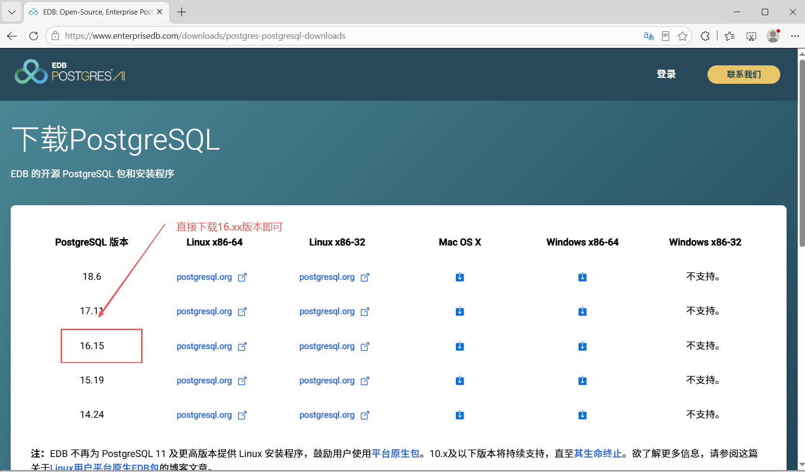

2.安装PostgreSQL，双击运行安装包 → "Next"


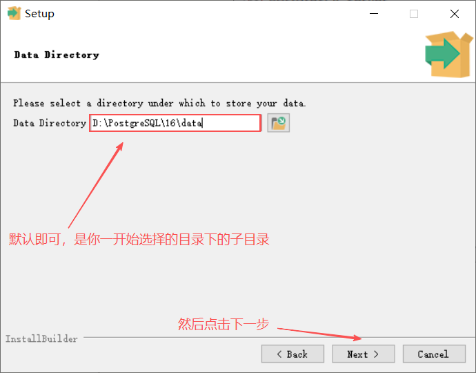

**Password**：给超级用户 `postgres` 设密码。⚠️ **自己编一个强密码。这一页是全教程最重要的截图之一，截完把密码打码。**把密码记在纸上或本地笔记里，忘了很麻烦，这里我设置123456作为演示。


设置Port：5432(默认)，“所有人都认这个号——QGIS 新建连接时默认就填 5432，网上所有教程、文档里的命令也全是按 5432 写的。你改成别的也能用，但以后每次连接、每条命令都要多写一句“端口 xxxx”，忘了就报错，纯属给自己挖坑。"


Locale（区域设置）保持默认 Default locale 即可

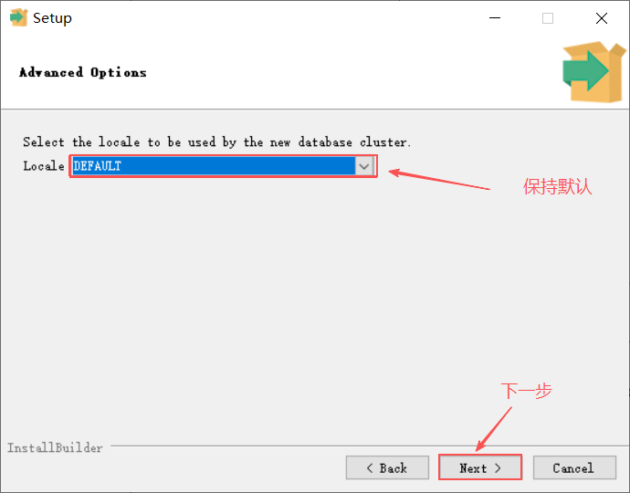


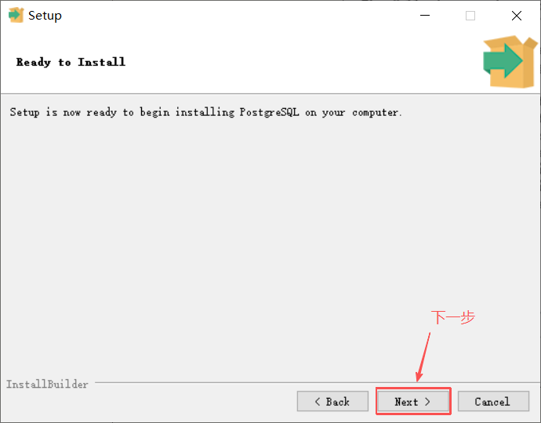

等待进度条到头


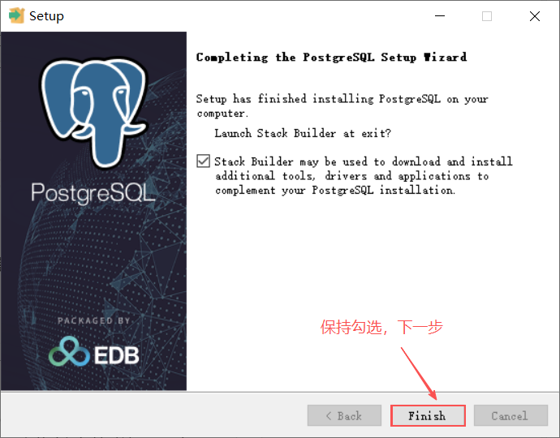

Stack Builder 会自动打开（可以点击win键搜索Application Stack Builder运行即可打开）


等待下载完成，树形列表展开 **类别** → **Spatial Extensions****，勾上 **PostGIS Bundle for PostgreSQL x64 16**（选最新的 3.x 版本）→ Next，等它下载完。

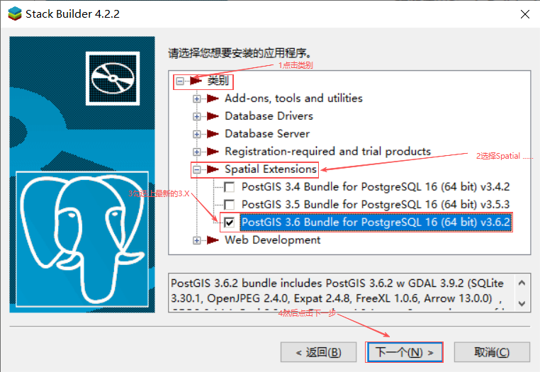

点击后等待安装好

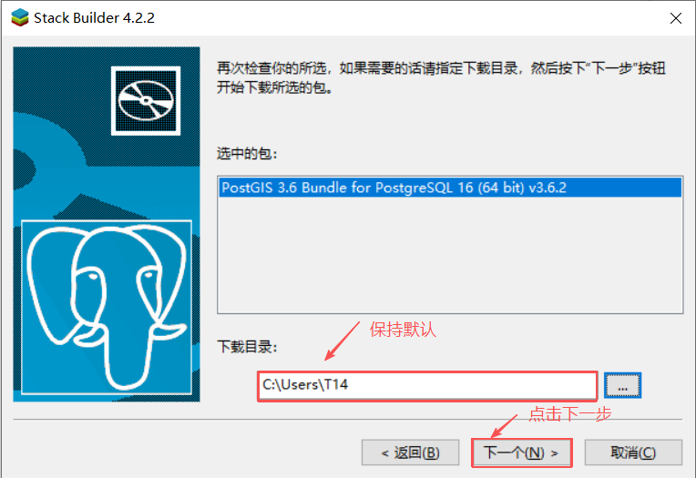

出现这个界面点击下一步不要勾选

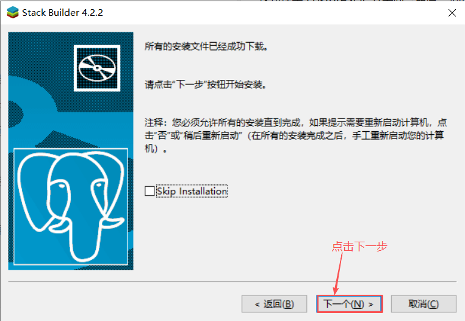

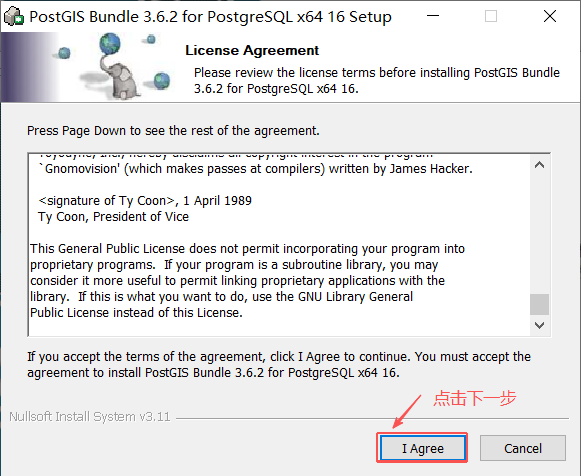


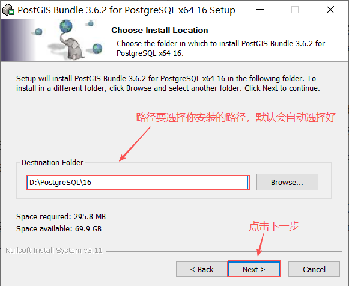

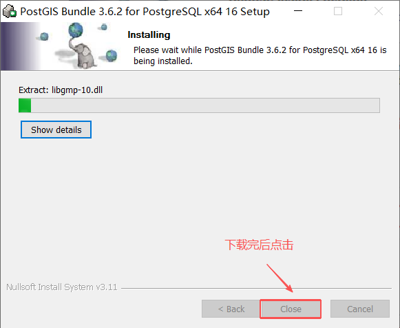

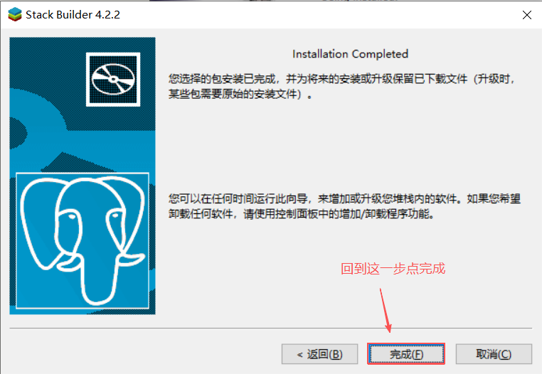

至此**PostgreSQL + PostGIS** 以及多人协助的扩展就都安装好了。接下来测试验证

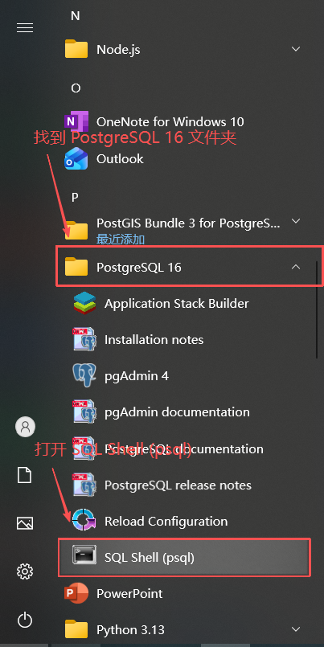

它会依次问你 5 个问题，**前 4 个全部直接回车**（用默认的 localhost / postgres / 5432 / postgres）：

- `Server [localhost]:` 回车
- `Database [postgres]:` 回车
- `Port [5432]:` 回车
- `Username [postgres]:` 回车
- `Password:` 输入你安装时设的密码 → **屏幕上不会显示任何字符，是正常的**，输完回车

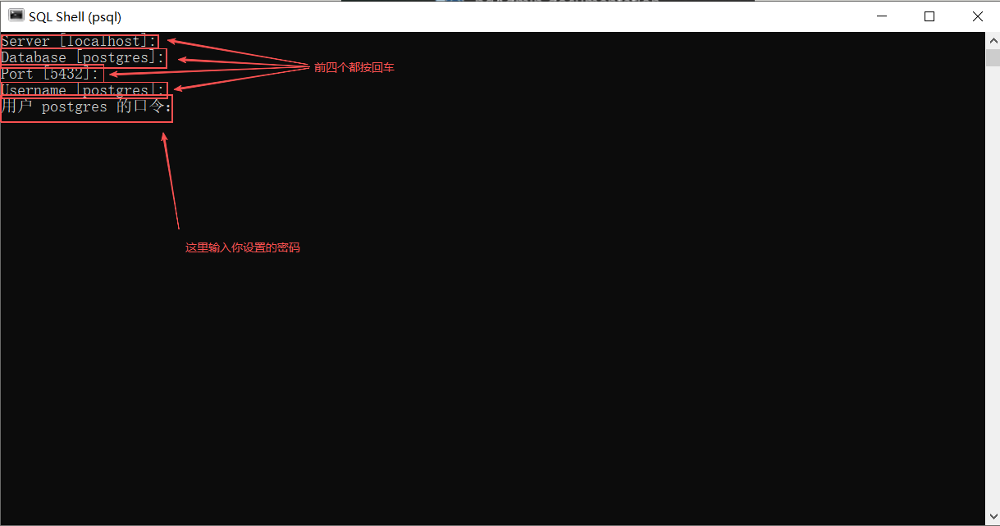

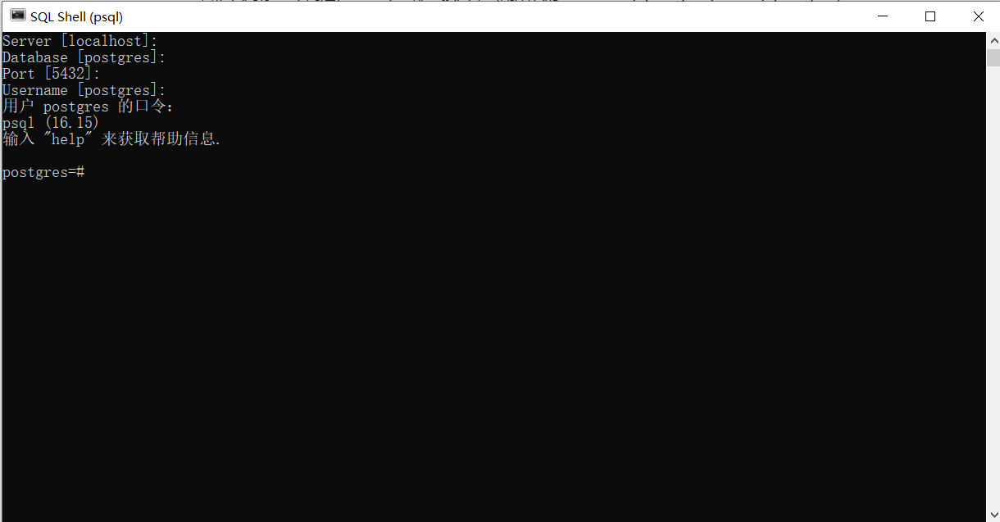

看到 `postgres=#` 提示符就说明进去了。依次敲这两条（每条以分号结尾，回车）：

```
SELECT version();
SELECT name, default_version FROM pg_available_extensions WHERE name = 'postgis';
```

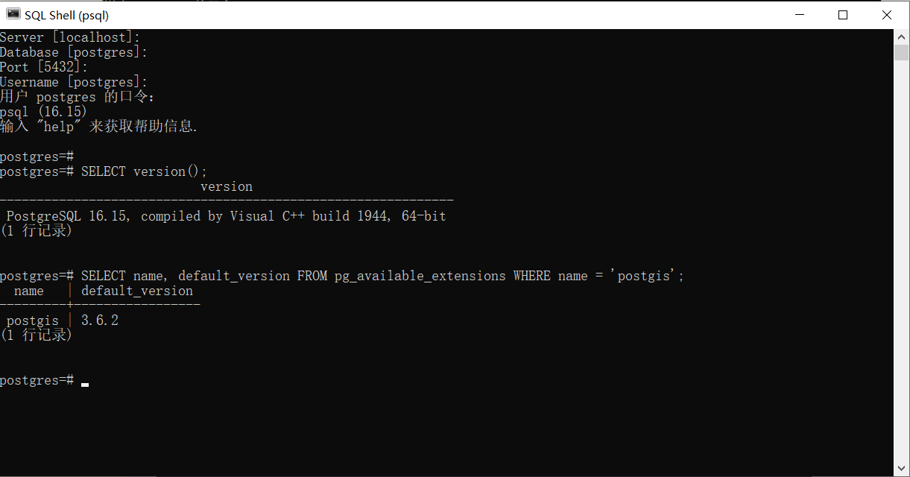

第二条命令回车后显示 postgis | 3.6.2说明安装就位了，然后输入 `\q` 回车退出。

## 阶段2服务器三件套

### (1)使防火墙放行 5432

 以管理员运行`powershell`

1.powershell管理员运行终端中粘贴这条指令回车

```
New-NetFirewallRule -DisplayName "PG5432_collab" -Direction Inbound -Protocol TCP -LocalPort 5432 -RemoteAddress 10.111.0.0/16 -Action Allow
```

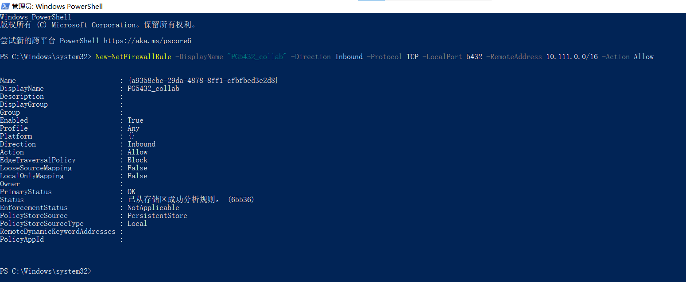

2.再粘这条验证（应显示一条绿色 Enabled=True 的规则，用来查询上一条命令并验证）：

```
Get-NetFirewallRule -DisplayName "PG5432_collab
```


- `Enabled : True` —— 规则已启用
- `Direction : Inbound` + `Action : Allow` —— 入站放行
- `Status : 已从存储区成功分析规则` —— 已写入防火墙

### (2) 设置电源永不睡眠

设置 → 系统 → 电源和睡眠 → 把**接通电源时“睡眠”**设为**从不**（“关闭屏幕”可以随便，屏幕关了不影响服务）。

也可以直接敲这条命令：

```
powercfg /change standby-timeout-ac 0
```

### (3) 固定IP（用你当前的真实值，以下ip只做演示，可以自己查询）

#### 通用三步法

**第 1 步：先用“自动获取 IP”状态正常连上网**（能上网就行）。 静态 IP 的所有参数

**第 2 步：把这些值抄下来。** `Win + R` → 输入 `cmd` 回车，敲：

```
ipconfig /all
```

在“**无线局域网适配器 WLAN**”那段里找这四行（我给你标注了一个例子，你的数字会和这个不一样，**没关系，照抄自己的**）：

```
   IPv4 地址 . . . . . . . . . . . . : 10.111.0.105     ← 抄：IP 地址
   子网掩码  . . . . . . . . . . . . : 255.255.0.0     ← 抄：子网掩码
   默认网关 . . . . . . . . . . . . : 10.111.0.1       ← 抄：默认网关
   DNS 服务器  . . . . . . . . . . . : 114.114.114.114 ← 抄：首选 DNS（有几行抄几行）
                                       223.5.5.5       ← 再抄：备用 DNS
```

**第 3 步：把抄下来的值填进静态 IP 页面**（就是 ncpa.cpl 那套步骤，值换成自己抄的）。

ncpa.cpl 步骤：

1. `Win + R` → `ncpa.cpl` 回车
2. **WLAN 右键 → 属性** → 双击 **Internet 协议版本 4 (TCP/IPv4)**
3. 选“使用下面的 IP 地址”，按上表填 → 确定

这里我是用自己电脑做演示，钉死该网段

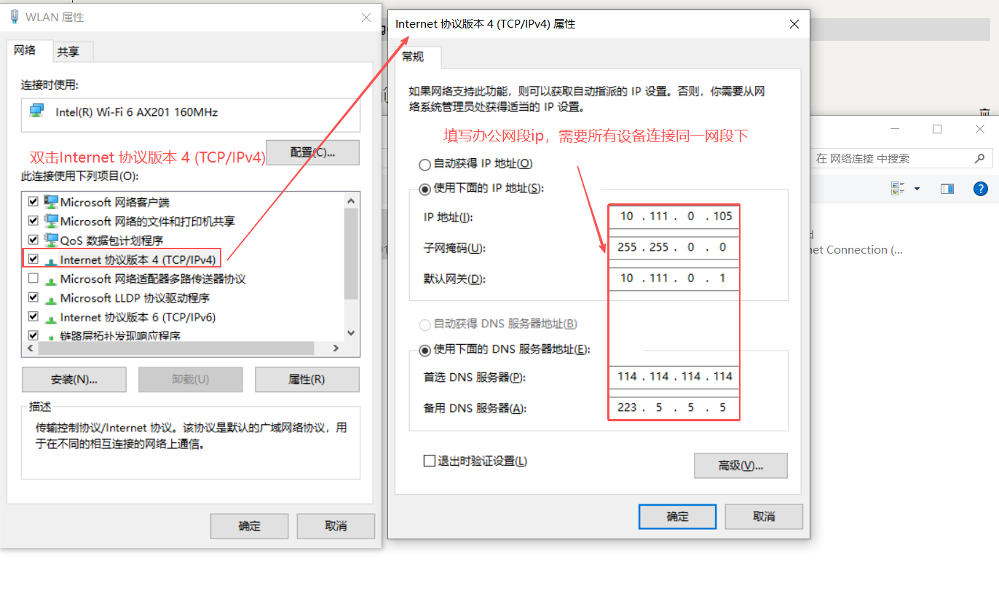

## 阶段 3让局域网能访问你的数据库


### 1.先备份配置文件

打开资源管理器 → 进入 `D:\PostgreSQL\16\data\` → 把 `postgresql.conf` 和 `pg_hba.conf` 各复制粘贴一份（自动得到“... - 副本”），或者改名为 `.bak` 后缀。


### 2.检查 postgresql.conf（大概率不用修改）

1. `Win + R` → 输入 `notepad` → **按 `Ctrl + Shift + Enter`**（管理员身份打开记事本，弹 UAC 点“是”）

   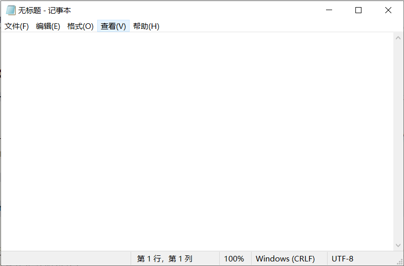

2. 文件 → 打开 → 地址栏粘贴 `D:\PostgreSQL\16\data\` （安装的路径）→ 右下角文件类型从“文本文档”**改成“所有文件”**（否则看不到 .conf）→ 双击 `postgresql.conf`

   

3. `Ctrl + F` 搜索 `listen_addresses`，找到那行：

```
listen_addresses = '*'
```


- 如果已经是 `'*'` 且行首没有 `#` → **什么都不用做**
- 如果行首有 `#` 或值是 `'localhost'` → 删掉 `#` 改成 `'*'`，保存

### 3.改 pg_hba.conf（本阶段唯一真正的修改）

1）记事本打开文件`D:\PostgreSQL\16\data\pg_hba.conf`（对应安装的配置文件）

2）滚动到文件**最末尾**，另起一行，加上这一行（空格分隔）：

```
host    all    all    10.111.0.0/16    scram-sha-256
```


3)保存（`Ctrl + S`），关闭。

每个词的含义:

| 字段          | 含义                |
| ------------- | ------------------- |
| host          | 允许 TCP 网络连接   |
| 第一个 all    | 所有数据库          |
| 第二个 all    | 所有用户            |
| 10.111.0.0/16 | 只允许办公网段的 IP |
| scram-sha-256 | 需要密码验证        |

### 4.验证——模拟“同事”连你自己的服务器

打开 **SQL Shell (psql)**，这次第一个问题就不是直接回车了：

- `Server [localhost]:` → 输入 **`10.111.0.105`** 回车

- `Database [postgres]:` 回车

- `Port [5432]:` 回车

- `Username [postgres]:` 回车

- `Password:` 输入你的 postgres 密码回车(使用我自己设置的123456做演示)

  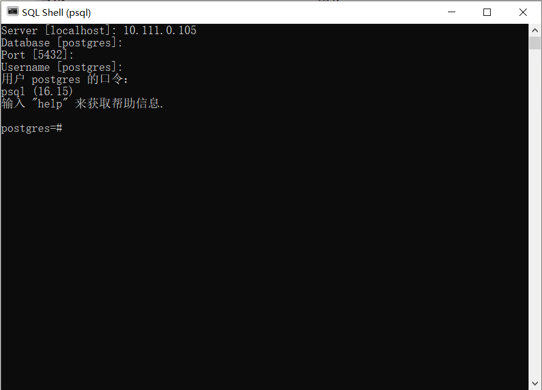

看到 `postgres=#` 就说明：监听 ✅ → 防火墙 ✅ → pg_hba 新规则 ✅ 整条链路通了。输入 `\q` 退出。

> 这是从“外部 IP 视角”走了一遍同事将来要走的路。真正的同事电脑实测放在阶段 9。

## 阶段 4建库建表——你第一次用 SQL 真正干活


注：操作前必读

1. 打开 **SQL Shell (psql)**，还是老样子：Server/Database/Port/Username 四个回车 + postgres 密码登录（进到 `postgres=#`）
2. 下面每一块 SQL：**复制整块 → 在 SQL Shell 窗口里点右键**（控制台窗口的粘贴方式）→ 回车执行
3. 每条命令必须以 **英文分号 `;`** 结尾；粘贴错了按 `Ctrl + C` 取消当前输入重来

### 1.建数据库 biaozhu

```
CREATE DATABASE biaozhu;
```

然后**切换进去**（这是 psql 命令，不带分号也不会出事，但照抄没错）：

```
\c biaozhu
```


### 2.给这个库装上 PostGIS 能力

```
CREATE EXTENSION IF NOT EXISTS postgis;
```

验证：	

```
SELECT postgis_full_version();
```

应该显示一长串 `POSTGIS="3.6.2" ...`。


### 3.建立账号

```
CREATE ROLE 改成主管的账号 LOGIN PASSWORD '改成你的主管密码';
CREATE ROLE 改成同事的账号 LOGIN PASSWORD '改成你的同事密码';
```

这里我建立3个账号作为演示分别为

```
CREATE ROLE bz LOGIN PASSWORD '123456';
CREATE ROLE bz001 LOGIN PASSWORD '123456';
CREATE ROLE bz002 LOGIN PASSWORD '123456';
```


### 4.建标注专用的 schema 和两张表

设计思想：`labels` 是个“抽屉”，把标注表和系统表分开；两张表一个存**已完成区域**（done），一个存**待核实的变化图斑**（mask）。你自己的表名可以随意，按照测试项目起名 `test_done` / `test_mask`。

#### （1）建 schema（标注的专用“抽屉”）

```
CREATE SCHEMA IF NOT EXISTS labels;
```


#### （2）建“已完成区域”表

```
CREATE TABLE labels.test_done (
    fid integer GENERATED BY DEFAULT AS IDENTITY PRIMARY KEY,
    geometry geometry(MultiPolygon, 4326),
    assignee text DEFAULT CURRENT_USER,
    status smallint DEFAULT 0,
    updated_at timestamptz DEFAULT now(),
    note text
);
```


#### （3）建“变化图斑”表

```
CREATE TABLE labels.test_mask (
    id integer GENERATED BY DEFAULT AS IDENTITY PRIMARY KEY,
    wkb_geometry geometry(MultiPolygon, 4326),
    assignee text DEFAULT CURRENT_USER,
    status smallint DEFAULT 0,
    note text,
    updated_at timestamptz DEFAULT now()
);
```


#### （4）建空间索引

```
CREATE INDEX test_done_geom_idx ON labels.test_done USING gist (geometry);
CREATE INDEX test_mask_geom_idx ON labels.test_mask USING gist (wkb_geometry);
```


#### （5）建自动更新时间的触发器

```
CREATE OR REPLACE FUNCTION labels.touch_updated_at()
RETURNS trigger AS $$
BEGIN
    NEW.updated_at = now();
    RETURN NEW;
END;
$$ LANGUAGE plpgsql;
```

预期回显：`CREATE FUNCTION`


继续执行这两条

```
CREATE TRIGGER trg_touch
BEFORE UPDATE ON labels.test_done
FOR EACH ROW EXECUTE FUNCTION labels.touch_updated_at();
```

```
CREATE TRIGGER trg_touch
BEFORE UPDATE ON labels.test_mask
FOR EACH ROW EXECUTE FUNCTION labels.touch_updated_at();
```

预期回显：两行 `CREATE TRIGGER`


#### （6）授权账号

```
GRANT USAGE ON SCHEMA labels TO bz, bz001, bz002;
GRANT SELECT, INSERT, UPDATE, DELETE ON ALL TABLES IN SCHEMA labels TO bz, bz001, bz002;
GRANT USAGE, SELECT ON ALL SEQUENCES IN SCHEMA labels TO bz, bz001, bz002;
```

预期回显：三行 `GRANT`

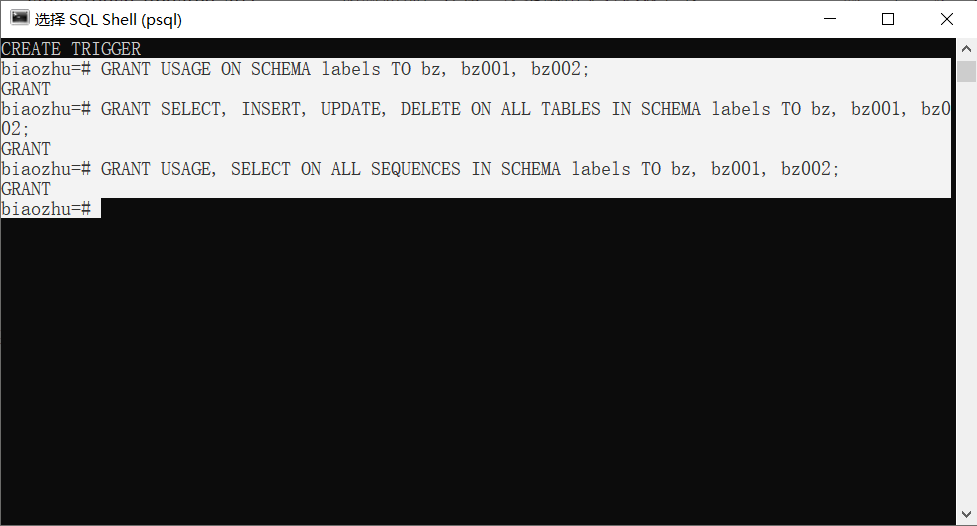


```
\dn
```

预期：列表里出现 `labels`。

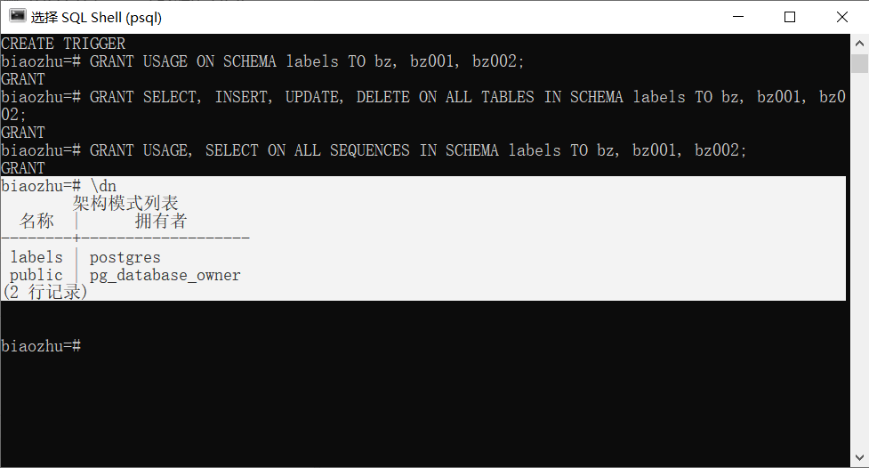

```
\dt labels.*
```

预期：列出 `labels | test_done | table` 和 `labels | test_mask | table` 两行。

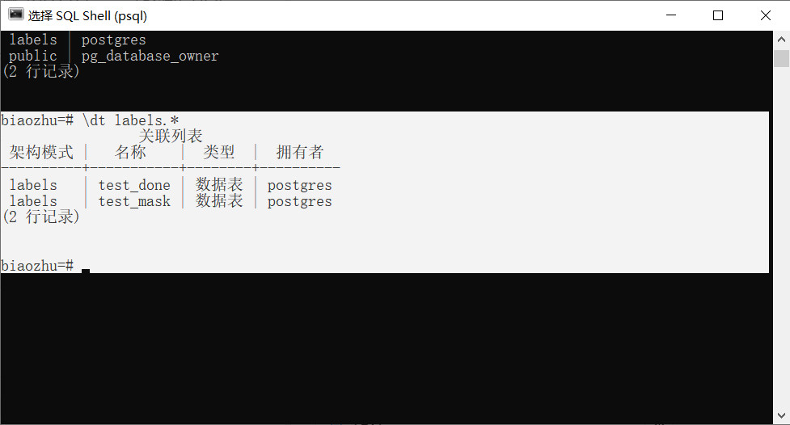

## 阶段5建立金字塔

（一般在qigs或者AI直接帮你搭建写进文件）

powershell中执行绘制金字塔

### 1.先备份原图

### 2.打开powershell终端中并按照顺序执行下面两条命令

```
& 'D:\QGIS 3.44.15\bin\gdaladdo.exe' -r average "D:\tif\src_a.tif" 2 4 8 16 32 64 128
```

```
& 'D:\QGIS 3.44.15\bin\gdaladdo.exe' -r average "D:\tif\src_b.tif" 2 4 8 16 32 64 128
```

注：**没有进度条**，光标停着就是在算

​	结束的标志：安静地回到 `PS C:\Users\T14>`，没有任何报错

​	期间**不要**开 QGIS、不要动这两个文件、不要关窗口

## 阶段6影像目录 SMB 共享

全程在**管理员 PowerShell**（`Win + R` → `powershell` → `Ctrl + Shift + Enter`）

### 1 .看网络类型

```
Get-NetConnectionProfile
```


**执行要点**：看 `InterfaceAlias` 为 `WLAN` 那行的 `NetworkCategory`（Private 或 Public）

**成功回显**：`Name : WLAN; NetworkCategory : Private/Public`。

**报错自救**：多条记录时认准 WLAN 那行。

### 2.建专用共享账号 gis

```
New-LocalUser -Name "gis" -Password (ConvertTo-SecureString '你的共享密码' -AsPlainText -Force) -FullName "影像共享账号" -Description "同事访问影像共享专用" -PasswordNeverExpires
```

这里我使用密码Gis@2026举例

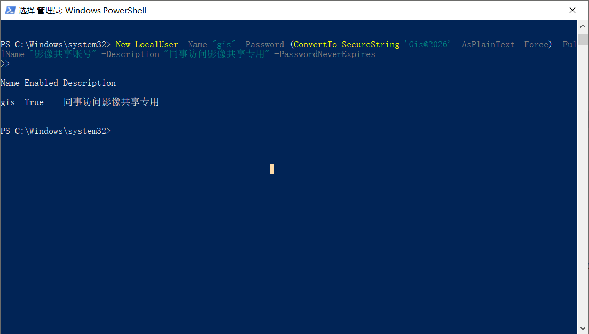

**执行要点**：引号里换成你定的密码；成功后 `Get-LocalUser gis` 看到 `Enabled True`。

**成功回显**：账号信息表一张。

**报错自救**：“账户已存在”→ 直接用；“密码不符合复杂度”→ **系统级硬规则**（≥8位、三类字符），`123456` 过不了，演示密码也换成如 `Gis@2026` 这种。

🔧 **换机注记**：本地账号属于机器，**换机必须重建**。建的时候**密码用同一个**——否则同事换机日要改凭据习惯。

### 3.创建共享 tifdata（只读）

```
New-SmbShare -Name "tifdata" -Path "D:\tif" -ReadAccess gis
```


**执行要点**：`-ReadAccess` 是故意的最小权限（影像只看，标注走库）。

**成功回显**：`Name/Path` 小表一张。

**报错自救**：“共享已存在”→ `Remove-SmbShare -Name tifdata -Force` 后重跑；“拒绝访问”→ 不是管理员身份。

🔧 **换机注记**：共享属于机器，换机重建；**共享名保持 `tifdata` 不变**——同事只需换 IP，不用改习惯。另外若新机影像放别的目录，`-Path` 跟着改。

### 4.防火墙放行 445

```
New-NetFirewallRule -DisplayName "SMB445_collab" -Direction Inbound -Protocol TCP -LocalPort 445 -RemoteAddress 10.111.0.0/16 -Action Allow
```


**执行要点**：和 `PG5432_collab` 同款写法，只换端口和名字。

**成功回显**：规则表，`Enabled: True`。

**报错自救**：“已存在”→ `Get-NetFirewallRule -DisplayName "SMB445_collab"` 确认即可。

🔧 **换机注记**：防火墙规则属于机器，**新机原样重跑**（连同 `PG5432_collab`，两条一起，教程里做成“防火墙双规则”小节）。

### 5.验证 + 本机自测

```
Get-SmbShare -Name tifdata
Get-SmbShareAccess -Name tifdata
```


**成功回显**：第一条 `Path D:\tif`；第二条 `gis / Allow / Read`。

**报错自救**：“找不到共享”→ 回第 3 步。

然后以 gis 身份建立会话在 PowerShell里：

```
net use \\10.111.0.105\tifdata /user:gis *
```


**逐参数**：`net use` 管理“到网络共享的会话”；目标 UNC 路径；`/user:gis` 指定以 gis 身份连接；最后的 `*` 表示**回车后交互输密码**（密码为刚设置的Gis@2026）。

​	**为什么需要**：Explorer 直开用本机身份，`net use` 能显式指定身份建立会话，之后资源管理器会自动复用这个会话。

​	**成功回显**：提示输入密码（输入时屏幕无显示，正常）→ 回车后显示“**命令成功完成。**”

​	报错自救：

​	`系统错误 1326`（用户名或密码不正确）→ 密码敲错，重试

​	`	系统错误 1219`（不允许同一用户多重连接）→ 先 `net use \\10.111.0.105\tifdata /delete` 再连

​	`	系统错误 5` → 名单问题（我查过是正常的，一般不会遇到）

然后**再开一次资源管理器**，地址栏输入 `\\10.111.0.105\tifdata`——这次应该直接列出 `src_a.tif`、`src_b.tif` 等文件。

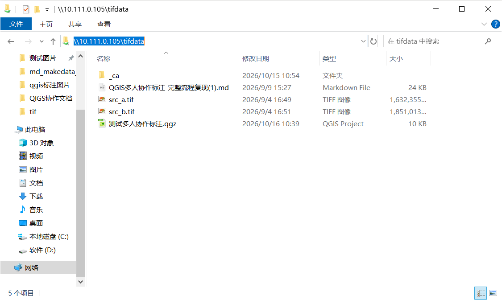

最后把测试会话拆掉（干净收尾）：

```
net use \\10.111.0.105\tifdata /delete
```

**成功回显**：“命令成功完成。”

**报错自救**：报“找不到网络连接”→ 说明会话已不存在，无需处理。

**如果显示**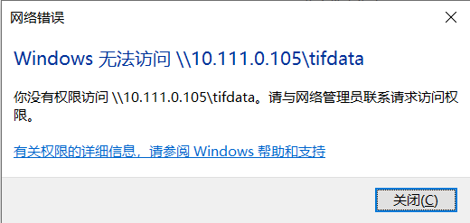

先关掉所有文件夹，在power shell中输入：

```
net use \\10.111.0.105\tifdata /delete
```

拆掉这个连接后重新以 gis 身份建立会话后再打开此电脑复制路径即可看到

文件夹数据

### 6.确认“密码保护的共享”开启（30 秒）

控制面板 → 网络和共享中心 → 更改高级共享设置 → 所有网络 → **密码保护的共享：启用**。

## 阶段7QGIS 连库

### 第 1 步：新建数据库连接

浏览器面板（左侧；没显示就：视图 → 面板 → 勾“浏览器”）→ 找到 **PostgreSQL** 节点（带大象图标）→ **右键 → 新建连接…**，按下面填：

| 栏位        | 填什么                                               |
| ----------- | ---------------------------------------------------- |
| 名称        | biaozhu@localhost（随便起，教程里这个名字好解释）    |
| 主机        | localhost                                            |
| 端口        | 5432                                                 |
| 数据库      | biaozhu                                              |
| SSL 模式    | 保持默认（auto）                                     |
| 认证 → 基本 | 用户名 bz，密码 123456，勾选“保存用户名”和“保存密码” |


填完点 **测试连接** → 再点确定保存。

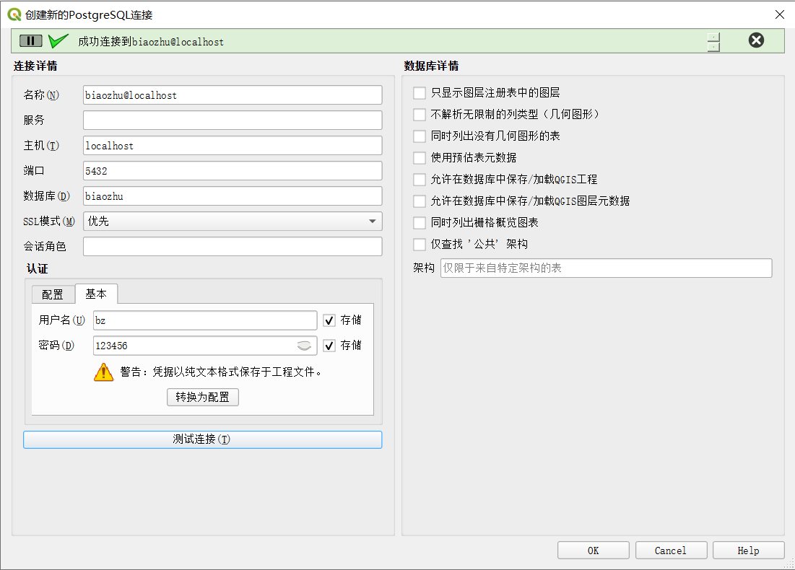

​	**为什么主机填 `localhost`**：你是主管，库就在本机。localhost 只认“本机有没有服务”，永远和 IP 解耦。

​	**成功表现**：弹出“连接成功”提示（或让你确认密码后通过），浏览器里出现 `biaozhu@localhost` 节点。

​	报错自救：

- “连接被拒绝 / could not connect” → 服务没在跑（`Get-Service postgresql-x64-16`）或端口填错
- “口令认证失败 / password authentication failed” → 密码敲错；确认用户名是 `bz` 不是别的
- “数据库不存在” → 数据库名拼错（是 **biaozhu**）

🔧 换机注记：**主管连接填 `localhost` → 换机零修改**（当初的设计红利）。但要改两处：①勾选的“保存密码”存在 QGIS 本机认证库里**不随工程迁移**，新机打开会重新要一次密码；②同事的连接填的是 IP，那个要换（阶段 9 讲）。

### 第 2 步：加载两张库图层

浏览器里展开：`biaozhu@localhost` → `labels`（schema 抽屉）→ 看到 `test_done`、`test_mask` → **双击** `test_done`（或右键 → 添加图层到工程）。`test_mask` 也加进来。

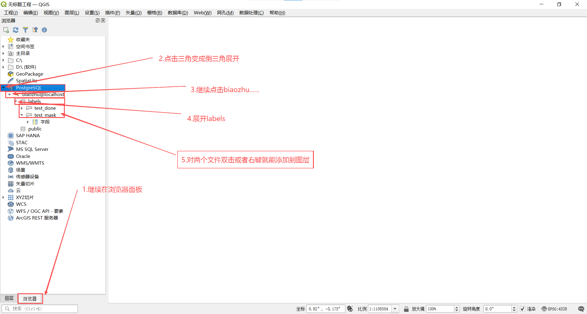

- **成功表现**：图层面板多出 `test_done`、`test_mask` 两个图层（此刻可能看着是空的或只有一个多边形）。


- **报错自救**：展开 labels 没看到表 → 连接展开后顶部可能有“选择 schema”提示，勾上 labels；提示“无几何图形的表”确认框 → 都勾上无妨。

### 第 3 步：验证测试图斑现身影像

​	确认 `src_a`、`src_b` 影像在图层面板**下方**，`test_done` 在**上方**（图层顺序=绘制顺序）。然后右键 `test_done` → **缩放到图层**。

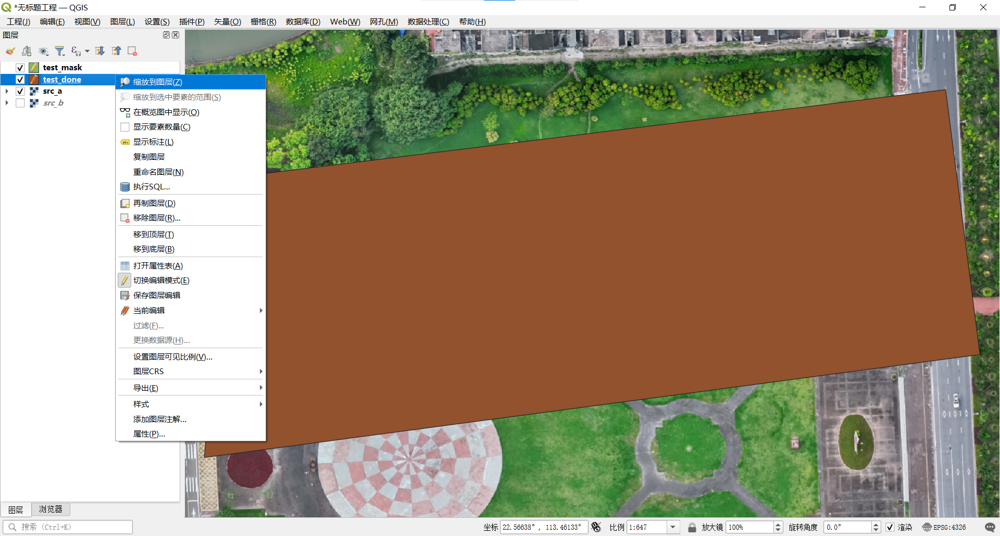

- **成功表现**：画面跳到影像中心，能看到一个多边形轮廓——那就是阶段 5 手工插的测试图斑，**坐标是按你影像范围算的，正好落在影像里**。。
- **报错自救**：只看到白底黑框（不在影像上）→ 图层顺序不对，把影像拖到下面。

🔧 换机注记：你的影像是相对路径（`./src_a.tif`）——**换机只要 tif 还和 .qgz 在同一目录、盘符一致，就零修改**。

### （选做）第 4 步：样式入库，存为默认

给 `test_done` 配样式：图层面板双击 → 属性 → 左栏“样式” → 选一个醒目的（如红色填充 + 透明度 30% + 白色描边）→ 应用。

然后关键一步——**把样式存进数据库**：还在样式页，右下角“**样式**”按钮 → **另存为…（Save as…）** → 保存位置选“**数据库(PG)**” → 连接选 `biaozhu@localhost` → 名称写 `test_done样式` → **勾选“作为该图层的默认样式”** → 确定。`test_mask` 配绿色系同款再来一遍。

- **为什么存数据库而不是存在工程里**：存库后**每个**连进来的 QGIS（包括同事）加载图层时自动套用同一套样式，不用人手发 .qml 文件。
- **成功表现**：提示保存成功；之后无论谁加载 `test_done`，直接就是红的多边形。
- **报错自救**：找不到“另存为”入口 → 各版本菜单位置略有差异，把样式页截图发我；报权限错误 → 你用的 bz 有全表权限，`public.layer_styles` 表是 PostGIS 扩展自动建的、public schema 默认对公众开放，一般不会遇到。

🔧 换机注记：**样式存在 `public.layer_styles` 表里 → 随 pg_dump 走，换机零重做**（这是“样式入库”的红利；对比：存在工程里的样式要跟着 .qgz 修）。

### 第 5 步：15 秒自动刷新

分别对 `test_done`、`test_mask`：图层属性 → 左栏“**渲染**” → 找到“**刷新间隔**”（Layer refresh interval）→ 勾选/启用，填 **15** 秒，模式选 **ReloadData（重载数据）** → 确定。


- **为什么**：同事保存标注后，你画面 15 秒内自动重读数据库——这就是“多人同时标注互相看得见”的机制。
- **成功表现**：设置静默生效。验收方法：开两个窗口或等阶段 9 双人实测。
- **报错自救**：渲染页里找不到该项 → 截图发我（3.44 一定有，在渲染页中部偏上）。

🔧 换机注记：自动刷新存在**工程文件里** → 随 .qgz 走，换机零重做。

### 第 6 步：试画一笔（端到端验证署名机制）

​	1.图层面板**选中 `test_done`**（高亮它，别选成影像）

这里不做截图演示了

​	2.图层工具栏点“**开启编辑**”（铅笔图标）

这里不做截图演示了

​	3.用“添加多边形要素”随便在影像上画一个小多边形 → 弹属性表单 → `note` 填 `主管试画` → 确定

这里不做截图演示了

​	4.点“**保存图层编辑**”（重要！不是 Ctrl+S）**重要！重要！重要！**

​	5.开 SQL Shell 验证（`biaozhu=#` 提示符下）：

```
SELECT fid, assignee, note, updated_at FROM labels.test_done ORDER BY fid;
```

​	**成功表现**：两行记录——fid 1 是 postgres 的手工测试图斑，fid 2 是你刚画的，**`assignee` = `bz`**、note/updated_at 自动填好。

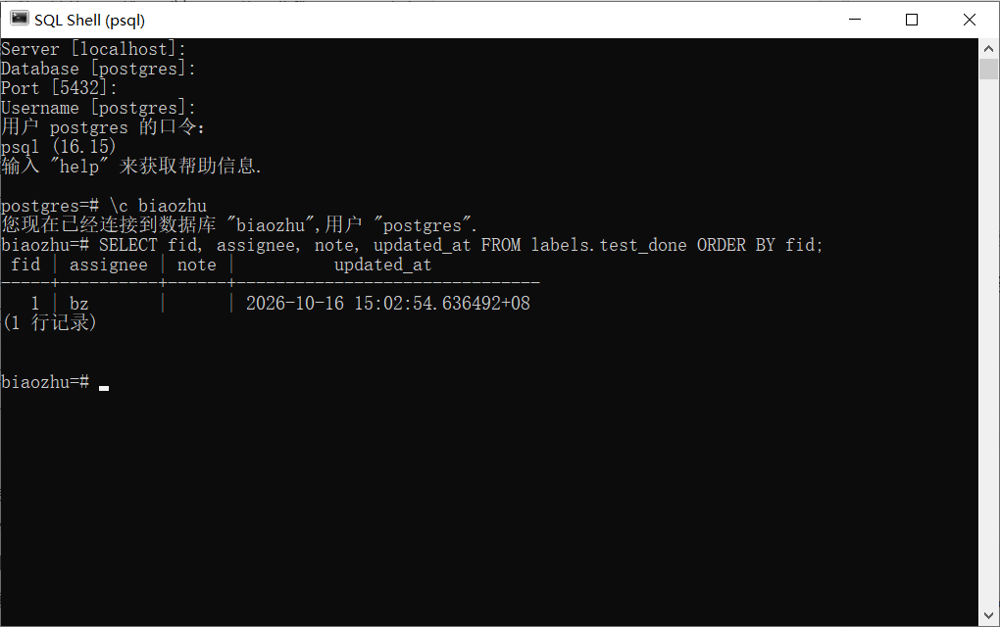

​	报错自救：

- 画不了 → 图层面板确认当前图层是 test_done，且编辑已开启
- 保存报错 → 报错原文贴给我（大概率是权限或几何列问题）
- 查询只有一行 → 保存图层编辑没点，画的东西还挂在内存里

### 第 7 步：保存工程

`Ctrl + S`。注意教程里要着重写的一条纪律：

​	Ctrl+S 只保存 QGIS 工程（图层顺序、样式引用、刷新设置），不保存标注。**标注必须点工具栏的"保存图层编辑"才入库！！！**

​	重要的说三遍:

**标注必须点工具栏的"保存图层编辑"才入库！！！**

**标注必须点工具栏的"保存图层编辑"才入库！！！**

**标注必须点工具栏的"保存图层编辑"才入库！！！**

🔧 换机注记：.qgz 拷走时，工程内的影像相对路径 + 自动刷新设置 + 库图层引用都跟着走（库密码除外）。

## 阶段八（可选附录）自动备份（这里我就不做截图任何演示了，可以自行查看文档创建自动备份功能）

这是搭建的最后一个基础设施阶段。

### 第 1 步：建备份目录

powershell运行

```
New-Item -ItemType Directory -Path "D:\pgbackup" -Force
```

- **逐参数**：`-ItemType Directory` 建目录；`-Force` 已存在不报错。
- **为什么**：备份必须落在**独立的专用目录**，和业务文件分开，方便整体拷走。
- **成功回显**：显示目录信息（已存在时会提示但不报错）。
- **报错自救**：基本不会报错；D 盘只读的话换盘符。

🔧 换机注记：目录路径属于机器，新机想放别的盘就同步改脚本里的两处路径。

### 第 2 步：写备份脚本 backup.ps1

记事本新建 `D:\pgbackup\backup.ps1`，内容如下（**引号里的 postgres 密码换成你的**）：

=powershell

```
$env:PGPASSWORD = '你的postgres密码'$stamp = Get-Date -Format 'yyyyMMdd'& 'D:\PostgreSQL\16\bin\pg_dump.exe' -h localhost -U postgres -F c -f "D:\pgbackup\biaozhu_$stamp.dump" biaozhu
# 删除30天前的旧备份，防止磁盘被填满Get-ChildItem 'D:\pgbackup\biaozhu_*.dump' |    Where-Object { $_.LastWriteTime -lt (Get-Date).AddDays(-30) } |    Remove-Item
```

- 逐行拆解

  ：

  - `$env:PGPASSWORD`：pg_dump 从环境变量拿密码，避免命令行明文
  - `$stamp`：当天日期戳，文件名长这样 `biaozhu_20261016.dump`，一天一份
  - `pg_dump -h -U -F c -f`：`-F c` 是自定义压缩格式（体积小、支持选择性恢复，恢复用 pg_restore）；`-f` 指定输出文件；最后 `biaozhu` 是库名
  - 清理段：30 天前的旧备份自动删除——没有这段，一年后磁盘必满

- **为什么用 .ps1 而不是原文档的 .bat**：批处理的 `%date%` 取日期在中文系统里格式多变（周几/斜杠/横杠），容易切出错文件名；PowerShell 的 `Get-Date -Format` 是死的 yyyyMMdd，跨机器稳定。

- **成功表现**：文件保存即可，先别跑。

- **报错自救**：记事本保存时类型选“所有文件”，文件名手动写全 `backup.ps1`（防止存成 backup.ps1.txt——经典坑）。

🔧 换机注记：脚本里的安装路径、备份路径都是机器相关值，新机按实际改。

### 第 3 步：手动跑一次，验证脚本本身能用

powershell运行

```
powershell -NoProfile -ExecutionPolicy Bypass -File "D:\pgbackup\backup.ps1"
```

- **逐参数**：`-NoProfile` 不加载个人配置（干净环境）；`-ExecutionPolicy Bypass` 绕过脚本执行策略限制（Windows 默认禁止运行 .ps1）；`-File` 指定脚本。
- **为什么先手动跑**：脚本没验证过就挂计划任务，等于没备份还自以为有。
- **成功回显**：无报错回到提示符；`D:\pgbackup` 出现 `biaozhu_20261016.dump`（几 MB 大小属正常，你的数据现在还很少）。
- **报错自救**：authentication failed → 脚本里密码没改对；找不到 pg_dump → 路径拼错；报“无法加载文件…禁止运行”→ 确认命令里带了 `-ExecutionPolicy Bypass`。

### 第 4 步：注册计划任务（管理员 PowerShell）

powershell运行

```
$act = New-ScheduledTaskAction -Execute 'powershell.exe' -Argument '-NoProfile -ExecutionPolicy Bypass -File "D:\pgbackup\backup.ps1"'
$trg = New-ScheduledTaskTrigger -Daily -At 23:00
Register-ScheduledTask -TaskName "PgBackup_biaozhu_2300" -Action $act -Trigger $trg -Description "每晚23:00自动备份biaozhu数据库"
```

- **逐行拆解**：第一行定义“做什么”（调 powershell 跑脚本）；第二行定义“何时”（每天 23:00）；第三行把两者组装成名为 `PgBackup_biaozhu_2300` 的任务。
- **为什么**：计划任务是 Windows 原生定时器，不依赖任何人记得手动备份。
- **成功回显**：一张任务信息表，`State: Ready`。
- **报错自救**：“任务已存在” → `Unregister-ScheduledTask -TaskName "PgBackup_biaozhu_2300" -Confirm:$false` 后重注册；权限不足 → 用管理员窗口。

🔧 换机注记：**计划任务属于机器**（迁移清单第三类#7），新机重跑这三行；触发时间和脚本路径照抄。

### 第 5 步：立即触发一次，验证任务本身能用

powershell运行

```
Start-ScheduledTask -TaskName "PgBackup_biaozhu_2300"
Start-Sleep -Seconds 20
Get-ScheduledTaskInfo -TaskName "PgBackup_biaozhu_2300"
```

- **逐参数**：第一行手动点火；第二行等 20 秒让它跑完；第三行查结果。
- **成功回显**：`LastTaskResult : 0`（0 = 上次运行成功），且 `D:\pgbackup` 多出一个今天时间戳的新 dump。
- **报错自救**：`LastTaskResult` 非 0 且不是 0 → 把数字贴我；267011/267009 表示“正在运行”，等一会再查。

### 第 6 步：恢复演练（没恢复过的备份不算备份）

powershell运行

```
$env:PGPASSWORD = '你的postgres密码'
& 'D:\PostgreSQL\16\bin\createdb.exe' -h localhost -U postgres biaozhu_restore_test
& 'D:\PostgreSQL\16\bin\pg_restore.exe' -h localhost -U postgres -d biaozhu_restore_test "D:\pgbackup\刚生成的那个.dump文件名"
& 'D:\PostgreSQL\16\bin\psql.exe' -h localhost -U postgres -d biaozhu_restore_test -c "SELECT count(*) FROM labels.test_done;"
& 'D:\PostgreSQL\16\bin\dropdb.exe' -h localhost -U postgres biaozhu_restore_test
```

- **逐行拆解**：建临时演练库 → 把备份灌进去 → 数一数 test_done 有几行 → 删掉临时库。
- **为什么**：备份的可靠性只有恢复成功才算数——这也是**换机清单第五节第 5 步的原样预演**（新机靠的就是 createdb + pg_restore 这套）。
- **成功回显**：count 返回 **2**（fid 1 postgres 手工图斑 + fid 2 你的试画）。
- **报错自救**：pg_restore 报“角色不存在” → 正好预演了迁移清单里那个经典陷阱（账号是实例级、不随 dump 走）——演练库缺角色不影响 count 验证，教程里把这一段和“先建角色再恢复”知识点放一起讲，绝佳素材。

🔧 换机注记：备份 .dump 文件本身就是**换机迁移的核心载体**（清单第五节第 1 步）——演练通过 = 迁移动作预演通过。

## 阶段九：接入 + 多人联调

### 计划 A 彩排准备（**无第二台电脑才需要**）

QGIS 主窗口：菜单 **设置 → 用户配置 → 新建配置…** → 名字填 `同事彩排` → 确定后会自动**切换到这个全新配置**（界面全空、无任何连接记录——完美模拟同事的电脑）。

> 原理：QGIS 的用户配置=各自的“干净房间”（独立的连接、密码、工程记录）。彩排完切回 default 即可，互不污染。
>
> 🔧 换机注记：无——彩排技巧与换机无关。

### 第 1 步：其他电脑装 QGIS

1. 下载：**https://qgis.org/downloads/** → Windows 版 QGIS 3.44.x 安装包（约 1GB）
2. 双击安装，全部默认，下一步到底
3. ⚠️ **同事不装 PostgreSQL**——这是教程要点：数据库只住服务器，同事装了也没用还占 1GB

- **成功表现**：桌面出现 QGIS 图标，打开能进主界面
- **报错自救**：装完打不开 → 显卡驱动/VC++ 运行库问题，报错截图发我

🔧 换机注记：换服务器不用动同事电脑；**换 QGIS 大版本时全体同事重装**（工程文件向后兼容，提前提醒即可）。

### 第 2 步：同事连影像共享

1. 资源管理器地址栏输入 `\\10.111.0.105\tifdata` 回车

2. 弹凭据框 → 用户名 `gis`、密码（你设的共享密码：Gis@2026）→ **勾“记住我的凭据”** → 确定

3. 看到两个 tif 文件 = 通了

   

   

顺手做个映射（QGIS 加载更稳）：右键 `tifdata` → **映射网络驱动器** → 盘符选 `X:` → 勾“登录时重新连接” → 完成。


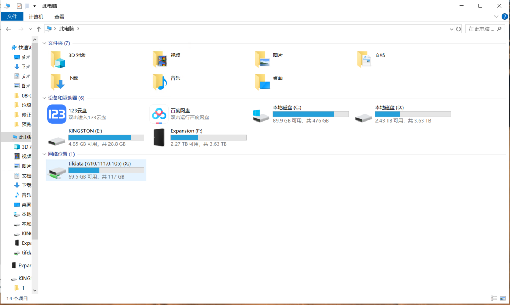

​		**成功表现**：此电脑里出现“网络位置 X:”

​		报错自救：

- 弹“找不到网络路径” → 先 `ping 10.111.0.105`（四件套见下）；ping 通但共享不通 → 服务器防火墙 445 规则检查（`Get-NetFirewallRule -DisplayName "SMB445_collab"`）
- 不弹凭据框直接“没有权限” → **就是阶段 6 那个会话粘滞坑**，同事电脑上做三步修复：`net use \\10.111.0.105\tifdata /delete` → `net use \\10.111.0.105\tifdata /user:gis *` → 重开资源管理器

**ping 的四件套**（其他电脑 PowerShell）：

```
ping 10.111.0.105
```

​	**逐参数**：向服务器发 4 个探测包。

​	**为什么**：区分“网络层不通”还是“服务层不通”——ping 都不通就不用查共享/数据库了。

​	**成功回显**：`来自 10.111.0.105 的回复: 字节=32 时间<1ms TTL=128` ×4，丢包 0%。

​	**报错自救**：“请求超时” → 同事和服务器不在同一网段（`ipconfig` 对比 IP 前两段）、或服务器防火墙连 ICMP 都拦了（少见）、或 WLAN 隔离（访客网络常见）。

🔧 换机注记：**`10.111.0.105` 是全系统唯一散播给同事的 IP**——换机日这 4 处要改：共享地址、映射驱动器、QGIS 数据库连接主机、（若有）工程里的 UNC 路径。这就是迁移清单第四类的全部内容。

### 第 3 步：其他电脑 QGIS 连库（身份 bz001、bz002.....）

浏览器 → PostgreSQL 右键 → 新建连接：

| 栏位   | 填什么                          | 和主管的差异                                        |
| ------ | ------------------------------- | --------------------------------------------------- |
| 名称   | biaozhu@服务器                  |                                                     |
| 主机   | 10.111.0.105                    | 不是 localhost（localhost 在同事电脑上=同事自己！） |
| 端口   | 5432                            | 同                                                  |
| 数据库 | biaozhu                         | 同                                                  |
| 认证   | 用户 bz001 或bz002/ 密码 123456 | 主管是 bz                                           |


测试连接 → 确定 → 展开 → 双击加载 `test_done`、`test_mask`。


**成功表现**：两个图层加载出来，**自动就是主管配好的红/绿样式**（样式入库的红利当场兑现！这里我没有做样式入库）。

报错自救：

- `password authentication failed` → 用户名/密码错（是 bz001）
- `no pg_hba.conf entry for host "10.111.0.x"` → 服务器阶段 3 那行的网段和同事实际 IP 不匹配，报错里的 host 值贴给我
- 连接超时 → ping 先行（第 2 步四件套），再查 `PG5432_collab` 规则

🔧 换机注记：同事连接里的 IP 即换机清单第四类#1；其他参数永远不变。

### 第 4 步：同事加载影像

QGIS：**图层 → 添加图层 → 添加栅格图层** → 文件名框填 `Z:\src_a.tif` → 添加；`Z:\src_b.tif` 同理。也可以直接通过连接的文件夹拖动进图层


- **成功表现**：影像加载流畅（金字塔出力：即使走网络，缩放也不卡）。
- **报错自救**：加载极卡/白块 → 金字塔没起作用（检查是否真用了内嵌版文件）；“无法打开” → 映射盘符断了（重启电脑后 Z: 要能自动重连，勾过“登录时重新连接”一般没事）。

🔧 换机注记：UNC/映射路径按新 IP 重指（同第 2 步）。

### 第 5 步：双人同时标注联调剧本（教程的压轴戏）

按顺序演，每步都是一张截图：

| #    | 主管（这台机，bz）       | 同事（bz001）                    | 预期              |
| ---- | ------------------------ | -------------------------------- | ----------------- |
| 1    | 画多边形 → 保存图层编辑  | 干等                             | —                 |
| 2    | —                        | 数 15 秒，画面自动出现主管的图斑 | ReloadData 生效 ✅ |
| 3    | —                        | 画多边形 → 保存图层编辑          | —                 |
| 4    | 数 15 秒，看到同事的图斑 | —                                | 双向互见 ✅        |

然后主服务器这边跑一条只读 SQL 终极验收：

sql中运行

```
SELECT client_addr, usename, state FROM pg_stat_activity WHERE datname = 'biaozhu';
```

预期看到**两条连接**：`localhost/127.0.0.1 的 bz` + `10.111.0.x 的 bz001`——这就是“双人在线”的铁证。再配一条：

sql中运行

```
SELECT fid, assignee, note, updated_at FROM labels.test_done ORDER BY fid DESC LIMIT 4;
```

两笔新图斑分别署名 `bz` 和 `bz001`，时间自动填。

**联调纪律**（原文档第十四节的规则，教程照搬）：①各管各区域；②不同时改同一个图斑；③保存冲突时先刷新再改；④勤点“保存图层编辑”，别开着编辑长时间走人。

🔧 换机注记：联调剧本换机后原样重演一遍就是验收流程——教程里把它写成“每次换机后的回归测试清单”。
