# 图片制作提示词

## 单时刻→第二时刻

#### 一：森林→荒地

```
PROMPT = """
请基于输入的无人机正射航拍图进行真实遥感风格图像编辑，将图中森林、林地、树冠密集区域自然转化为荒地、裸地或采伐后空地。

荒地变化可以是局部区域，也可以是大面积区域，比例随机但要自然合理。被改变的森林区域应去除树冠覆盖，呈现黄褐色、灰褐色或浅土黄色裸露地表，可包含干燥泥土、砂石、碎石、稀疏枯草、低矮灌木残留、树桩、枯枝、车辙、土路痕迹、局部湿润暗色土斑、采伐后不规则空地等细节。

允许荒地区域周边背景随之发生合理变化，例如林缘变稀疏、裸土与草地过渡、地表颜色和纹理发生变化、阴影减少或改变、局部出现不规则空隙和自然斑块，使画面看起来像真实航拍中的森林退化、采伐、干旱或土地裸露结果。

必须保持无人机高空正射俯视视角，保持原图的地形走向、道路、水体、田块边界、建筑轮廓、河沟、山体坡向和整体空间布局基本不变。不要改变相机角度，不要裁剪图片，不要旋转图片，不要改变原始分辨率比例。生成结果应与原图的光照方向、阴影强度、清晰度、压缩噪声、航拍质感和遥感影像风格一致。

荒地区域边界要自然、不规则、有过渡，不要像规则矩形或人工涂抹。整体画面必须真实、自然、可信，像同一地点经过森林减少或地表裸露后的真实无人机正射影像。
"""

NEGATIVE_PROMPT = """
卡通，插画，油画，3D渲染，游戏地图，卫星地图标注，文字，水印，logo，边框，比例尺，图例，网格线，地图标注，明显人工涂抹，规则矩形荒地，重复纹理，复制粘贴感，过度锐化，过度模糊，低清晰度，颜色过饱和，荧光色，不真实的沙漠化效果。

不要改变正射俯视视角，不要生成天空、地平线、侧视角、倾斜透视。不要新增大型建筑，不要删除原有道路，不要改变道路走向，不要改变河流和水体形状，不要改变建筑轮廓，不要生成车辆、人物、动物、机械设备。不要把整张图变成城市、农田、沙漠或纯色地面。不要产生明显断裂边缘、错误阴影、不合理比例、漂浮物体、伪影、畸变。
"""
NEGATIVE_PROMPT_FIELD = "negativePrompt"
```

A→B


#### 二：空地→地基

提示词1

```
PROMPT = "请基于输入的无人机正射航拍图进行局部编辑，只允许在图中明确的空地、裸土地、荒地、村庄道路旁空地、农田边缘空地或已有建筑附近但未被占用的地面上新增1到3处农村自建房未完工地基。已有房屋、屋顶、院墙、棚子、道路和树木必须作为不可编辑背景，保持原样，严禁修改、覆盖、替换、扩建或重绘任何已有建筑。新增地基必须与已有建筑保持明显间距，不能贴在屋顶上，不能跨到已有房屋、院墙或道路上。新增地基要明显可见，尺寸不要太小，单个地基的占地规模应接近真实农村自建房，比普通小标记大很多，约等于附近小型房屋或院落的一部分大小。每处地基应像真实航拍图中正在施工早期的房屋基础：由低矮灰黑色或深灰色混凝土地梁、红褐色砖砌基础墙、土黄色夯土地面、灰褐色水泥面、浅褐色基槽、碎石、砂土和裸土扰动组成，形成清晰的矩形或近矩形房屋平面。内部应有几道明显的房间分隔基础墙或格子状地基结构，类似已经砌出房间格局但尚未建墙体和屋顶的施工状态。地基颜色以深灰色、灰褐色、红褐色、土黄色、浅棕色、砂石色为主，可以有少量白灰或水泥残留，但不能整体变成纯白色线条。地基应贴合地面，略高于地面或呈浅沟槽状态，带有真实阴影、开挖痕迹、翻土、压平地面、砂石堆和周围裸土颜色变化。整体效果要像真实无人机正射航拍影像中新出现的农村未完工房屋地基，清晰、自然、可信。保持原图相机视角、光照方向、阴影、分辨率、压缩噪声和整体空间结构不变。"

NEGATIVE_PROMPT = "修改已有房屋，改变已有建筑，覆盖已有屋顶，把屋顶变成地基，把已有楼房改成未完工建筑，扩建已有建筑，删除已有建筑，改变院墙，改变棚子，改变屋顶颜色，改变屋顶纹理，改变建筑阴影，在已有建筑上生成地基，地基贴着屋顶，地基跨到道路上，地基跨到院墙上，在树冠上生成地基，在水体上生成地基，地基太小，像小白框，像标注框，白色放线，纯白线条，发光线条，只有轮廓线，没有地基实体，没有内部隔间，完整房屋，屋顶，高墙，楼房，彩钢棚，大型工地，大量机械，挖掘机，车辆，人物，改变道路，改变树木，改变水体，改变相机视角，倾斜透视，地基漂浮，像贴纸，边缘过于锐利，颜色过亮，荧光色，3D渲染感，游戏地图感，严重变形。"

NEGATIVE_PROMPT_FIELD = "negativePrompt"
```

效果图A→B

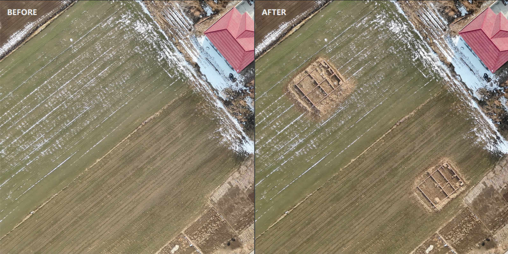

提示词2

```
PROMPT = "请基于输入的无人机正射航拍图进行真实遥感风格局部编辑。优先在图中已有的未完工房屋、老旧房屋、低矮农村自建房、破旧院落、简易棚屋或建筑旁空地上进行自然扩建；如果图中没有明显适合扩建的房屋，则可以在明确的空地、裸土地、村庄道路旁空地或农田边缘空地上新建一处农村自建房早期施工结构。每幅图随机生成1到3处变化。扩建效果应像真实农村建筑改造或自建房加建：可以新增低矮砖墙、灰褐色混凝土地梁、红褐色砖砌墙体、未封顶房间格局、半成型院墙、浅灰水泥地面、土黄色施工地面、裸土扰动、砂石堆、少量建筑材料和开挖痕迹。扩建部分应与原有房屋自然连接或位于旁边空地，尺寸要符合农村建筑比例，不能过小，也不能覆盖大片区域。若是在空地新建，应生成类似农村未完工房屋地基或低矮基础墙，带有清晰房间分隔结构。新增或扩建部分的颜色应以红褐色砖块、灰褐色水泥、深灰色地梁、土黄色裸土、浅棕色砂石和旧建筑相近色为主，避免纯白色或过亮颜色。建筑结构必须贴合地面和原图透视，符合无人机正射航拍视角，有自然阴影和真实施工痕迹。保持原图道路、树木、农田、水体、已有完整建筑、相机视角、光照方向、阴影、分辨率和整体空间结构基本不变。最终效果必须像真实航拍图中农村房屋正在扩建、翻建或新建早期施工状态。"

NEGATIVE_PROMPT = "改变相机视角，倾斜透视，生成天空，生成地平线，大型城市建筑，高楼，完整豪华别墅，现代商业楼，大型厂房，大面积工地，过度施工，挖掘机，吊车，大量车辆，大量人物，覆盖大片农田，改变道路走向，改变树木，改变水体，删除已有建筑，严重重绘整张图，改变完整房屋屋顶颜色，改变无关建筑纹理，扩建部分漂浮，像贴纸，边缘过于锐利，比例过大，比例过小，纯白色线条，白色放线，发光颜色，荧光色，亮蓝色，亮绿色，塑料感，3D渲染感，游戏地图感，卡通，插画，文字，水印，logo，红色标注框，箭头，地图标注，严重变形，重复纹理。"

NEGATIVE_PROMPT_FIELD = "negativePrompt"
```

效果图A→B


#### 三：地基→成品房子

提示词

```
PROMPT = "请基于输入的无人机正射航拍图进行真实遥感风格局部编辑。识别图中所有未完工房屋地基、裸露地基、格子状基础墙、施工中的房屋基础、土黄色或灰褐色的矩形地基区域，并将这些地基全部自然改造成已经建成的农村房屋或低矮民房。必须处理图中所有类似地基区域，不要遗漏。只允许修改这些未完工地基区域及其紧邻施工裸土区域，其他已有房屋、道路、树木、院墙、车辆、水体和农田必须保持原样。生成的新房子应与周围已有房屋风格相近，符合农村航拍正射影像：可以是灰色平屋顶、红色或红褐色瓦屋顶、浅灰色金属屋顶、蓝灰色彩钢屋顶、水泥平顶或低矮砖混民房。每栋新房子的占地范围应基本覆盖原来的地基位置，形状和朝向与原地基一致，可以保留合理院墙边界或小院结构，但地基裸土和内部格子基础应被屋顶、墙体或完整建筑表面替代。新房子高度和体量要与附近民房相近，不要变成高楼、大厂房或豪华别墅。为增强真实感，请为新生成的房屋添加与原图光照一致的自然阴影，也可以适度调整局部阴影方向和长度，使画面呈现不同拍摄时刻的感觉，例如早晨或傍晚的斜向阴影、屋檐阴影、院墙阴影和建筑投影。但阴影必须真实、柔和、方向一致，不能影响整张图的结构。新房子的屋顶颜色、亮度、纹理、边缘清晰度、压缩噪声和航拍质感应与周围建筑融合。保持无人机正射俯视视角、原始分辨率、道路走向、已有建筑形状和整体空间布局不变。最终效果必须像真实航拍图中这些地基已经建成房屋后的状态。"

NEGATIVE_PROMPT = "遗漏地基，只改一个地基，不处理全部地基，修改已有完整房屋，改变周围已有屋顶，改变道路，改变树木，改变车辆，改变院墙，改变水体，改变整张图光照，重绘整张图，新增大面积建筑群，高楼，商业楼，厂房，豪华别墅，现代玻璃建筑，过高建筑，屋顶漂浮，建筑比例错误，房子超出原地基太多，覆盖道路，覆盖树木，覆盖已有房屋，保留裸露地基，保留格子状基础墙，仍然像施工现场，屋顶没有阴影，阴影方向混乱，阴影过黑，阴影像贴纸，强烈不真实光斑，倾斜透视，生成天空，地平线，3D渲染感，游戏地图感，卡通，插画，文字，水印，logo，红色标注框，箭头，地图标注，边缘过锐，模糊变形，重复纹理。"

NEGATIVE_PROMPT_FIELD = "negativePrompt"
```

效果图：A→B

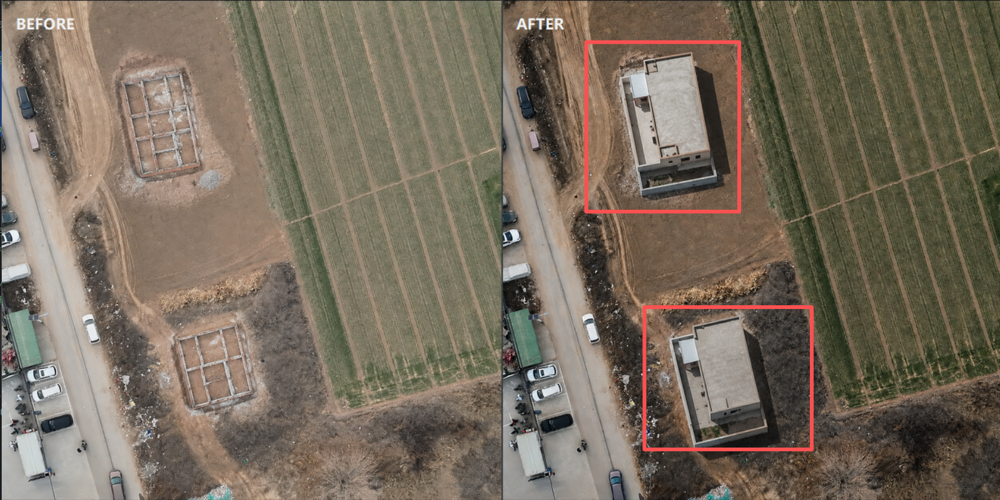

#### 四：空地→农业大棚

提示词：

```
PROMPT = """
请基于输入的无人机正射航拍图进行真实遥感风格的局部编辑，在图中明显适合建设农业大棚的农田、裸土田块、规则空闲地、现有农业用地区域，自然生成若干农业温室大棚。

农业大棚应符合真实农村航拍影像特征：从正上方俯视，整体呈长条形、拱棚形、并列条带形或连栋温室形态；方向应顺着原有田块、田垄、道路、沟渠或地块边界排列，多个大棚之间可以平行分布，并保留合理的窄路、间距、排水沟或田埂。大棚数量、长度、宽度和占地范围要与周围田块尺度一致，不要过密、过大或过于整齐机械。

大棚类型可以有自然差异：常见的白色或灰白色塑料薄膜拱棚、浅灰色旧棚、银灰色温室棚、少量蓝灰色或浅绿色棚顶、较宽的连栋温室。棚顶不能纯白发光，不能像新贴上去的图形；应带有真实航拍中的轻微灰尘、老化、压缩噪声、柔和边缘、薄膜纹理、纵向筋线、局部反光和亮暗不均。部分棚可以略旧、略脏或局部偏暗，但整体仍应像真实农业设施。

只允许修改适合建棚的农田、裸地或空闲农业地块，以及这些地块内部的局部纹理。不要修改已有完整房屋、道路、树木、水体、车辆、院墙、沟渠主线和重要地物；不要覆盖道路、房屋、树木、水体和车辆。如果某处不适合建设大棚，请保持原样。生成后应像这些地块原本后来新建了农业大棚，而不是把整张图重新绘制。

可以加入由于拍摄时间不同造成的轻微真实变化：大棚附近可出现柔和阴影、棚顶反光强弱变化、轻微色温差异、局部亮度变化、田地湿润程度或植被颜色的轻微变化。阴影方向必须与整张图光照一致，阴影长度和强度要符合无人机正射影像，不能过黑、不能方向混乱，也不能改变整张图的季节、地块结构、道路走向或建筑布局。

保持无人机正射俯视角度、原始分辨率、真实遥感影像质感、周围空间关系和整体画面风格。最终效果必须像真实航拍图中自然存在的农业大棚。
"""
NEGATIVE_PROMPT = """
卡通，插画，3D渲染，游戏地图，模型感，贴纸感，透视视角，斜拍视角，低空近景，生成天空，地平线，文字，水印，logo，地图标注，红色标注框，箭头，整图重绘，改变整张图光照，改变季节，改变道路走向，改变建筑布局，破坏田块边界，覆盖道路，覆盖房屋，覆盖树木，覆盖水体，覆盖车辆，覆盖院墙，覆盖沟渠主线，大棚悬浮，大棚边缘过锐，大棚比例过大，大棚比例过小，大棚排列方向混乱，大棚过度密集，大棚颜色纯白发光，强烈塑料反光，重复纹理，阴影方向混乱，阴影过黑，高楼，厂房，豪华建筑，现代玻璃建筑，太阳能板阵列，停车场，城市建筑
"""
NEGATIVE_PROMPT_FIELD = "negativePrompt"
```

效果图：A→B


#### 五：空地有垃圾

生活垃圾：

提示词

```
PROMPT = """
请基于输入的无人机正射航拍图进行真实遥感风格的局部编辑，在图中合理位置自然生成少量生活垃圾或混合杂物堆。请根据原图环境判断适合出现垃圾的位置，例如村庄边缘、房屋院墙旁、厂房空地、路边空闲地、树下、裸土地、施工边角、废弃院落角落或已有杂物附近；如果某个区域不适合堆放垃圾，请保持原样，不要强行生成。

垃圾应呈现真实航拍影像中的生活垃圾堆放状态：包含白色、灰色、蓝色、红色、黄色等零散塑料袋、编织袋、纸箱、泡沫箱、废弃包装物、破布、瓶罐、杂物碎片、少量木棍或建筑废料。整体应是不规则堆积，大小不一，颜色杂乱但不过度鲜艳，边缘散落，局部有灰尘、泥土覆盖、阴影和压缩噪声。垃圾堆不能像规则图案，也不能像贴上去的彩色颗粒。

垃圾规模要符合无人机正射图比例，可以是一小堆、中等堆或几处零散堆放，不要铺满大面积区域。垃圾应贴合地面，和裸土、水泥地、院墙边、草地边缘或道路边自然融合。可以有少量散落垃圾沿路边或空地边缘分布，但主体不要过度扩散。

只允许修改垃圾堆所在的小范围区域及其紧邻地面纹理。不要修改已有完整房屋、道路主体、树木主体、水体、车辆、院墙和重要地物；不要覆盖道路通行区域、房屋屋顶、车辆或明显农田主体。垃圾应避开不合理位置，例如房顶中央、水面中央、树冠顶部、道路正中间或整齐农田中央。

可以加入由于拍摄时间不同造成的轻微真实变化：垃圾附近可有柔和阴影、轻微亮度变化、尘土色差、局部潮湿或干燥痕迹。光照和阴影方向必须与原图一致，变化要自然克制，不要改变整张图季节、建筑布局、道路走向或整体色调。

保持无人机正射俯视角度、原始分辨率、真实遥感影像质感和整体空间关系。最终效果应像真实航拍图中自然存在的生活垃圾堆、杂物堆或村边废弃物堆放点。
"""
NEGATIVE_PROMPT = """
卡通，插画，3D渲染，游戏地图，模型感，贴纸感，规则图案，彩色圆点，彩色噪点，过度鲜艳，垃圾像花纹，垃圾像马赛克，垃圾边缘过锐，垃圾悬浮，垃圾比例过大，垃圾比例过小，大面积铺满垃圾，垃圾覆盖整条道路，垃圾覆盖房屋，垃圾覆盖树冠，垃圾覆盖水体，垃圾覆盖车辆，垃圾出现在屋顶中央，垃圾出现在水面中央，垃圾出现在道路正中间，垃圾出现在整齐农田中央，改变道路走向，改变建筑布局，改变树木形状，改变整张图光照，改变季节，整图重绘，生成垃圾桶，生成大型垃圾车，生成人物特写，生成火焰，浓烟，夸张污染，危险化学品标志，医疗废物标志，文字，水印，logo，地图标注，红色标注框，箭头，透视视角，斜拍视角，低空近景，生成天空，地平线，重复纹理，阴影方向混乱，阴影过黑
"""
NEGATIVE_PROMPT_FIELD = "negativePrompt"
```

效果图A→B

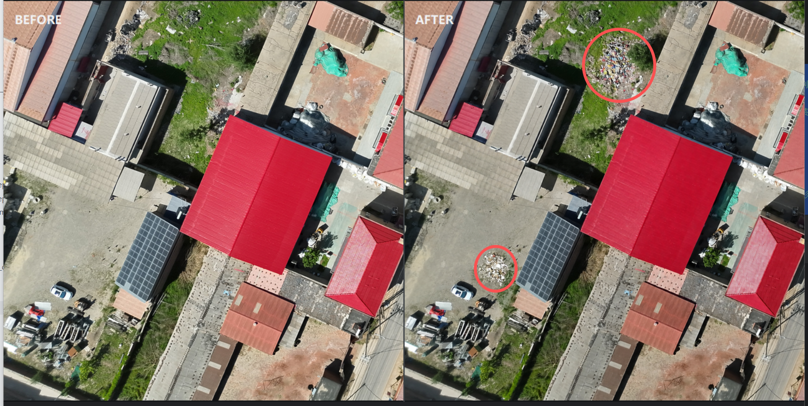

#### 六：屋顶光伏新增

提示词

```
PROMPT = """
请基于输入的无人机正射航拍图进行真实遥感风格的局部编辑，在图中选择少量适合安装光伏的屋顶，自然生成真实屋顶分布式太阳能光伏板阵列。请优先选择面积较大、无遮挡、结构清晰的平屋顶、厂房屋顶、彩钢瓦屋顶或农村房屋屋顶；不适合安装的位置保持原样，不要强行生成。

光伏板不能是一整块单调黑色平面，必须呈现真实组件阵列结构：由多块独立矩形太阳能板拼接组成，有清晰但不过锐利的行列分块、细密电池片网格、浅灰或银灰色金属边框、面板之间的窄缝、阵列边缘框架和局部支架阴影。每块组件应有轻微亮暗差异、蓝黑色或深灰蓝色玻璃质感、细微反光、压缩噪声和航拍模糊，整体看起来像真实航拍照片中的光伏组件，而不是贴上去的黑色矩形。

光伏阵列应有足够的细节和厚度感：面板边缘可以有轻微投影，阵列下方可有很浅的阴影或支架暗线，部分区域可受到树影、屋顶女儿墙、烟囱、天窗、屋脊或屋面结构影响，形成自然遮挡和亮度变化。面板表面可以出现轻微灰尘、局部反光不均、色块差异和组件拼接痕迹，但不要过脏、不要破损夸张。

光伏板必须贴合屋顶方向和建筑透视关系，沿屋顶长边、屋檐、屋脊或厂房边界整齐排列。阵列大小要符合屋顶尺度，可以覆盖屋顶一部分或大部分，但必须保留合理屋檐边距、检修通道、屋顶边缘和障碍物避让空间。不要越出屋顶边界，不要跨到道路、树冠、水体、车辆、院墙或相邻建筑上。

不同屋顶上的光伏阵列可以有自然差异：有的为大面积整齐矩形阵列，有的为几排较小组件，有的只覆盖屋顶一侧；颜色可以是深蓝、蓝黑、黑灰或深灰蓝，反光强弱、组件数量、排列方向和新旧程度可以不同。不要每个屋顶都安装，也不要所有光伏板完全一样。

只允许修改光伏板所在屋顶或硬质平面的小范围区域及其紧邻纹理。不要改变房屋轮廓、屋顶整体形状、道路走向、树木形状、水体、车辆、院墙、农田和整体空间布局。不要重绘整张图，不要生成大型地面光伏电站。

可以加入由于拍摄时间不同造成的轻微真实变化：光伏表面可有柔和高光、局部反射、树影遮挡、边框阴影、组件间暗缝和轻微色温变化。所有光照和阴影方向必须与原图一致，变化要自然克制，不要改变整张图季节、建筑布局或整体色调。

保持无人机正射俯视角度、原始分辨率、真实遥感影像质感和建筑空间关系。最终效果应像真实航拍图中自然安装在屋顶上的完整分布式太阳能光伏板阵列。
"""
NEGATIVE_PROMPT = """
一整块黑色矩形，纯黑色方块，没有组件分块，没有电池片网格，没有边框，没有缝隙，平面贴纸感，空洞单薄，悬浮太阳能板，太阳能板没有厚度，太阳能板越出屋顶边界，太阳能板跨到道路上，太阳能板跨到树冠上，太阳能板跨到车辆上，太阳能板跨到水体上，随机乱放，方向与屋顶不一致，透视关系错误，比例过大，比例过小，边缘过锐，反光过强，镜面反射，发光板，玻璃幕墙，普通窗户被误生成太阳能板，每个屋顶都安装，覆盖整张图，大型地面光伏电站，改变房屋轮廓，改变屋顶形状，改变道路走向，改变树木形状，改变车辆位置，改变整张图光照，改变季节，整图重绘，卡通，插画，3D渲染，游戏地图，模型感，透视视角，斜拍视角，低空近景，生成天空，地平线，文字，水印，logo，地图标注，红色标注框，箭头，重复纹理，阴影方向混乱，阴影过黑
"""
NEGATIVE_PROMPT_FIELD = "negativePrompt"
```

效果图A→B


#### 七：空地生活垃圾(垃圾袋堆叠，纸箱堆叠)

```
RANDOM_SEED = None
PROMPT = "对原图进行最小范围的局部物体添加：只在原图已经存在的一小块真实地面上添加一处普通日常生活垃圾堆，绝对不要生成、补建或改造任何环境结构。直接使用原图现有地表作为垃圾承载面，不得为了放置垃圾而新建或扩大房屋、楼群、屋顶、空地、平台、水泥地、道路、院落、围墙、棚子、垃圾站或其他设施，也不得改变原有地面的形状、范围、材质和颜色。垃圾集中为一个低矮紧凑的小堆，以单层摆放为主，少量两层自然重叠，高度不超过0.7米。若画面存在船只，整堆最长边不超过最小可见船只长度的三分之一，且必须明显小于船只；若没有船只，整堆不超过半个小汽车停车位并明显小于附近汽车。垃圾由八到十八个扎口且有装填感的日常垃圾袋组成，以乳白色、浅灰色和半透明塑料袋为主，搭配少量低饱和浅蓝色、浅绿色袋子，黑色和深灰色垃圾袋只占少数；另有两到四只浅棕色压扁旧纸箱，以及极少量透明塑料瓶、白色餐盒和低饱和彩色包装。所有物品彼此靠近并集中在同一处，外围只允许一两件小物。垃圾必须直接贴合原有地面，只有紧贴垃圾底部的自然接触阴影，透视、尺寸、清晰度、颜色、光照、颗粒感和压缩噪声与原图一致。若画面有水域，垃圾只能放在原图已经存在的干燥岸边地面上，不能修改水面、岸线或生成新平台。除垃圾及其微弱接触阴影覆盖的局部区域外，原图所有建筑、空地、平台、道路、水面、船只、岸线、树木、车辆和背景必须保持原样，不添加方框、线条或图形标记。"
NEGATIVE_PROMPT = "新增房屋，新增居民楼，新增建筑群，新增楼顶，新增屋顶，新增空地，新增平台，空地平台，水泥平台，高台，地基，台阶，码头平台，扩大地面，填平水面，开辟空地，新建道路，新建院落，新建围墙，新建棚子，新建垃圾站，新建垃圾房，新建垃圾收集亭，新增垃圾桶设施，改变地表材质，重绘大片地面，改变建筑结构，改变空地范围，改变平台轮廓，改变水面，改变岸线，改变船只，改变道路树木车辆，背景重建，大面积重绘，垃圾在屋顶，垃圾在平台顶部，垃圾在水面，垃圾漂浮，垃圾在船上，垃圾悬空，垃圾没有接地阴影，垃圾比船大，垃圾袋与汽车一样大，高耸垃圾山，多层高堆，多个垃圾堆，满地零散垃圾，全部黑色垃圾袋，大面积纯黑垃圾，建筑垃圾，砖块，水泥块，钢筋，碎石，木板，红框，矩形框，检测框，标注线，箭头，圆圈，文字，水印，贴纸效果，3D渲染，边缘过度锐利。"
NEGATIVE_PROMPT_FIELD = "negativePrompt"
```

效果图A→B


#### 八：房区生活垃圾（集中在道路旁垃圾堆）

```
RANDOM_SEED = None
PROMPT = "对原始无人机高空俯拍的房区影像进行严格的加法式局部编辑：必须在原图已有马路或巷道的道路旁边添加一处清楚可见的中等规模生活垃圾堆，不能返回没有变化或垃圾难以发现的图片，但只能叠加垃圾，绝不能删除、替换或移动原图中的任何物体。垃圾堆至少一侧必须直接紧贴原图清晰可见的道路外缘、路缘或路肩，中间不能隔着围墙、建筑、树冠、空地或其他物体；垃圾必须与道路上的汽车、摩托车或行人处于同一个地面高度和平面。只能放在道路外侧不影响车辆通行的现有地面，不能放在机动车道中央、道路交叉口、建筑入口、院落内部、停车通道或道路以外的封闭区域。选择能够完整容纳垃圾、视线无遮挡、不在深色阴影中且不靠近画面边缘的一段道路边缘；如果某处空间不足，应沿现有道路改选另一处，不能缩小到看不见，也不能移除树木、清除植被、改造屋顶或生成新地面。垃圾不得与任何树冠、屋顶、女儿墙、露台、雨棚或建筑平台重叠。垃圾堆约3到4米长、1.5到2.5米宽，占地大致相当于一辆小汽车或一个停车位，但不得超过一辆半汽车的占地；整体高度约0.4到0.8米，低矮平缓，以单层摆放为主，少量两层自然重叠。垃圾由十八到三十个扎口且有装填感的日常垃圾袋、三到五只压扁旧纸箱，以及少量塑料瓶、餐盒和食品包装组成；以乳白色、浅灰色、半透明和浅棕色为主，加入少量低饱和蓝色、绿色、红色包装，黑色垃圾袋只占少数。所有垃圾彼此接触并集中成一个轮廓完整、略不规则的混合色垃圾堆，与道路旁地面形成清楚但自然的颜色和纹理差异，外围最多只有两三件紧贴主堆的小物。垃圾必须直接贴合原有道路旁地面，只有紧贴底部的自然接触阴影，尺寸、透视、清晰度、光照、颗粒感和压缩噪声与原图一致。原图中每一棵树以及所有屋顶、建筑、道路、车辆的数量、位置、轮廓、纹理、颜色和阴影必须完全保留。除垃圾及其底部接触阴影覆盖的少量路边地面像素外，原图其余区域保持不变，不添加任何方框、文字或标记。"
NEGATIVE_PROMPT = "垃圾远离道路，垃圾与道路之间隔着建筑，垃圾与道路之间隔着围墙，垃圾与道路之间隔着树木，垃圾在院落内部，垃圾在封闭空地，垃圾在道路中央，垃圾阻断车道，垃圾在道路交叉口，垃圾遮挡建筑入口，垃圾占用停车通道，没有生成垃圾，原图完全没有变化，垃圾难以发现，垃圾过小不可见，垃圾藏在阴影中，垃圾被树木遮挡，垃圾位于画面边缘，删除树木，少了一棵树，树木消失，缩小树冠，改变树冠形状，垃圾覆盖树冠，清除植被，生成裸地，扩大裸地，垃圾在屋顶，垃圾在房顶，垃圾在楼顶平台，垃圾在露台，垃圾在雨棚，垃圾在建筑平台，把屋顶识别为地面，改变屋顶轮廓，改变建筑结构，新增平台，新增空地，新增道路，新增房屋，新增围墙，背景重建，大面积重绘，垃圾堆超过一辆半汽车占地，超大型垃圾堆，高耸垃圾山，多层高堆，多个垃圾堆，满地零散垃圾，垃圾悬空，垃圾没有接地阴影，透视错误，全部黑色垃圾袋，大面积纯黑垃圾，建筑垃圾，砖块，水泥块，钢筋，碎石，木板，红框，矩形框，检测框，箭头，圆圈，文字，水印，贴纸效果，3D渲染，边缘过度锐利。"
NEGATIVE_PROMPT_FIELD = "negativePrompt"
```

效果图:A→B

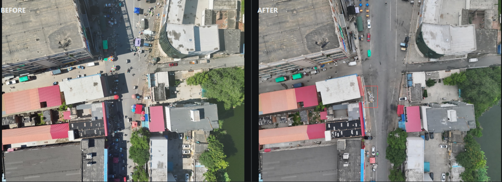


#### 九：田边生活垃圾（破旧衣物，分解物，混合碎片垃圾）

```
RANDOM_SEED = None
PROMPT = "对原始无人机高空俯拍影像进行局部编辑，必须在画面中实际新增一处清楚可见、真实自然的混合生活垃圾倾倒点，不能返回没有变化的原图。先识别原图已经存在的乡村道路边缘、房屋或厂区外围、田边、林地边缘、沟渠旁干燥地面以及裸土与杂草交界处，从中选择一处可由现有道路到达、没有树冠完全遮挡的合理位置。只能使用原图已有地面承载垃圾，不得新建空地、平台、道路、建筑、围墙或垃圾站。垃圾应为人为多次倾倒后形成的低矮、不规则混合垃圾堆，不是整齐排列的袋装垃圾。垃圾堆中心较密集，许多物品互相接触和遮挡，边缘有少量碎片紧贴裸土和杂草自然扩散，但不能散布到整幅画面。垃圾堆最宽处约为附近乡村道路宽度的0.6到1.5倍，整体高度低于0.8米，不堆成山，面积随原图地面空间自然调整，并明显小于附近建筑占地。垃圾以灰白色、浅灰色、半透明和浅棕色为主，包括白色或半透明塑料袋、编织袋、压扁纸箱、泡沫餐盒、塑料瓶、食品包装袋、废纸和少量旧布料，加入少量低饱和蓝色、绿色、红色包装形成自然色差；黑色垃圾只占少数，不能形成整块黑斑。垃圾必须直接贴合原有地面，部分被杂草轻微遮挡，具有真实接触阴影、脏污和不均匀纹理。垃圾的尺寸、透视、清晰度、光照、颗粒感和压缩噪声必须与原航拍影像一致。除垃圾及其紧邻区域外，保持原有房屋、厂房、农田、道路、沟渠、水面、岸线、植被、车辆和相机视角不变，不添加任何标注图形。"
NEGATIVE_PROMPT = "没有生成垃圾，原图完全没有变化，垃圾过小不可见，只生成一两个垃圾袋，整齐排列的垃圾袋，全部黑色垃圾袋，大面积纯黑垃圾，垃圾堆成高山，超大型垃圾场，垃圾均匀铺满画面，垃圾出现在农田中央，垃圾出现在道路中央，垃圾在屋顶，垃圾在水面，垃圾漂浮，垃圾悬空，垃圾被树冠完全遮挡，新增房屋，新增厂房，新增空地，新增水泥平台，新增道路，新增围墙，新增垃圾站，改变地表形状，大面积重绘，建筑垃圾，成堆砖块，水泥块，钢筋，巨大石块，红框，矩形框，检测框，箭头，圆圈，文字，水印，贴纸效果，3D渲染，边缘过度锐利。"
NEGATIVE_PROMPT_FIELD = "negativePrompt"
```

效果图：A→B


#### 十：建筑废料

```
RANDOM_SEED = None
PROMPT = "对原始无人机高空俯拍影像进行严格的加法式局部编辑，必须在画面中实际新增一处或两处清楚可见、真实自然的建筑拆除废料倾倒点，只添加废料，绝不能删除、替换或移动原图中的任何物体。先识别原图已有的道路外缘、路肩、田地边界、果园或树林边缘、围墙外侧、施工建筑外围和现有裸土地面，从中选择车辆能够到达、没有树冠完全遮挡的合理位置。建筑废料必须直接放在原图已经存在的地面上，优先沿道路、田埂、围墙或场地边界呈低矮不规则分布，不能生成在屋顶、水面、农作物中央、树林内部或机动车道中央。废料倾倒点可以是约4到8米长、2到4米宽的块状小堆，也可以沿田边、道路或围墙形成约8到18米长、1.5到3米宽的狭长废料带；整体高度约0.3到0.8米，以平铺和少量叠压为主，不堆成高山。主体由大量破碎的灰白色混凝土块、水泥砂浆块、石膏板、轻质隔墙板、破损水泥板和不规则建筑板材组成，混入适量红褐色碎砖、瓦片、瓷砖、陶瓷碎片和浅棕色砂浆，少量加入折断木板、细金属杆、短管件和破损塑料薄膜。所有材料必须呈现已经废弃和破碎的状态，大小不一、棱角不规则、表面有灰尘、裂纹和污渍，许多碎块互相接触、覆盖和叠压，不能像整齐堆放的新建材。废料中心较密集，边缘逐渐稀疏，少量小碎片紧贴裸土和杂草自然散落，可被边缘杂草轻微遮挡，但不能均匀铺满整幅画面。整体色彩以灰白、浅灰、土黄和红褐色为主，形成符合真实建筑废料的颗粒与块状纹理。废料必须贴合地面，具有自然接触阴影、遮挡关系和航拍尺度，清晰度、透视、光照、颜色、颗粒感和压缩噪声与原图一致。保持原有道路、农田、树木、植被、围墙、建筑、屋顶、车辆、水面、岸线和相机视角完全不变，不创建新道路、平台、建筑或裸地，不添加任何方框、文字或标记。"
NEGATIVE_PROMPT = "没有生成建筑废料，原图完全没有变化，废料过小不可见，袋装生活垃圾，黑色垃圾袋，食品垃圾，餐盒和饮料瓶占主体，彩色生活垃圾场，完整整齐的新砖，整齐码放的建材，未破损的新水泥板，纯白色连续贴片，白色地毯，新增水泥道路，新增混凝土平台，新增建筑，新增围墙，新增裸地，改变地表形状，废料在屋顶，废料在水面，废料在农作物中央，废料在树林内部，废料在机动车道中央，废料阻断道路，废料悬空，废料没有接地阴影，删除树木，少了一棵树，改变树冠，清除植被，改变农田，改变道路，改变建筑屋顶，背景重建，大面积重绘，超大型建筑垃圾山，高耸锥形废料堆，多层高堆，废料覆盖大片画面，均匀撒满小白点，透视错误，边缘过度锐利，红框，矩形框，检测框，箭头，圆圈，文字，水印，贴纸效果，3D渲染。"
NEGATIVE_PROMPT_FIELD = "negativePrompt"
```

效果图A→B


#### 十一：新增柏油路，含光影

```
RANDOM_SEED = None
PROMPT = "对原始无人机高空俯拍农田影像进行局部编辑，在图中新增一条符合真实农村通行和农田布局逻辑的深灰色柏油路。新道路宽度约3.5到5米，为普通单车道或窄双向乡村沥青道路，路面不设置中心线。优先从原图已有道路的侧边、转弯处或田间出入口自然分叉，连接处具有真实的沥青接缝和缓和转角；道路沿田块边界、田埂、农机通道或农田之间的现有空隙延伸，尽量减少对完整农田和作物的占用，不能无理由斜穿大片耕地。道路另一端必须连接另一条可见道路、村庄出入口、田间生产区域，或者自然延伸至画面边缘，不能在农田中央突然终止。如果画面中没有现有道路，新道路必须从一个画面边缘进入并从另一个合理的画面边缘离开，走向应顺应田块边界和作物种植纹理。道路转弯应平缓连续，交叉处形成合理的T形路口或缓弯，路宽前后一致。柏油路面以自然深灰色为主，具有轻微色差、细小沥青颗粒、局部修补痕迹、灰尘和浅淡轮胎印，不能是纯黑色贴片。道路两侧保留窄小土质路肩、零星杂草和自然排水边缘，路面必须贴合原有地形并具有正确透视。只修改新道路实际占用的狭长区域，保持其余农田、作物垄沟、树木、已有道路、人物、农机、建筑、光照、相机视角、航拍清晰度和压缩噪声不变。保持原有道路、农田、树木、植被、围墙、建筑、屋顶、车辆、水面、岸线和相机视角完全不变，不创建新道路、平台、建筑或裸地,更不能给我新增房屋建筑，不添加任何方框、文字或标记。并在图中多栋建筑同一侧生成明显的自然建筑阴影，模拟白天太阳角度较低时的后时相无人机影像。阴影从房屋、围墙、屋顶边缘自然投射到地面、道路、院落或空地上，长度比原图更长，颜色更深，为低饱和灰黑色，边缘柔和但清晰可见。所有建筑阴影方向必须一致，符合统一太阳光照。不要改变建筑本身、屋顶颜色、道路、树木、农田和其他真实地物，只改变阴影。明显增强图中树木和植被投射到地面、道路、院落或屋顶上的阴影。树影应比原图更深、更长，并向同一方向偏移，呈自然树冠投影形状，边缘柔和且不规则。部分树影可以覆盖道路、院落边缘或屋顶局部，但树木本身、建筑、道路、农田和地块边界必须完全不变。模拟同一区域不同白天时段的无人机后时相影像。整张图允许出现明显但自然的亮度、色温和阴影差异，像上午和下午拍摄时间不同造成的效果。建筑和树木阴影整体变得更长、更深，并向统一方向偏移；部分道路、院落和屋顶边缘被阴影覆盖。所有真实地物保持不变，不新增建筑、堆料、车辆或地基，只生成由光照和阴影变化造成的后时相差异。仅在道路、院落、房前空地或裸土地面上生成几处明显的自然投影阴影，阴影可以来自画面外建筑、树木、电线杆或围墙。阴影呈灰黑色低饱和投影，长度适中，方向统一，贴合地面，覆盖部分道路边缘、院落或空地，但不是实体物体。不要改变道路形状、院落边界、建筑轮廓、树木和周边环境。"
NEGATIVE_PROMPT = "道路悬空，孤立道路，断头路，道路在农田中央突然终止，道路没有连接现有道路或画面边缘，道路穿过建筑，道路穿过树冠，道路跨越水面，道路覆盖人物或农机，道路走向杂乱，道路形成无意义环形，道路急转直角，道路宽度忽粗忽细，多条新增道路，复杂道路网，城市高速公路，双向多车道，黑色沥青大道，黄色或白色车道线，人行道，路缘石，护栏，路灯，交通标志，停车场，桥梁，隧道，超宽道路，纯白色路面，路面像贴纸，边缘过度笔直锐利，大面积破坏农田，改变田块边界，改变已有道路，删除树木，新增建筑，改变相机视角，大面积重绘，红框，矩形框，箭头，文字，水印，3D渲染。新增房屋平台建筑"
NEGATIVE_PROMPT_FIELD = "negativePrompt"
```

效果图A→B

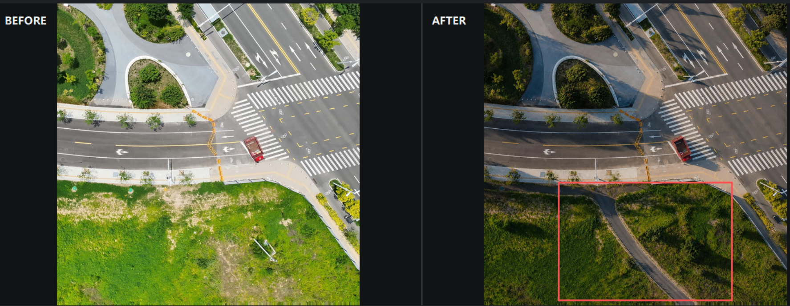

#### 十二：生成土路

```
PROMPT = "对原始无人机高空俯拍农田影像进行局部编辑，在图中新增一条符合真实农村生产通行逻辑的浅灰色水泥乡村道路或机耕道路。新道路宽度约3到4米，与图中已有道路的宽度、颜色、材质、亮度和磨损程度基本一致，不设置中心线。优先从原图已有道路的侧边或转弯处自然分叉，沿田块边界、田埂、现有农机行驶痕迹或农田之间的空隙延伸，尽量少占用完整农田，不随意斜穿大片作物。道路另一端必须连接另一条可见道路、田间出入口或自然延伸到画面边缘，不能在农田中间突然终止。如果画面内没有现有道路，新道路必须从一个画面边缘进入并从另一个画面边缘离开，方向应顺应田块边界和作物种植纹理，不能成为孤立路段。道路转弯应平缓自然，交接处形成合理的T形路口或缓弯，道路宽度前后一致。路面具有轻微水泥色差、灰尘、浅淡轮胎痕迹和少量磨损，不能是纯白色贴片；道路两侧保留窄小土质路肩、零星杂草和自然排水边缘，路面必须贴合原有地形。只修改新道路实际占用的狭长区域，保持原图其余农田、作物垄沟、树木、已有道路、人物、农机、建筑、光照、相机视角、航拍清晰度和压缩噪声不变。"
NEGATIVE_PROMPT = "道路悬空，孤立道路，断头路，道路在农田中央突然终止，道路没有连接现有道路或画面边缘，道路穿过建筑，道路穿过树冠，道路跨越水面，道路覆盖人物或农机，道路走向杂乱，道路形成无意义环形，道路急转直角，道路宽度忽粗忽细，多条新增道路，复杂道路网，城市高速公路，双向多车道，黑色沥青大道，黄色或白色车道线，人行道，路缘石，护栏，路灯，交通标志，停车场，桥梁，隧道，超宽道路，纯白色路面，路面像贴纸，边缘过度笔直锐利，大面积破坏农田，改变田块边界，改变已有道路，删除树木，新增建筑，改变相机视角，大面积重绘，红框，矩形框，箭头，文字，水印，3D渲染。"
```

效果图：A→B


#### 十三：GSD约0.75米的卫星图新建房屋

```
PROMPT = ("【最高优先级：必须出现明确的新建筑轮廓，不能只改变颜色或光照。】对这张GSD约0.75米/像素的正射俯视卫星影像进行严格的局部加法式编辑。在原图原本没有任何屋顶的地面上，强制新增且只新增1栋完整、清楚、可辨认的低层住宅；新建筑必须占用一块原先为裸地、空置宅基地、院落空地或建筑区边缘田地的区域，使该区域从"无建筑"明确变为"有建筑"。不得把既有屋顶换色、加亮、压暗、加阴影或改变纹理来冒充新增建筑，也不得仅在原房屋上画一小块颜色。优先在画面中部15%至85%的范围内选址，并靠近现有住宅、院落或巷道；若首选位置空间不足，应改选另一块完整空地，绝不能省略新建筑。新住宅采用与周边乡村住宅一致的单层或两层矩形形态，屋顶必须是一个几何轮廓完整、四周边界闭合的新屋顶。建筑占地约12至21米长、8至14米宽；在0.75米GSD影像中，新屋顶应约16至28像素长、11至19像素宽，面积约为附近普通住宅屋顶的0.8至1.3倍，确保以原始尺寸查看时能立刻指出新增位置，但不能成为异常巨大的建筑。新增建筑必须使用当地常见的瓦片或彩瓦屋顶，颜色从以下三类中选择一种：低饱和旧红色/砖红色、低饱和灰蓝色/旧蓝色，或炭黑灰色/深灰色；以红瓦和蓝瓦屋顶为主，也允许与周围村镇协调的黑灰瓦屋顶。颜色必须像真实卫星图中的旧屋面：经过日晒、风化和大气薄雾影响，饱和度偏低、亮度适中、色彩略灰，不得使用纯红、纯蓝、亮宝蓝、荧光色或刚喷漆般鲜艳光滑的颜色。新屋顶的可见性主要依靠完整建筑轮廓、屋脊和与周边地面的自然明度差，而不是依靠高饱和颜色。瓦片在0.75米GSD下只表现为轻微、粗粒度、方向一致的暗明纹理和自然旧化，不刻画清晰的单片瓦，不制造重复密集条纹。屋顶整体色调、对比度、反射亮度、雾感、颗粒感和压缩噪声必须与附近原有屋顶一致，看起来属于同一次卫星拍摄。屋脊方向、长边朝向、建筑间距和退界参考最近的房屋及道路；不得建在道路、水面、密集树冠或任何现有建筑上，不得覆盖既有屋顶，新增屋顶与已有屋顶之间必须存在可辨认的边界。为新房屋生成与原图太阳方向完全一致、紧贴建筑边缘的短而自然的投影；屋顶清晰度、空间分辨率、颗粒感和压缩噪声与原图一致，边缘符合0.75米GSD的轻微像素混合，不得呈现高清贴图、矢量边缘或3D模型效果。编辑严格限制在新建筑及其紧邻阴影的小范围内。除该局部区域外，原图的曝光、亮度、对比度、饱和度、白平衡、色调和阴影必须逐处保持不变；所有原有房屋、屋顶、道路、田地边界、树木、车辆及其他目标的位置、轮廓、颜色和纹理必须保留，禁止整图重绘或全局调色。成功标准：对比编辑前后图时，观察者无需放大就能立即看到一栋此前不存在、带完整低饱和红瓦、蓝瓦或黑灰瓦屋顶的新住宅；如果只有明暗变化、色调变化或旧屋顶变化，则结果视为失败。")

NEGATIVE_PROMPT = ("没有新建筑，无变化，变化不明显，只改变光照，只改变曝光，只改变亮度，只改变对比度，只改变饱和度，只改变白平衡，整图变暗，整图变亮，整图偏色，整图调色，重新打光，增加晒光，增加阴影，全局重绘，背景重建，把旧屋顶改成红色，把旧屋顶改成蓝色，旧屋顶换色，旧屋顶变亮，旧屋顶变暗，修改原有房屋，在原屋顶上画色块，没有新的闭合屋顶轮廓，新房屋过小，屋顶小于16×11像素，房屋只是模糊斑点，房屋难以辨认，屋顶与地面完全融为一体，纯白新屋顶，透明屋顶，纯红屋顶，纯蓝屋顶，亮宝蓝屋顶，荧光红，荧光蓝，高饱和屋顶，颜色刺眼，过度鲜艳，塑料质感，镜面反光，刚喷漆质感，颜色溢出，清晰的单片瓦，密集重复瓦片条纹，多个新增房屋，新增建筑群，超大建筑，高层建筑，厂房，仓库，商场，豪宅，房屋比例过大，房屋比例过小，屋顶大于附近住宅1.3倍，建筑尺度与0.75米GSD不符，房屋建在道路中央，堵塞巷道，建在水面，覆盖树冠，覆盖现有建筑，覆盖既有屋顶，房屋悬空，跨越地块边界，紧贴画面边缘，选址不合理，朝向冲突，透视错误，屋顶轮廓畸变，边界不闭合，重复屋顶，融合破损，屋顶颜色与卫星影像不协调，阴影方向错误，阴影过重，阴影缺失，过度锐利，过度清晰，贴纸效果，复制粘贴痕迹，3D渲染，插画，卡通，建筑效果图，删除或移动原有房屋，改变原有屋顶轮廓，删除树木，改变树冠，清除大片植被，改变道路，新增道路，改变田地边界，改变车辆，裁剪，旋转，缩放，整体模糊，接缝，伪影，红框，矩形框，箭头，圆圈，文字，水印")
```

**效果图A→B**

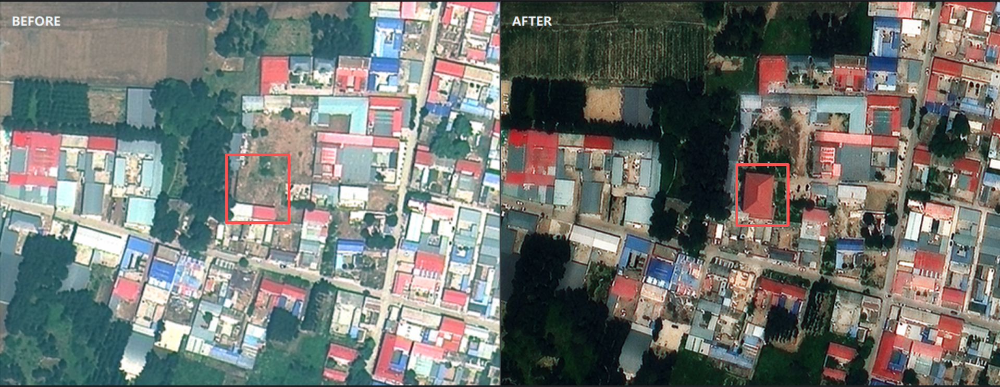

#### 十四：新增红蓝房子

```
PROMPT = """Edit the supplied image as a strict, photorealistic overhead satellite-image edit. Add exactly ONE new house and make no other visible change anywhere in the image.
Site-selection priority:
1. First look for a genuinely vacant, buildable patch of bare or unused land. If one exists, place the single new house entirely within that open space. Do not cover roads, sidewalks, parking spaces, vehicles, trees, gardens, water, walls, or existing buildings.
2. Only when the scene is too densely built and no suitable vacant land is available, place the single new house as a small rooftop addition centered on a structurally plausible existing flat-roof low-rise building. Keep the host building's footprint, outer walls, edges, and all neighboring buildings unchanged; modify only the small rooftop area occupied by the addition.
The new house must be compact and plausible for the local neighborhood, with one clean, clearly recognizable pitched roof made of corrugated metal or roof tiles. Use either a vivid blue roof or a red roof, choosing whichever fits the surrounding roof styles and remains clearly visible. Preserve the source image's exact top-down/near-nadir camera angle, scale, orientation, perspective, sunlight direction, shadows, sharpness, texture, color balance, and satellite-photo resolution. Blend the new house naturally into the ground or host rooftop with accurate contact shadows and clean edges. Preserve every original pixel as closely as possible outside the single construction area. Output the edited image only, with the same framing and dimensions as the source."""

NEGATIVE_PROMPT = """More than one new house, multiple buildings, duplicate houses, extra structures, construction on multiple sites, changing or replacing existing buildings, demolishing buildings, altered roof colors on unrelated buildings, enlarged or reshaped building footprints, moved roads, changed road markings, blocked streets, changed sidewalks, removed or added vehicles, damaged cars, removed or added trees, changed vegetation, altered parking areas, changed walls or property boundaries, scene-wide redesign, urban redevelopment, empty-land infill when no buildable clearance exists, rooftop addition when suitable vacant land exists, floating building, oversized building, implausible placement, roof without supporting structure, distorted geometry, wrong scale, wrong perspective, oblique camera angle, changed camera viewpoint, changed crop, rotation, blur, low resolution, painterly or CGI appearance, inconsistent lighting, incorrect shadows, seams, halos, artifacts, text, labels, logos, watermarks."""
```

**效果图**A→B

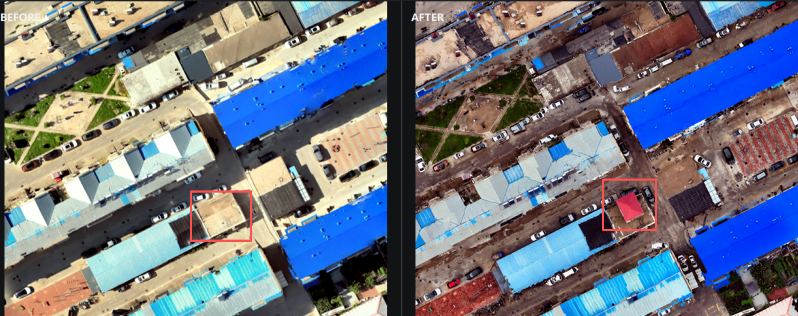

#### 十五：将房屋变成无违和感的空地

```
PROMPT = "Edit the provided drone aerial photograph realistically. Select and completely remove only one or two clearly identifiable individual houses or small buildings, including their roofs, walls, attached parts, foundations, and cast shadows. Convert each removed building's footprint into natural flat open ground that seamlessly continues the immediately surrounding terrain. Infer the correct local surface separately for each location—such as compacted earth, weathered soil, sparse grass, low weeds, gravel, or a subtle mixture—and match the neighboring color, texture, moisture, vegetation density, lighting, shadows, image sharpness, noise, top-down scale, and resolution. Blend the boundary irregularly and naturally so there is no obvious rectangular patch or editing seam. The finished area should look long-established and believable, not freshly cleared or artificially clean. Preserve the exact overhead viewpoint, composition, roads, paths, trees, vehicles, walls, fences, neighboring buildings, and every other part of the source image unchanged. Make no edits outside the selected one or two building footprints and their immediately necessary edge-blending areas. Photorealistic high-resolution orthographic drone imagery."

NEGATIVE_PROMPT = "removing more than two buildings, changing unselected buildings, partial building remaining, roof fragments, walls remaining, exposed foundation, concrete slab, building-shaped outline, demolition in progress, excavator, construction machinery, large rubble pile, excessive debris, crater, deep hole, trench, scorched ground, flooded area, new road, new path, new parking lot, new building, new objects, added trees, dense new vegetation, manicured lawn, unnaturally clean ground, uniform flat color, perfect rectangle, sharp boundary, visible seam, mismatched soil, mismatched texture, repeated texture, blur, smearing, warped geometry, distorted roads, altered cars, altered trees, shifted objects, perspective change, camera-angle change, crop, rotation, zoom, illustration, painting, CGI, low resolution, oversharpening, text, watermark"
```

**效果图**A→B

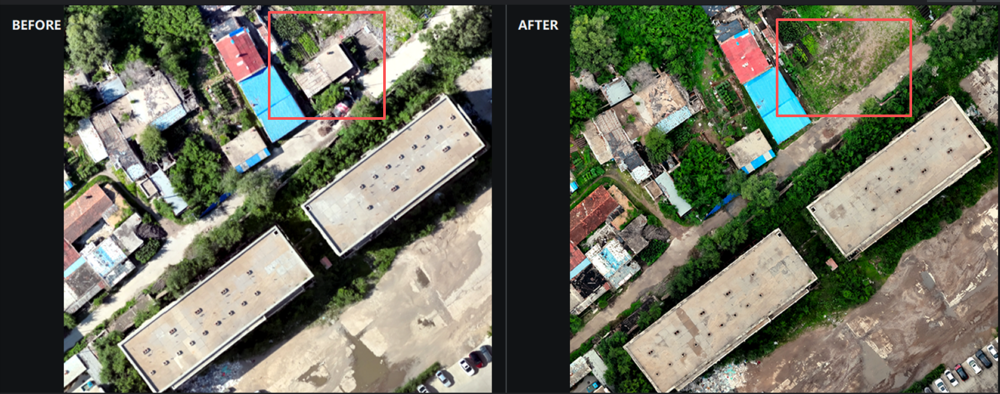

#### 十六：将公路变成无违和感的空地

```
PROMPT = "请基于输入的无人机正射航拍图进行真实遥感风格的局部编辑。识别并只选择图中最明显的一条连续机动车公路，将这条公路在画面内可见的全部路段自然移除，并恢复成与道路两侧周围环境连续一致的自然空地。完整清除目标公路范围内的沥青或水泥路面、车道线、斑马线、道路标记、路缘、护栏、机动车、摩托车以及只属于该公路的桥面、桥墩和道路投影，不得残留明显的公路结构或笔直路基痕迹。道路移除后，必须逐段参考道路左右两侧同一位置的真实地貌进行补全，不要把整条道路统一替换成同一种纹理：周围是草地的位置应自然延续草地、杂草和零散裸土；周围是灌木或林地的位置应延续相近密度和大小的灌木、低矮植被及少量树木；周围是泥土或荒地的位置应延续相同颜色、湿度和颗粒感的土壤；如果公路或桥梁跨越河流、池塘、沟渠或湿地，应恢复连续的水面、自然岸线、芦苇和湿地植被，不得用草地堵住原有水体。补全区域的植被种类、覆盖密度、颜色、纹理、土壤斑块、自然阴影、清晰度、噪声和航拍尺度必须与紧邻区域一致。道路原有的笔直边缘应完全消失，通过不规则的草丛、灌木、裸土斑块和自然地形向两侧柔和融合，不能形成一条规则、等宽、颜色均匀的绿色长带。如果有非目标的人行步道、乡间小路、水沟或自然地貌横穿目标公路，应在原公路范围内自然接续，使其结构连续合理。保持无人机正射俯视角度、原始分辨率、构图和整体空间布局不变。除目标公路及其必要的边缘融合区域外，其他道路、人行步道、建筑、树木、水体、岸线、农田、院墙、停车区域、输电塔、电线、电线杆及所有其他物体必须保持原样。最终效果应像这里从未修建过这条公路，原位置一直是与周围自然环境连成一体的空地、绿地、林地或湿地。"
NEGATIVE_PROMPT = "保留目标公路，公路没有完全移除，只删除一小段道路，残留沥青，残留水泥路面，残留车道线，残留斑马线，残留道路标记，残留车辆，残留摩托车，残留护栏，残留路缘，残留桥面，残留桥墩，残留道路阴影，残留笔直路基，废弃公路，破损公路，开裂路面，泥泞道路，施工道路，道路遗址，笔直土路，规则等宽绿色带，长方形草地，颜色均匀的填充区域，人工草坪，过度整齐的植被，明显道路轮廓，明显平行边界，明显修图接缝，重复纹理，左右地貌不连续，用草地填平河流，用泥土堵塞水体，改变非目标道路，删除人行步道，删除乡间小路，改变建筑，改变停车场，改变树木，改变农田，改变水体，改变岸线，改变输电塔，改变电线，改变电线杆，新增房屋，新增道路，新增车辆，新增桥梁，大面积森林，密集新树木，不符合周围环境的植被，整张图变绿，重绘整张图，改变整体光照，改变拍摄角度，倾斜透视，裁剪，旋转，缩放，物体移位，几何变形，模糊，涂抹，过度锐化，低分辨率，3D渲染感，游戏地图感，卡通，插画，文字，水印，logo，红色标注框，箭头，地图标注。"
```

**效果图B→A**

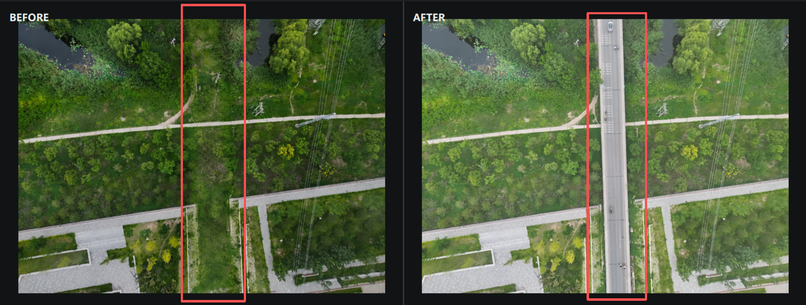

#### 十七：生成森林

提示词：

```
PROMPT = ("对原图执行受控的土地覆被转换：仅将画面中可见的主要裸露耕地、收割后麦田或低覆盖农田转换为真实、连续、自然生长的森林。先准确识别原有田块边界、田埂、沟渠、道路以及所有非耕地对象；森林必须严格限制在原有耕地内部，沿真实田界自然收边，不得越过田埂、道路、沟渠或画面中其他既有边界。当画面几乎全部是耕地时，应让主要田块内部形成大面积连片森林，覆盖绝大部分可编辑耕地，而不是只添加少量树木或零散绿点；原有耕作纹理只允许在森林边缘极少量自然过渡区域隐约可见。森林类型为符合华北平原气候的温带落叶阔叶混交林，以杨树、柳树、榆树、槐树等常见乡土树种的自然混合效果为参考。树木处于健康生长期，以中等至成熟树龄为主，树冠浓密但大小略有差异，呈不规则自然镶嵌分布；整体冠层连续，局部保留少量小型林隙，不能排列成整齐果园、苗圃或人工棋盘格。保持原图的无人机高空近垂直俯视视角和原始地理方向。树冠尺度必须与航拍高度、田块尺度和原图分辨率一致：不能出现几棵巨树覆盖整块田，也不能缩小成草点、灌木点或规则纹理。树冠颜色以真实的中绿、深绿和少量黄绿色为主，明暗层次自然且低饱和。保持原图太阳照射方向和整体曝光基调，但新增森林必须带来清晰可感知、符合真实空间关系的光影变化：迎光侧树冠略亮，背光侧自然变暗，树冠之间形成细碎且连续的冠层自阴影，林隙和较低植被处出现柔和斑驳光影，林缘向紧邻的原有地面投下方向一致的自然投影。阴影应具有深浅变化和柔和边缘，长度约为对应树冠直径的四分之一至四分之三，不得全部同形、同方向机械复制；林冠较密处阴影更深，稀疏处透入少量阳光。光影差异应在前后图对比中明显可见，但不能把整幅画面改成日落、强逆光或戏剧性照明，也不能无故改变远离森林区域的亮度和颜色。森林的清晰度、景深、颗粒感、压缩噪声、色温和基础对比度应与原始航拍照片协调一致，允许森林及其紧邻投影区域出现由新增树木自然造成的局部亮度、对比度和阴影变化，避免贴图感、重复纹理和过度锐化。除耕地被森林冠层自然覆盖的区域外，原图中的田块轮廓、田埂、道路、沟渠、水面、建筑、车辆、电线杆及其他非耕地目标的位置、形状、尺寸和颜色全部保持不变；不得新增或改造任何建筑、道路、水体、设施或地形，也不得添加文字、边框、箭头和其他标记。生成一张阴影干扰明显的白天后时相无人机图像。建筑、树木和围墙投影比原图明显更深、更长，多个阴影覆盖道路、院落、屋顶边缘和空地局部，形成容易被误检为变化的灰黑色投影区域。所有阴影必须方向一致，边缘自然柔和，不能是纯黑色块。不要改变任何建筑、道路、树木、农田、车辆和地物结构。")

NEGATIVE_PROMPT = ("只把土地染成绿色，绿色滤镜，草坪，草皮，苔藓，低矮草丛，只有灌木，没有乔木，稀疏幼苗，零散几棵树，树木数量过少，大片裸土仍然可见，森林覆盖不足，热带雨林，棕榈树，椰子树，竹林，针叶林，雪山森林，异域树种，夸张古树，巨型树冠，树冠尺度过大，树冠小成噪点，树干侧视，出现地平线，非俯视视角，果园，苗圃，经济林，整齐树列，等间距栽植，棋盘格树木，完全相同的树冠，复制粘贴树冠，周期性重复纹理，规则圆点，人工绿化带，公园景观，花坛，树冠融化，树冠糊成一片，塑料树，卡通树，贴图效果，纹理平铺，边界发光，硬直矩形边界，森林越过田界，森林覆盖道路，森林覆盖沟渠，森林覆盖水面，森林覆盖建筑，新增道路，新增土路，新增河流，新增湖泊，新增池塘，新增房屋，新增建筑群，新增围墙，新增棚屋，新增电塔，新增车辆，新增设施，改变田块轮廓，改变道路位置，改变沟渠和岸线，改变地形起伏，没有树冠阴影，没有冠层明暗，森林光照扁平，所有树冠亮度完全相同，阴影方向混乱，阴影与树冠分离，多个完全相同的复制阴影，阴影边缘过硬，纯黑死黑阴影，大面积背景重建，画面裁切，旋转画面，透视改变，航拍高度改变，光照方向错误，超长傍晚阴影，强逆光，日落氛围，戏剧性舞台光，强烈阳光光斑，整幅画面变暗，整幅画面变色，颜色过饱和，荧光绿色，过度锐化，过度模糊，低清晰度，油画，插画，3D渲染，游戏地图，红框，矩形框，检测框，标注线，箭头，圆圈，文字，数字，水印，标志，贴纸")
```

**效果图A→B**

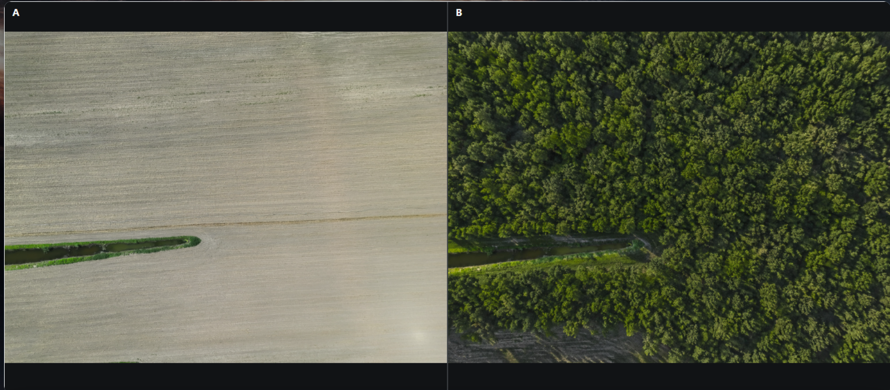

#### 十八：水面污染

```
PROMPT = ("对原图进行受控的水面污染编辑：仅修改原图中已经存在的河流、沟渠、池塘或其他真实水面，在其中生成一处中等程度、航拍视角下清晰可见且符合真实水流规律的水面污染区域。禁止新建、扩大、缩小或填平任何水体，不得改变原有河道宽度、流向、岸线形状、岛屿轮廓和水陆边界。污染应主要集中在一片连续水域内，从靠近原有岸边、支流交汇处或水流相对缓慢的位置自然形成，并顺着原有水流方向向外扩散。污染区呈不规则羽状、带状或云团状分布，边缘柔和、破碎且浓淡渐变，不能形成规则圆形、矩形、直线边界或人工涂抹形状。污染区域约占可见水面的百分之二十至百分之四十，必须明显可辨，但不能覆盖全部水面。污染主体表现为真实的灰绿色、暗褐绿色和少量浑浊黄褐色水体。靠近污染来源或滞水区域颜色较深、透明度较低，向外围逐渐变淡并自然融入原有水色。局部加入少量不连续的灰白色污水泡沫、细碎浮沫和薄层表面污膜；泡沫沿水流边缘、回水区和岸边自然聚集，不能铺满整片河面。在污染最明显的位置可以出现少量真实、细小、尺度符合高空航拍距离的漂浮生活垃圾，包括零散的半透明塑料袋、白色泡沫餐盒、浅色塑料瓶和低饱和包装碎片。漂浮物应形成一至三处疏松的小型聚集带，主要靠近岸边、水草边缘或缓流区，单个物品不能过大，不能在航拍画面中呈现清晰的近景细节，也不能形成垃圾山。污染水面仍须保留真实的水面属性：原有波纹、水流纹理、天空反射、树木倒影和太阳反光应部分可见，污染膜应随波纹发生细微变形。允许污染区的反光变弱、颜色变暗，并出现轻微不规则油膜光泽，但不能生成大面积彩虹色油膜、镜面金属效果或纯黑水面。严格保持原图的无人机高空俯拍视角、航拍高度、构图、透视、光照方向和原始分辨率。污染物的尺寸、清晰度、色温、曝光、颗粒感、压缩噪声和边缘柔度必须与原始航拍照片一致，使污染像真实存在于原水面中，而不是覆盖在照片上的半透明色块、贴纸或后期涂层。除现有水面内部的污染、水色变化、少量浮沫和漂浮物外，原图中的岸线、水草、芦苇、荷叶、树木、岛屿、泥滩、道路、建筑、船只、车辆和所有背景必须保持原样。不得在岸边新增排污管、工厂、房屋、平台、码头、道路、围栏或其他设施；不得改变船只、植被和陆地结构，不得添加文字、边框、箭头、圆圈或任何标注。生成一张阴影干扰明显的白天后时相无人机图像。建筑、树木和围墙投影比原图明显更深、更长，多个阴影覆盖道路、院落、屋顶边缘和空地局部，形成容易被误检为变化的灰黑色投影区域。所有阴影必须方向一致，边缘自然柔和，不能是纯黑色块。不要改变任何建筑、道路、树木、农田、车辆和地物结构。")

NEGATIVE_PROMPT = ("干净无污染水面，污染完全不可见，污染范围过小，只有轻微调色，整条河全部变色，全部水面被污染覆盖，纯黑河水，墨水般黑水，血红色水面，荧光绿色水面，亮蓝色化学液体，紫色污水，颜色过度饱和，卡通污染，规则圆形污染，规则矩形污染，直线污染边界，硬边色块，渐变滤镜，绿色滤镜，棕色滤镜，透明贴图，贴纸效果，油漆涂抹，污染悬浮在水面上方，污染与波纹分离，重复纹理，复制粘贴泡沫，规则排列的垃圾，大面积彩虹油膜，金属镜面，汽油彩虹覆盖整条河，厚重油漆，沥青水面，泡沫覆盖全部水面，巨大泡沫团，雪花状泡沫，规则白色圆点，肥皂泡，海浪，巨浪，垃圾山，大型垃圾岛，满河垃圾，密集塑料瓶，巨大塑料袋，巨大餐盒，漂浮汽车，漂浮家具，漂浮集装箱，建筑垃圾，砖块，水泥块，钢筋，木板，动物尸体，鱼群尸体，夸张死鱼，人物，清洁船，打捞人员，新增排污管，新增下水口，新增工厂，新增房屋，新增建筑群，新增码头，新增平台，新增道路，新增桥梁，新增围墙，新增垃圾站，新增船只，扩大河道，缩小河道，填平水面，新建水面，改变河流方向，改变岸线，改变岛屿轮廓，改变泥滩，改变水草，改变芦苇，改变荷叶，改变树木，改变道路建筑车辆，背景重建，大面积重绘，水面波纹完全消失，太阳反光完全消失，新增多个太阳倒影，反光位置错误，光照方向错误，强烈光晕，过度曝光，整幅画面变暗，整幅画面变色，透视改变，航拍高度改变，画面裁切，旋转画面，低清晰度，过度模糊，过度锐化，3D渲染，游戏地图，油画，插画，卡通，红框，矩形框，检测框，标注线，箭头，圆圈，文字，数字，标签，水印，标志")
```

**效果图**A→B

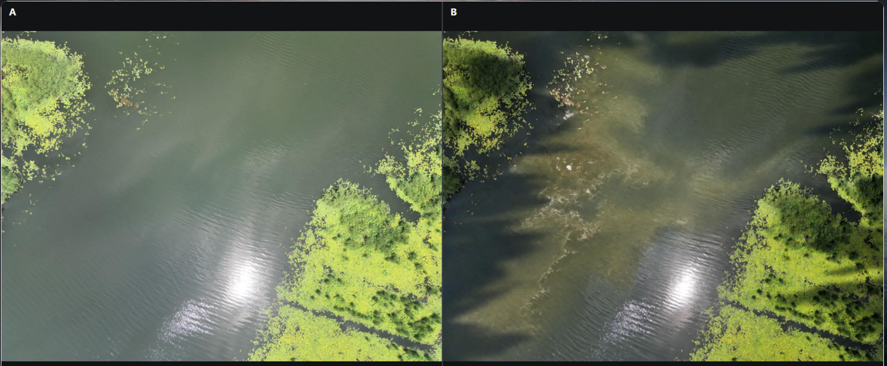

#### 十九：水域转陆域

提示词：

```
PROMPT = ("对原图进行受控的水域转道路编辑：仅将原图中指定的河流、沟渠、池塘或其他水面区域改造为真实道路，道路必须严格限制在原有水域范围以内，沿原河道或水体的走向自然延伸。不得超出原有水陆边界，不得侵占周围农田、植被、建筑、泥滩或其他陆地区域。移除指定区域内的水面、水色、波纹、倒影、漂浮物和水生植物，将其转换为连续、可通行的道路路面。道路的宽度和轮廓应尽量继承原水体的整体形状，但需要对局部边缘进行合理的道路工程化处理，使道路边缘自然、连续、稳定，避免完全复制河岸的细碎曲线。生成一条真实的双向沥青道路，路面呈低饱和深灰色，具有细微的沥青颗粒、车轮磨损、少量自然色差和符合航拍尺度的路面接缝。根据道路宽度添加合理的白色或黄色中心线、道路边缘线和少量必要的转弯引导线。所有标线必须符合真实道路透视和航拍比例，不能过粗、过亮、重复或超出路面。道路应顺着原水域的主要走向自然弯曲，在较宽水面区域形成合理的缓弯或稍宽路段，在狭窄区域保持道路宽度基本稳定。道路连接画面中已有道路时，应形成自然、可通行的交叉口或衔接段；如果原水域没有连接现有道路，则让道路从画面边缘自然进入和离开，不得无故终止在画面内部。原有河岸或池岸改造为真实的道路路肩、边坡和窄幅排水带。道路两侧可保留少量压实土壤、碎石路肩、浅色边坡和细窄排水沟，但不得重新生成大面积水体。原岸边植被应尽量保留，只允许在紧邻路面的必要范围内出现轻微、合理的施工清理痕迹。严格保持原图的无人机高空俯拍视角、航拍高度、画面构图、透视关系、光照方向、阴影、天气条件、色温、曝光和原始分辨率。新道路的清晰度、颗粒感、压缩噪声、边缘柔度和空间尺度必须与原始航拍照片一致，使道路像真实修建在原水域位置，而不是覆盖在照片上的灰色色块或贴图。除指定水域转换为道路及其必要的路肩、边坡和排水结构外，原图中的农田、树木、草地、建筑、车辆、既有道路、桥梁、岛屿和所有背景必须保持原样。不得新增无关建筑、工厂、停车场、收费站、人物、施工机械或大型交通设施，不得改变非目标区域的地形与土地用途，不得添加文字、箭头、边框、圆圈、水印或任何标注。生成一张阴影干扰明显的白天后时相无人机图像。建筑、树木和围墙投影比原图明显更深、更长，多个阴影覆盖道路、院落、屋顶边缘和空地局部，形成容易被误检为变化的灰黑色投影区域。所有阴影必须方向一致，边缘自然柔和，不能是纯黑色块。不要改变任何建筑、道路、树木、农田、车辆和地物结构。")

NEGATIVE_PROMPT = ("保留河水，残留水面，路面出现波纹，路面出现水面倒影，水中道路，道路漂浮在水面上，道路与原水域重叠，河流和道路同时存在，大面积积水，洪水，湿地，沼泽，池塘，道路超出原水域范围，侵占农田，破坏建筑，破坏树木，大面积砍伐植被，改变非目标区域，改变整体地形，改变画面构图，改变航拍高度，改变透视，背景重建，大面积重绘，道路宽度忽大忽小，道路无故中断，断头路，道路无法通行，畸形交叉口，急剧折线道路，不合理发卡弯，重复道路，多层道路，新增高架桥，新增大型桥梁，新增隧道，路面边缘锯齿，硬边灰色色块，透明贴图，贴纸效果，复制粘贴纹理，过宽标线，发光标线，错误交通标线，密集箭头，重复斑马线，文字标识，巨大车辆，密集车流，交通堵塞，施工现场，挖掘机，起重机，工人，收费站，服务区，停车场，整幅画面变暗，整幅画面变色，错误光照，错误阴影，过度曝光，过度锐化，过度模糊，低清晰度，3D渲染，游戏地图，城市规划图，卫星地图标注，油画，插画，卡通，红框，检测框，箭头，圆圈，文字，数字，标签，水印，标志")
```

**效果图**A→B

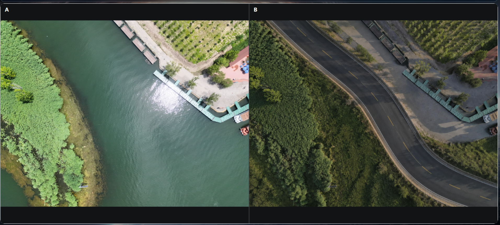


#### 二十：楼顶随机纸箱子

提示词：

```
PROMPT = ("编辑输入的无人机航拍图片。先准确识别画面中建筑物的屋顶轮廓，只允许在建筑屋顶平面内部新增物体。在画面中一栋边界清晰、面积较大的平坦建筑屋顶上，自然放置一个小型棕黄色瓦楞纸箱。纸箱必须完整位于屋顶女儿墙内侧，优先放在屋顶空旷区域、女儿墙内侧墙角或屋顶设备附近。纸箱的主体、底部及其全部阴影都必须落在同一屋顶平面内，不得接触或越过屋顶边缘，不得出现在院落、道路、空地、农田、绿地、建筑之间或任何非屋顶区域。纸箱体积较小，实际尺寸约为30至50厘米，在整张高空航拍图中只占很小面积。纸箱大小约为屋顶小型设备箱的三分之一，不得生成醒目或尺寸过大的纸箱。纸箱略微陈旧，箱口自然半开，瓦楞纸板表面有轻微折痕、凹陷、磨损和少量灰尘，颜色为低饱和度的棕黄色，没有文字、品牌标志、快递单和醒目标签。严格匹配原图的无人机垂直俯拍角度、航拍高度、真实比例、透视关系、光照方向、色温、清晰度和图像噪点。纸箱底部紧贴建筑屋面，并只在屋顶平面上产生范围很小、方向正确、边缘柔和的自然接触阴影。纸箱边缘与屋面自然融合，看起来原本就放置在该屋顶上。保留原图已有的建筑、树木和围墙阴影特征，所有阴影方向保持一致，边缘自然柔和，不得形成纯黑色块。只新增一个屋顶纸箱，除此之外完整保留原图内容，不得改变建筑结构、屋顶设备、管线、墙体、道路、院落、树木、农田、车辆及周围背景。阴影干扰明显的白天后时相无人机图像。建筑、树木和围墙投影比原图明显更深、更长，多个阴影覆盖道路、院落、屋顶边缘和空地局部，形成容易被误检为变化的灰黑色投影区域。所有阴影必须方向一致，边缘自然柔和，不能是纯黑色块。不要改变任何建筑、道路、树木、农田、车辆和地物结构。")

NEGATIVE_PROMPT = ("纸箱位于地面，纸箱位于院子，纸箱位于道路，纸箱位于街道，纸箱位于空地，纸箱位于农田，纸箱位于绿地，纸箱位于树下，纸箱位于建筑之间，纸箱位于屋檐外，纸箱位于墙体上，纸箱越过屋顶边缘，纸箱放在女儿墙外侧，纸箱阴影落到屋顶之外，非屋顶区域出现纸箱，多个纸箱，大型纸箱，纸箱堆，纸箱铺满屋顶，塑料箱，木箱，彩色包装箱，垃圾桶，完整垃圾堆，快递文字，品牌标志，快递单，二维码，醒目标签，人物，新增车辆，施工机械，尺寸过大，比例失真，物体悬浮，纸箱嵌入屋面，透视错误，光照方向不一致，阴影过重，纯黑阴影，边缘发光，边缘模糊，过度锐化，卡通风格，绘画效果，三维渲染感，明显合成痕迹，红色标注框，修改屋顶结构，移动屋顶设备，覆盖管线，改变建筑，改变道路，改变院落，改变树木，改变农田，修改原图背景")
```

**效果图A→B**

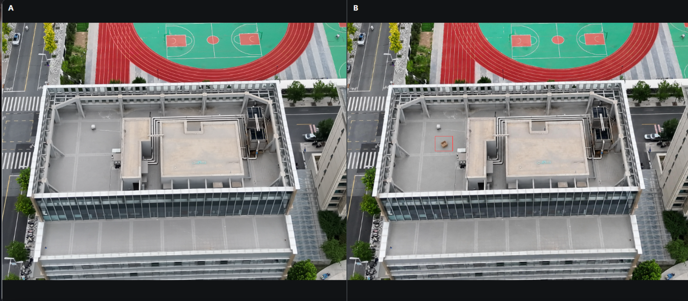

#### 二十一：楼顶随机破旧家具

提示词：

```
PROMPT = ("编辑输入的楼顶航拍图片，在楼顶一处空旷地面上自然添加少量废旧家具。废旧家具由一把破损的木质椅子和一个小型旧木柜组成，紧靠在一起随意摆放，表面褪色、积灰，带有轻微掉漆、划痕、破损边角和长期日晒雨淋的痕迹，整体颜色为暗棕色和灰褐色，不鲜艳、不崭新。家具尺寸必须符合真实比例，在整张航拍图中面积较小，整体宽度约为附近白色楼顶设备箱宽度的二分之一，不得生成大型家具堆，不得占用大片楼顶区域。严格匹配原图的无人机高空俯拍角度、透视比例、拍摄高度、光照方向、色温、清晰度和图像噪点。家具底部紧贴楼顶地面，产生微弱、自然且方向一致的接触阴影，边缘与原图自然融合，呈现真实航拍摄影效果。只新增这两件小型废旧家具，完整保留原图的建筑结构、设备、管线、墙体、道路和其他背景，不得修改任何原有内容。")

NEGATIVE_PROMPT = ("全新家具，豪华家具，现代家具，鲜艳颜色，完整家具套装，大型沙发，双人床，床垫，大衣柜，办公桌，大型家具堆，过多家具，家具占据大片楼顶，比例过大，尺寸失真，多个重复物体，纸箱，垃圾袋，生活用品，人物，动物，家具悬浮，家具嵌入地面，透视错误，俯拍角度错误，阴影过大，阴影过重，光照不一致，边缘发光，边缘模糊，卡通风格，绘画感，三维渲染感，明显合成痕迹，改变楼顶结构，遮挡重要设备，移动设备，修改管线或背景")
```

**效果图A→B**

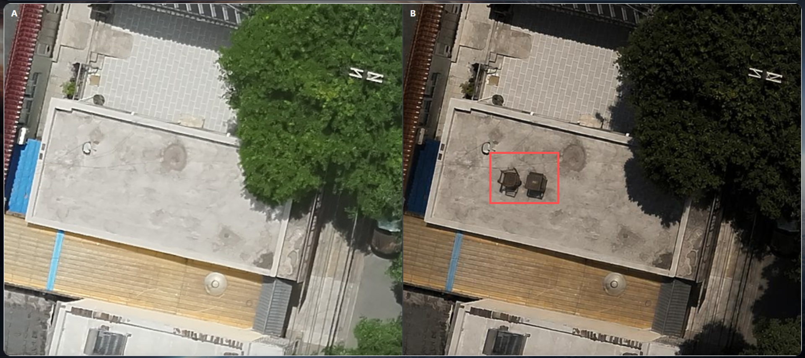

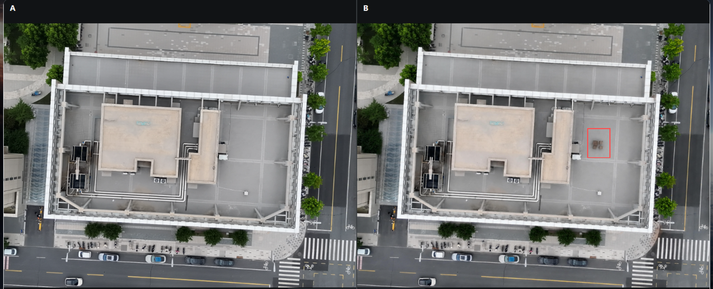

#### 二十二：楼顶太阳能板

提示词：

```
PROMPT = ("编辑输入的楼顶航拍图片，在楼顶空旷区域安装一至两处中等规模的太阳能光伏板阵列。太阳能板总数控制在12至20块之间，不得少于12块，也不得超过20块。如果只生成一处阵列，则由12至16块面板组成，排列为3排4块或4排4块；如果生成两处阵列，则每处由6至10块面板组成，两处总数保持在12至20块之间。两处阵列应分别位于两个合适的空旷区域，排列规整，但不得分散到屋顶各个角落。面板为标准矩形深黑灰色晶硅光伏板，具有细密规则的电池网格线、窄银灰色铝合金边框和清晰自然的面板拼接缝。所有面板方向统一、横平竖直、等距排列，采用低矮支架贴近屋面安装，仅带有轻微且一致的倾斜角度。光伏阵列总面积约占可见楼顶面积的15%至25%，既不能只有零星几块，也不能大面积铺满整个屋顶。避开设备房、空调、冷却塔、管线、排水口和屋顶边缘，在阵列周围保留清晰的消防及检修通道。严格匹配输入图片的无人机俯拍角度、航拍高度、透视比例、光照方向、色温、清晰度和图像噪点。面板具有轻微自然反射和淡薄阴影，边缘真实融合。除新增太阳能板和低矮支架外，完整保留原图其他内容。")

NEGATIVE_PROMPT = ("少于12块太阳能板，仅生成4块，仅生成6块，零星面板，超过20块太阳能板，三处或更多阵列，大面积密集铺设，铺满整个屋顶，连续超长阵列，屋顶所有空隙都有面板，重复面板，排列杂乱，方向不一致，间距过大，面板重叠，高支架，大角度倾斜，悬浮面板，越过屋顶边缘，覆盖设备房，遮挡空调、冷却塔或管线，堵塞消防通道，强烈镜面反光，过曝，鲜艳蓝色，发光面板，尺寸失真，透视错误，阴影过重，边缘发光，卡通感，明显合成痕迹，改变建筑结构，移动原有设备，修改管线、道路或背景")
```

**效果图A→B**

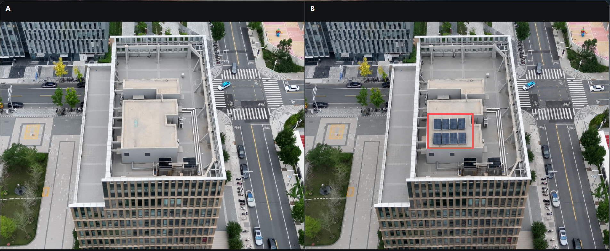

密集太阳能板：

```
PROMPT = ("编辑输入的楼顶航拍图片，在楼顶空旷区域安装一至两处中等规模的太阳能光伏板阵列。太阳能板总数控制在12至20块之间，不得少于12块，也不得超过20块。如果只生成一处阵列，则由12至16块面板组成，排列为3排4块或4排4块；如果生成两处阵列，则每处由6至10块面板组成，两处总数保持在12至20块之间。两处阵列应分别位于两个合适的空旷区域，排列规整，但不得分散到屋顶各个角落。面板为标准矩形深黑灰色晶硅光伏板，具有细密规则的电池网格线、窄银灰色铝合金边框和清晰自然的面板拼接缝。所有面板方向统一、横平竖直、等距排列，采用低矮支架贴近屋面安装，仅带有轻微且一致的倾斜角度。光伏阵列总面积约占可见楼顶面积的15%至25%，既不能只有零星几块，也不能大面积铺满整个屋顶。避开设备房、空调、冷却塔、管线、排水口和屋顶边缘，在阵列周围保留清晰的消防及检修通道。严格匹配输入图片的无人机俯拍角度、航拍高度、透视比例、光照方向、色温、清晰度和图像噪点。面板具有轻微自然反射和淡薄阴影，边缘真实融合。除新增太阳能板和低矮支架外，完整保留原图其他内容。")

NEGATIVE_PROMPT = ("少于12块太阳能板，仅生成4块，仅生成6块，零星面板，超过20块太阳能板，三处或更多阵列，大面积密集铺设，铺满整个屋顶，连续超长阵列，屋顶所有空隙都有面板，重复面板，排列杂乱，方向不一致，间距过大，面板重叠，高支架，大角度倾斜，悬浮面板，越过屋顶边缘，覆盖设备房，遮挡空调、冷却塔或管线，堵塞消防通道，强烈镜面反光，过曝，鲜艳蓝色，发光面板，尺寸失真，透视错误，阴影过重，边缘发光，卡通感，明显合成痕迹，改变建筑结构，移动原有设备，修改管线、道路或背景")
```

#### 二十三：楼顶轮胎

提示词：

```
PROMPT = ("编辑输入的无人机航拍图片。首先准确识别画面中的建筑物、平坦屋顶平面、屋顶边缘及女儿墙轮廓。所有新增轮胎只能生成在同一栋建筑的屋顶平面内部。选择一栋边界清晰、面积较大的平坦建筑屋顶，仅在屋顶女儿墙内侧的空旷区域、屋顶墙角或设备附近，自然添加一小组3至5个废旧汽车轮胎。轮胎与屋顶边缘、屋檐和女儿墙保持明显安全距离。每个轮胎的主体、底部、接触点以及全部阴影，都必须完整落在同一栋建筑的屋顶平面范围内。轮胎不得接触或越过屋顶边界，不得放在女儿墙顶部或外侧。不得将轮胎生成在院落、道路、街道、停车场、空地、农田、绿地、树木附近、建筑之间或其他任何非屋顶区域。所有轮胎集中放置在屋顶同一处小范围内，只形成一组，不得分散至多个屋顶或屋顶的不同位置。其中2至3个轮胎平放在屋面上，可以轻微错位叠放；另外1个轮胎可以倾斜放置或斜靠在轮胎堆旁边。整体摆放自然、松散且略微凌乱，堆叠高度不得超过两个轮胎。轮胎为普通小汽车轮胎，实际直径约60至70厘米，宽度约18至23厘米，尺寸符合真实比例。整组轮胎在高空航拍图中只占很小面积，整体占地宽度约为附近白色屋顶设备箱宽度的二分之一至三分之二，不得生成尺寸醒目或比例过大的轮胎。轮胎呈低反光的暗黑色、灰黑色或褪色黑色。橡胶表面老化、积灰并轻微褪色，带有磨损胎纹、少量灰褐色污渍及长期日晒雨淋形成的陈旧痕迹。轮胎中心孔和圆环结构清楚自然，但不得带有轮毂。轮胎不得像新品一样乌黑、洁净或具有强烈光泽。严格匹配输入图片的无人机高空垂直俯拍角度、航拍高度、透视关系、真实尺度、光照方向、色温、清晰度和图像噪点。轮胎底部紧贴建筑屋面，不得悬浮或嵌入屋面。所有接触阴影只能落在同一屋顶平面内部，阴影方向与原图一致，范围较小、颜色较淡、边缘自然柔和。轮胎的清晰度、材质和边缘与屋面自然融合，呈现真实的无人机航拍摄影效果。阴影干扰明显的白天后时相无人机图像。建筑、树木和围墙投影比原图明显更深、更长，多个阴影覆盖道路、院落、屋顶边缘和空地局部，形成容易被误检为变化的灰黑色投影区域。所有阴影必须方向一致，边缘自然柔和，不能是纯黑色块。不要改变任何建筑、道路、树木、农田、车辆和地物结构。轮胎不得遮挡屋顶设备、管线、排水口、检修口和消防通道。只新增这一组屋顶废旧轮胎，除此之外完整保留原图内容。不得改变建筑结构、屋顶形状、女儿墙、设备、管线、道路、院落、树木、农田、车辆及周围背景。")

NEGATIVE_PROMPT = ("轮胎生成在地面，轮胎生成在院子，轮胎生成在道路，轮胎生成在街道，轮胎生成在停车场，轮胎生成在空地，轮胎生成在农田，轮胎生成在绿地，轮胎生成在树木旁，轮胎生成在建筑之间，轮胎生成在任何非屋顶区域，轮胎生成在另一个屋顶，轮胎位于墙体表面，轮胎位于女儿墙顶部，轮胎位于女儿墙外侧，轮胎接触屋顶边缘，轮胎越过屋檐，轮胎跨越屋顶边界，轮胎阴影落在屋顶之外，大量轮胎，多组轮胎，多处轮胎，分散摆放的轮胎，轮胎分布在多个屋顶，超过5个轮胎，轮胎铺满屋顶，堆叠超过两层，巨型轮胎，卡车轮胎，工程车轮胎，自行车轮胎，摩托车轮胎，彩色轮胎，燃烧轮胎，全新轮胎，轮胎乌黑发亮，湿润轮胎，完整车轮，汽车轮毂，金属轮圈，汽车零件，车辆，机械设备，纸箱，家具，垃圾袋，生活垃圾，人物，动物，尺寸过大，比例失真，轮胎严重变形，中心孔消失，圆环结构错误，重复物体，轮胎悬浮，轮胎嵌入屋面，摆放过于整齐，错误透视，俯拍角度错误，光照方向不一致，阴影落在地面，阴影过大，阴影过重，纯黑阴影，边缘发光，边缘模糊，过度锐化，卡通风格，绘画效果，三维渲染感，明显合成痕迹，遮挡屋顶设备，覆盖屋顶管线，堵塞排水口，堵塞检修通道，改变屋顶结构，改变女儿墙，移动原有设备，修改建筑、道路、院落、树木、农田、车辆或背景")
```

**效果图**A→B

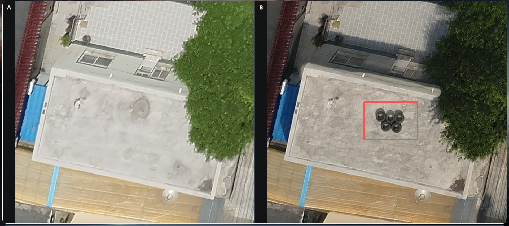

#### 二十四：混合垃圾，蓝色塑料

提示词：

```
PROMPT = ("编辑输入的无人机航拍图片。首先准确识别画面中的建筑物、平坦屋面、屋顶边缘、屋檐以及女儿墙轮廓。所有新增内容只能生成在同一栋建筑的屋顶平面内部，禁止在任何非屋顶区域新增物体。选择一栋边界清晰、面积较大的平坦建筑屋顶，只在女儿墙内侧的空旷屋面、屋顶墙角或设备附近，自然添加一处以蓝色塑料废料为主要特征的小型混合建筑垃圾堆。垃圾堆与屋顶边缘、屋檐和女儿墙保持明显安全距离。垃圾堆的主体、底部、所有零散碎片以及全部阴影，必须完整落在同一栋建筑的屋顶平面范围内。任何垃圾都不得接触、跨越或掉落到屋顶边界之外，不得放在女儿墙顶部或外侧。不得将垃圾生成在院落、道路、街道、停车场、地面空地、农田、绿地、树木附近、建筑之间或其他任何非屋顶区域。混合建筑垃圾包括2至3个破旧的蓝色塑料编织袋、一小块皱褶破损的蓝色塑料布、少量蓝色PVC管材边角料，并混合少量碎木板、旧纸板、灰色水泥块、砖块碎片和包装泡沫。所有垃圾集中在屋顶同一处，只形成一堆，摆放松散、凌乱、不规则，但不过度分散。少量碎片只能散落在垃圾堆周围很小的范围内。蓝色塑料材料应略微褪色、积灰、起皱并有局部破损，颜色以低饱和度的灰蓝色、旧蓝色和暗蓝色为主。塑料布具有自然褶皱和轻微反光，但不得生成鲜艳、洁净、高饱和度的亮蓝色塑料，也不得形成覆盖大片屋顶的完整篷布。木板、纸板、水泥块、砖块和泡沫数量较少，作为混合成分自然夹杂在蓝色塑料废料之间。垃圾堆呈低矮、松散、不规则的小型建筑废料堆，实际长度约1.5至2.5米，宽度约0.8至1.5米，整体高度不超过40至60厘米。垃圾堆只占目标屋顶可见面积约1%至3%，在整张高空航拍图中面积较小，不得形成大型垃圾山。严格匹配原图的无人机高空垂直俯拍角度、航拍高度、真实尺度、透视关系、光照方向、色温、清晰度和图像噪点。所有垃圾紧贴建筑屋面，不得悬浮或嵌入屋面。垃圾产生的全部接触阴影只能落在同一屋顶平面内部，阴影方向与原图一致，范围较小、颜色较淡、边缘自然柔和。垃圾材质、清晰度和边缘与屋面自然融合，呈现真实的无人机航拍摄影效果。阴影干扰明显的白天后时相无人机图像。建筑、树木和围墙投影比原图明显更深、更长，多个阴影覆盖道路、院落、屋顶边缘和空地局部，形成容易被误检为变化的灰黑色投影区域。所有阴影必须方向一致，边缘自然柔和，不能是纯黑色块。不要改变任何建筑、道路、树木、农田、车辆和地物结构。垃圾堆不得遮挡屋顶原有设备、管线、排水口、检修口和消防通道。只新增这一处位于屋顶内部的蓝色塑料混合建筑垃圾，除此之外完整保留原图中的建筑结构、屋顶形状、女儿墙、设备、管线、道路、院落、树木、农田、车辆及周围背景。")

NEGATIVE_PROMPT = ("垃圾生成在地面，垃圾生成在院子，垃圾生成在道路，垃圾生成在街道，垃圾生成在停车场，垃圾生成在空地，垃圾生成在农田，垃圾生成在绿地，垃圾生成在树木旁，垃圾生成在建筑之间，垃圾生成在任何非屋顶区域，垃圾生成在其他屋顶，垃圾位于墙体表面，垃圾位于女儿墙顶部，垃圾位于女儿墙外侧，垃圾接触屋顶边缘，垃圾越过屋檐，垃圾跨越屋顶边界，垃圾从屋顶掉落，垃圾碎片散落在屋顶之外，垃圾阴影落在屋顶之外，多处垃圾堆，多栋屋顶出现垃圾，大面积垃圾，垃圾铺满屋顶，大型垃圾山，生活垃圾场，过度分散的垃圾，大量零散碎片，整齐码放的材料，只有单一蓝色物体，重复垃圾袋，大量相同物体，全新塑料袋，完整蓝色帐篷，巨大蓝色塑料布，完整蓝色篷布覆盖屋顶，高饱和亮蓝色，荧光蓝色，大量食物垃圾，厨余垃圾，医疗垃圾，动物尸体，巨型垃圾，比例过大，垃圾悬浮，废料嵌入屋面，塑料表面像金属，物体严重变形，重复纹理，错误透视，俯拍角度错误，光照方向不一致，阴影落到地面，阴影过大，阴影过重，纯黑阴影，边缘发光，边缘模糊，过度锐化，卡通风格，绘画效果，三维渲染感，明显合成痕迹，人物，动物，新增车辆，施工机械，遮挡屋顶设备，覆盖屋顶管线，堵塞排水口，堵塞检修通道，改变屋顶结构，改变女儿墙，移动原有设备，修改建筑、道路、院落、树木、农田、车辆或背景")
```


效果图：A→B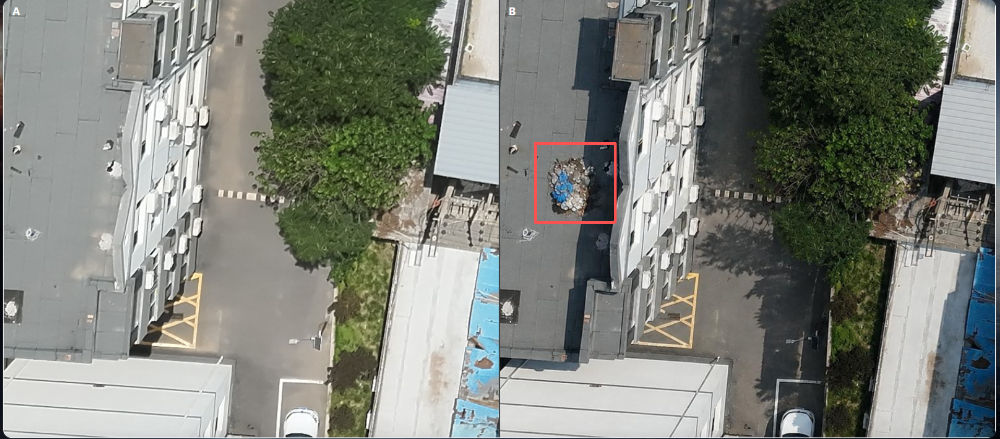


#### 二十五：泡沫板(带阴影)

提示词：

```
PROMPT = ("编辑输入的无人机航拍图片。首先准确识别画面中的建筑物及其屋顶轮廓，所有新增物体必须完整位于同一栋建筑的屋顶平面内部。只在一栋边界清晰、面积较大的平坦建筑屋顶上，自然添加一小堆废旧泡沫保温板。泡沫板优先放置在屋顶空旷区域、女儿墙内侧墙角或屋顶设备附近，并与屋顶边缘、屋檐和女儿墙保持安全距离。泡沫板的主体、底部、碎屑及全部阴影都必须落在同一屋顶平面内，不得接触或越过屋顶边界。不得将泡沫板生成在院落、道路、街道、空地、农田、绿地、树木附近、建筑之间或其他任何非屋顶区域。生成一处由5至8块废旧泡沫保温板组成的小型材料堆。泡沫板为常见白色、灰白色或浅灰色矩形板材，大小和厚度略有差异，以低矮方式叠放在屋顶同一处。板材排列不完全整齐，存在轻微错位、倾斜和交叠，其中1至2块可以平放在材料堆边缘，但不得散落到其他位置。泡沫板表面略微发黄、褪色并沾有灰尘和水泥粉末，带有轻微凹痕、污渍、磨损和不规则碎裂边缘。部分板材边角缺损或断裂，露出真实的泡沫颗粒结构，但不得产生大量细小碎屑，不得显得纯白、崭新或整洁。整堆泡沫板呈低矮、扁平、不规则的废旧建筑材料堆。实际占地约1.5至2.5米长、0.8至1.5米宽，整体高度不超过40至50厘米。材料堆在整张高空航拍图中只占很小面积，约占可见屋顶面积的1%至3%，不得形成大型堆垛。严格匹配输入图片的无人机高空垂直俯拍角度、航拍高度、真实比例、透视关系、光照方向、色温、清晰度和图像噪点。所有泡沫板底部紧贴建筑屋面，不得悬浮或嵌入屋面。接触阴影只能落在同一屋顶平面上，方向与原图一致，范围较小、深浅合理且边缘自然柔和。泡沫板的材质和边缘与屋面真实融合，呈现原生航拍摄影效果。泡沫板不得遮挡屋顶设备、管线、排水口、检修口和消防通道。只新增这一处屋顶废旧泡沫板，除此之外完整保留原图内容。不得改变建筑结构、屋顶形状、女儿墙、设备、管线、道路、院落、树木、农田、车辆及周围背景。阴影干扰明显的白天后时相无人机图像。建筑、树木和围墙投影比原图明显更深、更长，多个阴影覆盖道路、院落、屋顶边缘和空地局部，形成容易被误检为变化的灰黑色投影区域。所有阴影必须方向一致，边缘自然柔和，不能是纯黑色块。不要改变任何建筑、道路、树木、农田、车辆和地物结构。")

NEGATIVE_PROMPT = ("木材，木板，木方，木条，原木，树枝，胶合板，家具板，完整家具，木材堆，木材仓库，金属废料，纸箱堆，生活垃圾，泡沫板出现在地面，泡沫板出现在院子，泡沫板出现在道路，泡沫板出现在街道，泡沫板出现在空地，泡沫板出现在农田，泡沫板出现在绿地，泡沫板出现在树木旁，泡沫板出现在建筑之间，泡沫板出现在任何非屋顶区域，泡沫板位于墙体表面，泡沫板位于女儿墙外侧，泡沫板接触屋顶边缘，泡沫板越过屋檐，泡沫板阴影落在屋顶之外，多处泡沫板堆，大量泡沫板，泡沫板铺满屋顶，超高堆垛，巨大泡沫板，大量泡沫碎屑，碎屑四处散落，纯白崭新泡沫板，整齐包装的泡沫板，彩色泡沫板，塑料薄膜，塑料袋，纸板，石膏板，金属板，人物，新增车辆，施工机械，材料悬浮，材料嵌入屋面，板材严重弯曲，比例失真，重复纹理，重复物体，错误透视，光照方向不一致，阴影落到地面，阴影过重，纯黑阴影，边缘发光，边缘模糊，过度锐化，卡通风格，绘画效果，三维渲染感，明显合成痕迹，红色标注框，遮挡屋顶设备，覆盖屋顶管线，堵塞排水口，堵塞消防通道，改变屋顶结构，改变女儿墙，移动原有设备，修改建筑、道路、院落、树木、农田、车辆或背景")
```

**效果图** A→B

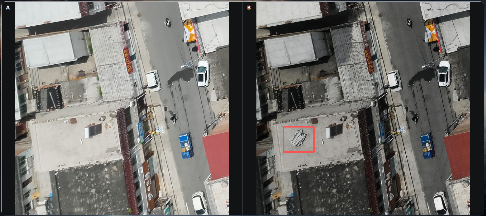


#### 二十六：油漆桶(带阴影)

提示词：

```
PROMPT = ("编辑输入的无人机航拍图片。首先准确识别画面中的建筑物及其屋顶轮廓，所有新增油漆桶必须完整位于同一栋建筑的屋顶平面内部。只在一栋边界清晰、面积较大的平坦建筑屋顶上，自然添加一小组废旧金属油漆桶。优先放置在屋顶空旷区域、女儿墙内侧墙角或屋顶设备附近，与屋顶边缘保持安全距离。油漆桶的主体、底部及其全部阴影必须落在同一屋顶平面内，不得接触或越过屋顶边缘、屋檐和女儿墙。不得将油漆桶生成在院落、道路、街道、空地、农田、绿地、树木附近、建筑之间或其他任何非屋顶区域。生成3至5个常见圆柱形金属油漆桶，集中摆放在屋顶的同一处。其中2至3个直立放置，另外1个可以轻微倾斜或侧倒，彼此距离较近，排列自然、略显凌乱，但不能堆叠。油漆桶为常见10至20升规格，实际高度约35至40厘米，直径约25至30厘米。整组油漆桶在高空航拍图中只占很小面积，整体占地宽度约为附近白色屋顶设备箱宽度的二分之一，不得生成尺寸醒目或比例过大的油桶。桶身以低饱和度的旧白色、灰色和暗蓝色为主，表面带有灰尘、褪色、划痕、轻微锈迹、少量干燥油漆滴痕和局部污渍。桶盖和细小金属提手自然可见，部分桶盖可以轻微变形或没有完全盖严，但不得出现明显液体或大面积油漆泄漏。油漆桶应呈现长期放置在室外屋顶后的陈旧状态。严格匹配输入图片的无人机高空垂直俯拍角度、航拍高度、透视比例、真实尺度、太阳光照方向、色温、清晰度和图像噪点。油漆桶底部紧贴建筑屋面，不得悬浮或陷入屋面。接触阴影只能落在同一屋顶平面上，范围较小、方向一致、深浅合理且边缘自然柔和。油漆桶边缘与屋面真实融合，呈现原生航拍摄影效果。油漆桶不得遮挡屋顶原有设备、管线、排水口、检修口和消防通道。只新增这一组屋顶废旧油漆桶，除此之外完整保留原图内容。不得改变建筑结构、屋顶形状、女儿墙、设备、管线、道路、院落、树木、农田、车辆及周围背景。阴影干扰明显的白天后时相无人机图像。建筑、树木和围墙投影比原图明显更深、更长，多个阴影覆盖道路、院落、屋顶边缘和空地局部，形成容易被误检为变化的灰黑色投影区域。所有阴影必须方向一致，边缘自然柔和，不能是纯黑色块。不要改变任何建筑、道路、树木、农田、车辆和地物结构。")

NEGATIVE_PROMPT = ("油漆桶出现在地面，油漆桶出现在院子，油漆桶出现在道路，油漆桶出现在街道，油漆桶出现在空地，油漆桶出现在农田，油漆桶出现在绿地，油漆桶出现在树木旁，油漆桶出现在建筑之间，油漆桶出现在任何非屋顶区域，油漆桶位于墙体表面，油漆桶位于女儿墙外侧，油漆桶接触屋顶边缘，油漆桶越过屋檐，油漆桶阴影落在屋顶之外，大量油漆桶，多组油漆桶，多处油漆桶，超过5个油漆桶，油漆桶铺满屋顶，桶体堆叠，巨型油桶，工业储油罐，汽油桶，燃气瓶，塑料垃圾桶，水桶，全新油漆桶，鲜艳包装，鲜艳颜色，清晰品牌标志，广告文字，警示文字，二维码，醒目标签，大量油漆泄漏，大面积彩色液体，夸张污渍，火焰，烟雾，爆炸，人物，新增车辆，施工机械，尺寸过大，比例失真，桶体悬浮，桶体嵌入屋面，形状扭曲，重复物体，错误透视，光照方向不一致，阴影落到地面，阴影过重，纯黑阴影，边缘发光，边缘模糊，过度锐化，卡通风格，绘画效果，三维渲染感，明显合成痕迹，红色标注框，遮挡屋顶设备，覆盖屋顶管线，堵塞排水口，堵塞检修通道，改变屋顶结构，改变女儿墙，移动原有设备，修改建筑、道路、院落、树木、农田、车辆或背景")
```

**效果图** A→B

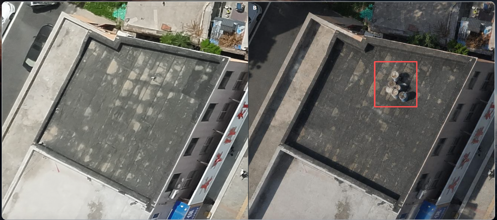

#### 二十七：楼顶绿色建筑垃圾袋（阴影）

提示词：

```
PROMPT = ('''编辑输入的无人机楼顶航拍图片：首先识别画面中的建筑屋顶轮廓，仅在一至两栋清晰可见、面积较大且边界清楚的屋顶（优先选择画面中央或近景中位置，排除道路、院落、空地、农田、绿地及建筑之间的地面）上，自然添加1至2小堆由绿色塑料编织袋和绿色建筑防尘网包裹的废弃建筑垃圾，每堆实际占地约50至80厘米、整体高度不超过30至40厘米，呈低矮、不规则、松散的鼓包形状，绿色编织材料皱缩折叠并局部塌陷、边缘具有自然褶皱、袋口随意收拢或用细绳扎紧，少量灰褐色建筑废料从缝隙中露出，材质为略微褪色的翠绿色或灰绿色塑料编织布、表面沾有灰尘水泥粉末和少量深色污渍并带有轻微塑料反光，不得鲜艳洁净或呈现崭新的完整垃圾袋外观，若生成多堆则保持一定间隔分开放置在屋顶边缘内侧、女儿墙墙角或屋顶设备附近，不得集中形成大型垃圾堆；所有新增物体及其底部和阴影必须完整位于建筑屋顶平面内部，与屋面直接接触，不得越过屋顶边缘或女儿墙；严格匹配原图的无人机垂直俯拍视角、航拍高度、真实比例、透视方向、太阳光照、色温、清晰度和图像噪点，垃圾紧贴屋面并在屋顶平面上产生范围较小、方向一致、边缘柔和的接触阴影，保持真实航拍摄影效果；本图为白天后时相无人机图像，建筑、树木和围墙投影比原图稍深稍长，所有阴影方向一致、边缘自然柔和、不能是纯黑色块，阴影可覆盖道路、院落、屋顶边缘和空地局部形成容易被误检为变化的灰黑色投影区域；只新增屋顶上的绿色编织袋建筑垃圾，完整保留建筑结构、屋顶设备、管线、道路、院落、树木、农田、车辆及周围背景。阴影干扰明显的白天后时相无人机图像。建筑、树木和围墙投影比原图明显深、长，多个阴影覆盖道路、院落、屋顶边缘和空地局部，形成容易被误检为变化的灰黑色投影区域。所有阴影必须方向一致，边缘自然柔和，不能是纯黑色块。不要改变任何建筑、道路、树木、农田、车辆和地物结构。''')
NEGATIVE_PROMPT = ('''鲜艳洁净或崭新的完整垃圾袋外观、超出屋顶边界或翻越女儿墙、阴影方向不一致或纯黑色块、建筑或道路结构被改变、树木农田车辆等背景元素被修改、透视或视角与原图不符、图像噪点或清晰度与原作产生差异、垃圾堆过于集中或体积过大、地面湿滑积水或异常水渍''')
```

**效果图 **A→B

 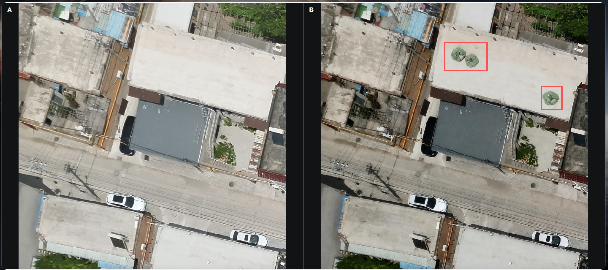

#### 二十八：楼顶生成蓝色管道

提示词：

```
PROMPT = ('''基于输入的无人机俯视建筑照片进行超写实局部编辑，严格保留原图的建筑轮廓、平屋顶结构、女儿墙、屋顶机房、空调设备、玻璃天窗、道路、绿化、航拍视角、构图、光照、阴影和分辨率，只在屋顶机房或空调设备附近增加1组清晰醒目的蓝色工业冷却水管；该组由2至3根粗壮的圆形管道平行组成，总计仅2至3根主要管道，管道从冷却设备或机房侧面合理引出，沿设备区边缘及女儿墙内侧连续铺设，以较长的笔直管段为主，设置少量标准90度圆弧弯头；管道直径约为屋顶空调外机宽度的四分之一至三分之一，管道之间留有至少一个管径的清晰间隔，采用饱和度适中的工业蓝色防腐涂层，表面呈哑光金属质感，配有少量深灰色法兰、连接环、阀门、固定卡箍及低矮金属支架；每根管道必须完整连续、笔直等宽、轮廓锐利、边缘清楚，具有明显的侧面明暗、接触阴影和自然投射阴影，使蓝色管道在浅灰白色屋面上形成清晰对比，在远距离航拍画面中仍然明显可见；管道比例、透视、锐度、颗粒、日照方向及阴影必须与原始照片一致，真实无人机建筑巡检摄影，高清锐利，真实工程安装效果，除增加蓝色冷却水管外不改变原图任何内容。''')

NEGATIVE_PROMPT = ('''白色管道，浅灰色管道，红色管道，黄色管道，黑色主管道，管道与屋面融为一体，模糊管道，虚焦管道，低清晰度，边缘发虚，轮廓不清，半透明，缺少阴影，过细管道，细线状管道，电线，电缆，超过一组管线，超过三根主要管道，密集管网，管道铺满屋顶，杂乱交叉，随机分支，蜘蛛网状管线，断裂管道，消失管段，粗细变化，扭曲管道，波浪形管道，尖锐折线，错误弯头，管道悬空，管道穿模，管道重叠，超大管道，遮挡大面积屋面，过多阀门，复杂工业厂区，塑料玩具质感，改变建筑轮廓，改变屋顶结构，改变原有设备，移动空调外机，新增建筑，新增楼层，改变道路和绿化，改变航拍角度，改变构图，裁剪，旋转，错误透视，光照不一致，阴影方向错误，卡通，插画，3D渲染感，噪点，重影，文字，标签，水印。''')效果图：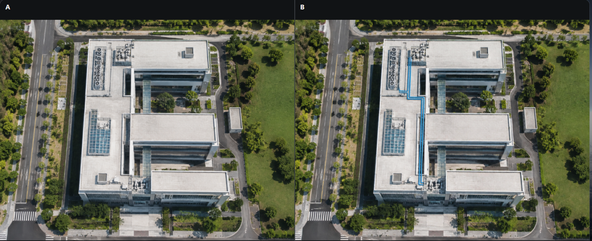
```

效果图 A→B

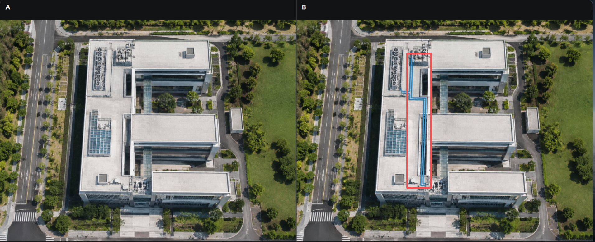

#### 二十九：负样本大楼形变

提示词：

```
PROMPT = ('''基于输入的无人机俯视建筑照片进行超写实时相变化局部编辑，严格保留原图中所有建筑的整体平面布局、占地位置与相互间距，以及道路走向、路口、停车位、绿化带、围墙、周边树木与农田分布，保持航拍正俯视角度、镜头高度、光照方向、色彩基调、影像分辨率与颗粒质感完全一致；仅对画面中的建筑本身进行明显的局部形变，使结果看起来像同一区域在另一个时间时相重新拍摄的真实无人机影像，效果与参考图A一致：每栋建筑的屋面产生明显的拱起、塌陷或鼓包，建筑边缘轮廓出现大幅度波浪状弯曲与不规则起伏，转角明显错位偏移，体块被显著拉伸、压缩或局部碎裂，部分建筑外轮廓向外扩张或向内收缩，屋顶分缝大面积开裂错动，女儿墙与檐口高度发生剧烈变化，平屋顶与坡屋顶之间自然过渡转换，屋面铺装纹理与颜色出现明显深浅变化，机房、天窗、空调外机与管廊的位置明显重排；所有形变保持真实物理感与自然过渡，建筑仍稳稳落在原地块内，不悬浮、不旋转、不新增、不删除，整体看起来像真实的时相差异影像而非人工修饰或3D渲染；除指定建筑形变外，原图道路、绿化、农田、车辆及其他地物结构与构图完全不变。''')
NEGATIVE_PROMPT = ('''建筑整体消失，建筑融化为液体，建筑变成抽象雕塑，建筑移出原位置，新增建筑，删除建筑，建筑数量改变，道路变形，道路弯曲，路口移位，停车位消失，绿化带消失，农田消失，树木大量移动，航拍角度改变，镜头旋转，倾斜地平线，透视改变，建筑悬浮，建筑飞起，强烈立体感，3D渲染感，概念设计图，卡通，插画，动漫风格，玻璃幕墙反光过强，建筑阴影方向错误，渲染光晕，过度锐化，过度平滑，噪点，重影，模糊，虚焦，低清晰度，色差，文字，数字，字母，标志，logo，水印，裁剪，画面旋转，天空，云层，明显阴影变化。''')
```

**效果图** A→B

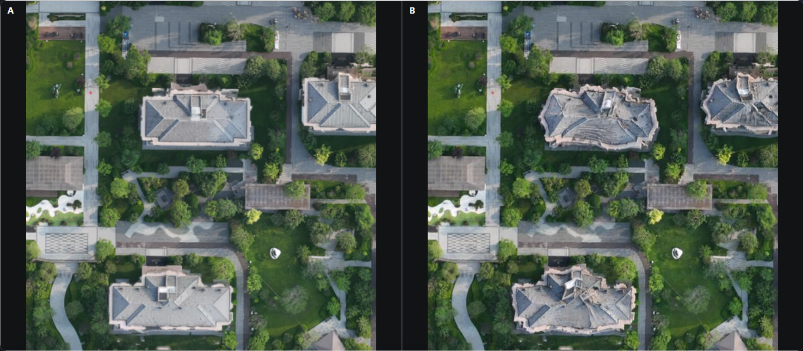


#### 三十：负样本大楼错位

提示词：

```
PROMPT = ('''基于输入的无人机正俯视建筑照片进行超写实时相变化局部编辑，严格保留原图中的道路走向、路口、停车位、绿化带、树木、围墙、广场铺装与整体构图，保持航拍正俯视角度、镜头高度、光照方向、色彩基调、影像分辨率与颗粒质感完全一致；仅对画面中的建筑进行错位处理：每栋建筑从原来的位置发生自然的水平偏移，可沿任意方向平移一小段距离，不同建筑错位方向与幅度各不相同，有的整体左移、有的右移、有的斜向偏移，建筑落点处的地面出现轻微的地基痕迹或铺装色差，原位置留下淡淡的屋面轮廓残影；建筑本身的形状、屋顶结构、材质、颜色与细节保持不变，不旋转、不缩放、不变形，只是位置发生偏移；错位后建筑与周边道路、绿化的衔接保持自然合理，不悬空、不遮挡路口，整体看起来像同一区域在另一个时间时相重新拍摄的真实无人机影像，真实照片质感，细节清晰锐利；除指定建筑错位外，原图其他地物与构图完全不变。''')
NEGATIVE_PROMPT = ('''建筑旋转，建筑变形，建筑缩放，建筑扭曲，建筑悬浮，建筑飞起，新增建筑，删除建筑，建筑数量改变，建筑重叠，建筑压在道路上，建筑压在绿化带上，建筑超出画面边界，道路变形，道路弯曲，路口移位，停车位消失，绿化带消失，树木大量移动，农田消失，围墙消失，航拍角度改变，镜头旋转，倾斜地平线，透视改变，剧烈透视，强烈立体感，3D渲染感，概念设计图，卡通，插画，动漫风格，玻璃幕墙反光过强，建筑阴影方向错误，渲染光晕，过度锐化，过度平滑，噪点，重影，模糊，虚焦，低清晰度，色差，文字，数字，字母，标志，logo，水印，裁剪，画面旋转，天空，云层，明显阴影变化。''')
```

**效果图** A→B

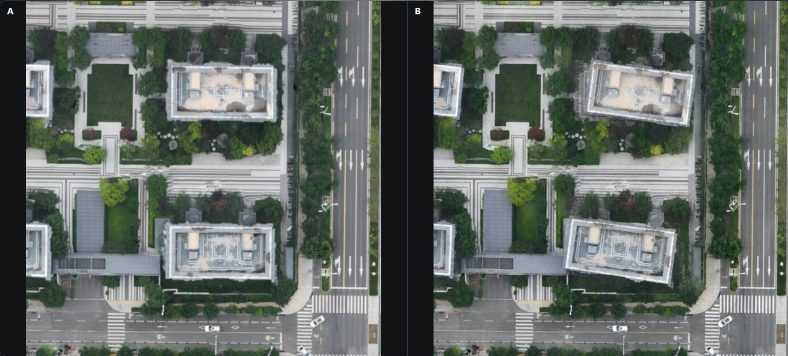

#### 三十一：大楼楼顶生成杂物

```
PROMPT = '将输入无人机航拍图作为不可修改底图，生成一张与原图逐像素严格配准的正射俯视结果：输出尺寸、比例、地面分辨率、构图、屋顶轮廓、地理方位、曝光、白平衡、道路、绿化、车辆、水域、施工区和所有建筑完全一致；不位移、不旋转、不缩放、不裁切、不拉伸，不整图重绘。先完整识别并保护原图中每一处既有屋顶设备、光伏板、通风管、管道、女儿墙、楼梯间、采光带、屋面分缝和阴影；已有目标的数量、位置、方向、大小、颜色和阴影必须原样保留，不得拆除、替换、移动、遮挡或重建。只在空旷、连续、平坦的浅灰色混凝土或防水卷材平屋面上选址；坡屋面、彩钢屋面、瓦屋面、绿色种植屋面、玻璃采光顶、施工区、操场、庭院、道路和绿化一律禁止。若没有足够大的完整空屋面容纳目标及其阴影，输出必须与原图完全一致。参照成功样例的克制效果，最多选择2块合格平屋面，离散新增最多5个小型独立目标，每类最多1个，互不连接、不成组、不成矩阵：1台低矮商用空调室外机，灰白色金属机壳，顶部仅有1个圆形风扇开口和深色格栅护圈，正俯视下呈单体空调室外机外观；1块深蓝色矩形太阳能光伏板，只能是单板；1小堆紧凑灰色建筑废料，由少量碎木板、破碎混凝土块和渣土组成；1组小型镀锌钢板方形通风管道与波纹金属风罩；1段细银色金属排水管道，带小型直角弯头和固定卡箍。所有目标必须参照原图女儿墙厚度、屋面分缝和既有设备确定真实比例；空调室外机长边不超过所在屋面长边的1/30，其余目标不超过1/40。目标之间、目标与既有设备之间保持明显空屋面间距，低矮贴合屋面，方向与屋面分缝或女儿墙平行。每个目标必须完全不透明，底部与屋面真实接触；其覆盖的小块原图区域必须被完整替换，不得透出底层纹理，不得叠加混合。每个目标只生成一个接触阴影，方向、长度、透明度和软硬程度与原图既有阴影一致。新增目标周围屋面自然延续原图颜色、污渍、积尘、分缝、噪点和摄影颗粒；边界干净无白雾、光晕、描边、半透明层、残影、重影、鬼影或修复痕迹。正午强烈直射阳光，新增目标阴影方向、长度与原图既有阴影完全一致，屋面有风化污渍和积尘，照片级真实感，超高分辨率，4K，细节锐利，边缘干净无重影.光照与车辆差异化处理：太阳高度角与方位角明显不同于原图，整体呈清晨低角度侧光，阴影更长且方向与原图不同，但全画面投影方向统一一致，新增目标与既有目标在新光照下投影自然衔接，高光、天空反光、色温与环境亮度随新光照同步变化；道路上车辆与原图完全不同，车型、颜色、尺寸、停放位置与朝向全部改变，新增多辆不同类型车辆（白色SUV、黑色轿车、蓝色厢式货车等），车身反光与地面投影匹配新光照，轮胎接地自然，车牌模糊无文字；在以上变化基础上保持像素级严格配准，构图、比例、地面分辨率、屋顶轮廓、女儿墙、圆环标线与地理方位不变'
NEGATIVE_PROMPT = '整图重绘，全图重构，地图重绘，风格迁移，全局调色，曝光变化，白平衡变化，锐化，美化，输出尺寸改变，画幅比例改变，拉伸，压缩，放大，缩小，重投影，拆除已有目标，替换已有目标，移动已有目标，删除已有光伏板，删除已有空调外机，删除已有通风设备，清空屋顶，改变建筑数量，改变屋顶轮廓，女儿墙变形，道路变形，树木变形，车辆消失或新增，目标放在坡屋面，目标放在彩钢屋面，目标放在瓦屋面，目标放在绿色种植屋面，目标放在玻璃采光顶，目标放在施工区，目标放在操场，目标放在庭院，目标放在道路上，目标放在绿化里，大面积新增，成片覆盖，连片目标，大面积光伏板，光伏阵列，矩阵排列，整齐网格排列，多台独立空调室外机，多组空调设备阵列，一排多个风扇，多风扇长条空调机组，横向排列多个风扇，集装箱设备房，大型冷水机组，高耸设备，超大型设备，多块太阳能板，多堆建筑废料，多条排水管，多组通风管道，多条燃气管道，大面积垃圾堆，满屋顶杂物，密集堆放，目标相互连接，目标重叠，侧视图，蓝色发光风扇，过亮白色，比例失真，目标过大，目标过小，目标悬浮，穿模，遮挡既有设备，虚影，残影，重影，鬼影，半透明物体，底层屋面透出，双重阴影，多重阴影，阴影方向冲突，羽化过渡，白雾，光晕，描边，柔光叠层，边缘模糊，边缘不对齐，拼接缝，修复痕迹，3D渲染感，塑料感，卡通感，低分辨率，模糊，JPEG压缩伪影，噪点异常，过饱和，文字，字母，数字，水印，标志，人物，新增车辆，倾斜视角，透视变形，鱼眼畸变'

```

**效果图** A→B

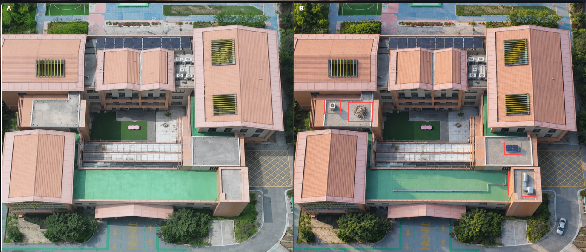

## 底图→全新图

#### 一：底图生全新建筑大楼（屋顶分割）

提示词1正射：

```
PROMPT = ('超写实无人机正射影像图，相机完全垂直向下，nadir视角，真实正射投影，画面内比例均匀，无透视畸变，像高精度卫星图或无人机正射拼接影像。展示一座全新的现代中国文化公共建筑群。参考图只作为屋顶处理、材质、色彩和整体气质的风格参考；必须生成全新的场地布局，不复制参考图中的具体建筑组合、道路走向或构图。建筑由多个大尺度矩形体量组合而成，整体庄重、理性、现代，类似文化中心、会议中心、博物馆或市民服务中心。画面中只能看到建筑屋顶和地面轮廓，不出现立面透视；屋顶为平屋顶或缓坡屋顶，布置细密金属格栅、光伏板阵列、灰色天窗、屋面检修通道和设备井，部分屋顶边缘带轻微弧形或切角，但整体仍然规整克制。周围是全新规划的城市新区，包括浅灰色石材广场、线性铺装、林荫道、草坪、绿篱、人行步道、宽阔沥青道路、清晰车道线、少量车辆、路灯和开阔绿地，附近可有柔和的河道或湿地边缘。阴天或薄雾日光，所有阴影方向一致，画面低对比，色彩以米黄、香槟金、暖灰、深灰和清新绿色为主。真实中国新区正射航拍纪实质感，沥青、混凝土、石材、金属屋面、玻璃和植被细节真实清晰，8K高清，锐利影像，无效果图感')
NEGATIVE_PROMPT = ('高空斜俯视角，斜俯视，低角度航拍，四十五度视角，透视视角，透视变形，可见建筑立面，可见墙面，可见窗户立面，地平线，天空，云朵，鱼眼，广角畸变，建筑漂浮，建筑倾斜，道路扭曲，复制参考图布局，重复参考图构图，卡通，插画，动漫，游戏画面，三维渲染感，效果图质感，塑料材质，过度光滑，高饱和颜色，奇幻建筑，未来科幻建筑，玻璃金字塔，扭转塔楼，高层住宅，中式传统坡屋顶，古建筑屋顶，繁复装饰，密集人群，密集车流，文字，数字，字母，标志，水印，边框，低清晰度，模糊，重影，噪点，过曝，欠曝')
```

**效果图** A←B

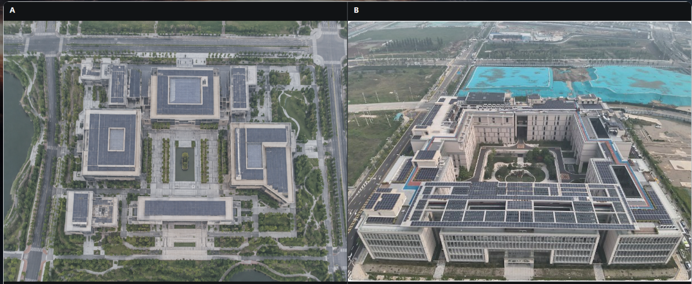


提示词2航拍图转正射图：

```
PROMPT = ('最高优先级视角规则：本任务中的每一张输出图都必须是真正的放大正射影像图，不允许任何一张出现斜俯视、透视航拍或立面视角。相机光轴必须与地面完全垂直，nadir视角，90度垂直向下，真实正射投影，画面比例均匀，无透视畸变，无近大远小。影像相当于较低航高、高地面分辨率、更高放大倍率的无人机正射拼接成果，画面只覆盖建筑群及其紧邻道路、广场和绿化，不呈现大范围城市全景。建筑群主体应占据画面主体位置，屋顶细节放大清晰，观感接近高分辨率卫星图局部放大或近距离正射底图。提交的一批航拍图只用于确认同一组建筑群的身份、材质、屋顶轮廓、体量组合、相对位置和场地关系；不要继承参考图的斜俯视角或构图。必须严格保持建筑一致性：建筑数量、体量组合、相对位置、间距、朝向、连廊、广场边界、道路衔接、河道关系、屋顶轮廓、屋面分缝、天窗、光伏阵列、金属格栅、设备井和主要材质都必须与提交影像对应。建筑群为现代中国文化公共建筑，采用米黄色石材、浅香槟金色金属屋面、灰色基座、细密金属格栅、光伏板阵列、灰色天窗、屋面检修通道和设备井，部分屋顶边缘带轻微弧形或切角，整体规整克制。画面中重点表现屋顶平面、屋面纹理、排水线、检修通道、屋面设备、檐口投影和紧邻场地关系，建筑立面、外墙和窗洞不得可见。周围只保留必要的浅灰色石材广场、线性铺装、林荫道、草坪、绿篱、人行步道、宽阔沥青道路、清晰车道线、少量车辆、路灯和绿地，可局部出现河道或湿地边缘，但不要扩大到远处城市环境。阴天或薄雾日光，光照均匀，所有阴影方向一致且较短，画面低对比，色彩以米黄、香槟金、暖灰、深灰和清新绿色为主。真实中国新区高分辨率正射航拍纪实质感，沥青、混凝土、石材、金属屋面、玻璃和植被纹理清晰可辨，8K高清，锐利影像，无效果图感')
NEGATIVE_PROMPT = ('任何非正射视角，任何一张斜俯视图，任何一张透视航拍图，高空斜俯视角，斜俯视，低角度航拍，四十五度视角，三点透视，两点透视，一点透视，鸟瞰透视，isometric，轴测图，可见建筑立面，可见墙面，可见窗户立面，立面细节，地平线，天空，云朵，远景透视，近大远小，比例不均匀，大范围全景，城市尺度远景，超宽视野，建筑过小，画面空洞，鱼眼，广角畸变，建筑倾斜，建筑拉伸，建筑悬浮，道路扭曲，复制参考图斜俯构图，风格漂移，建筑一致性改变，新增建筑，删除建筑，改变建筑数量，改变体量组合，改变相对位置，改变道路和广场关系，相似但不同的建筑群，全新布局，卡通，插画，动漫，游戏画面，三维渲染感，效果图质感，塑料材质，过度光滑，高饱和颜色，奇幻建筑，未来科幻建筑，玻璃金字塔，扭转塔楼，高层住宅，中式传统坡屋顶，古建筑屋顶，繁复装饰，密集人群，密集车流，文字，数字，字母，标志，水印，边框，低清晰度，模糊，重影，噪点，过曝，欠曝')

```

**效果图 **A←B

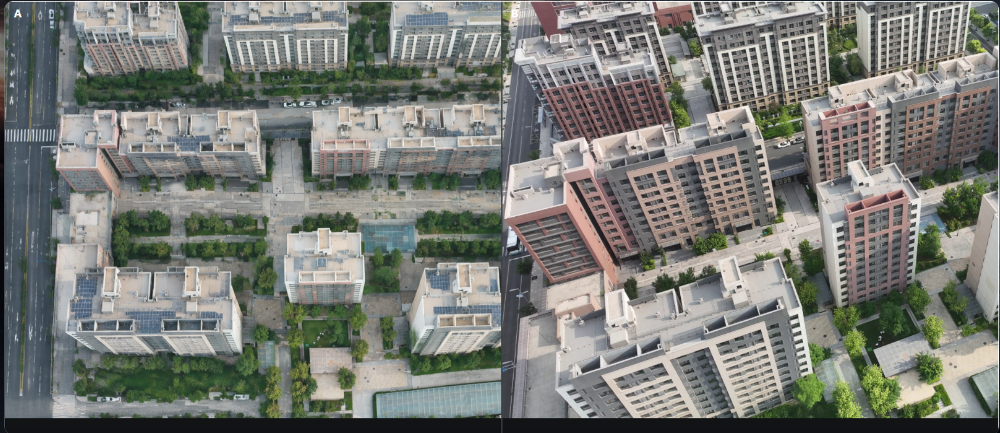


提示词3航拍图转正射图（更低行高）：

提示词：

```
PROMPT = ('最高优先级视角规则：每一张输出图都必须是超低空无人机放大正射影像，不允许任何一张出现斜俯视、透视航拍或立面视角。相机光轴必须与地面完全垂直，nadir视角，90度垂直向下，真实正射投影，画面比例均匀，无透视畸变，无近大远小。航高进一步降低，相当于约60至90米相对高度的无人机航测正射影像，地面分辨率极高，画面观感是高倍放大的正射底图局部。画面只覆盖一个建筑组团或一组连续屋面及其紧邻的广场、道路和绿化，单个大型屋顶或相邻屋顶组合应占据画面约百分之七十到九十，只保留少量周边场地用于识别位置关系，不呈现完整园区全景或城市远景。提交的一批航拍图只用于确认同一组建筑群的身份、材质、屋顶轮廓、体量组合、相对位置和场地关系；不要继承参考图的斜俯视角或构图。必须严格保持建筑一致性：建筑数量、体量组合、相对位置、间距、朝向、连廊、广场边界、道路衔接、河道关系、屋顶轮廓、屋面分缝、天窗、光伏阵列、金属格栅、设备井和主要材质都必须与提交影像对应。如果画面只显示建筑群局部，可见部分必须能准确对应原始建筑群，不得新增、删除或重新设计建筑。建筑群为现代中国文化公共建筑，采用米黄色石材、浅香槟金色金属屋面、灰色基座、细密金属格栅、光伏板阵列、灰色天窗、屋面检修通道和设备井，部分屋顶边缘带轻微弧形或切角，整体规整克制。画面重点表现屋顶平面、屋面纹理、排水线、检修通道、屋面设备、檐口投影和紧邻场地关系，建筑立面、外墙和窗洞不得可见。阴天或薄雾日光，光照均匀，所有阴影方向一致且较短，画面低对比，色彩以米黄、香槟金、暖灰、深灰和清新绿色为主。真实中国新区超低空高分辨率正射航拍纪实质感，沥青、混凝土、石材、金属屋面、玻璃和植被纹理清晰可辨，8K高清，锐利影像，无效果图感')
NEGATIVE_PROMPT = ('任何非正射视角，任何一张斜俯视图，任何一张透视航拍图，完整园区全景，大范围城市景观，远景，超宽视野，建筑过小，画面空洞，高空斜俯视角，斜俯视，低角度航拍，四十五度视角，三点透视，两点透视，一点透视，鸟瞰透视，isometric，轴测图，可见建筑立面，可见墙面，可见窗户立面，立面细节，地平线，天空，云朵，远景透视，近大远小，比例不均匀，低地面分辨率，鱼眼，广角畸变，建筑倾斜，建筑拉伸，建筑悬浮，道路扭曲，复制参考图斜俯构图，风格漂移，建筑一致性改变，新增建筑，删除建筑，改变建筑数量，改变体量组合，改变相对位置，改变道路和广场关系，相似但不同的建筑群，全新布局，卡通，插画，动漫，游戏画面，三维渲染感，效果图质感，塑料材质，过度光滑，高饱和颜色，奇幻建筑，未来科幻建筑，玻璃金字塔，扭转塔楼，高层住宅，中式传统坡屋顶，古建筑屋顶，繁复装饰，密集人群，密集车流，文字，数字，字母，标志，水印，边框，低清晰度，模糊，重影，噪点，过曝，欠曝')
```

**效果图 **A←B

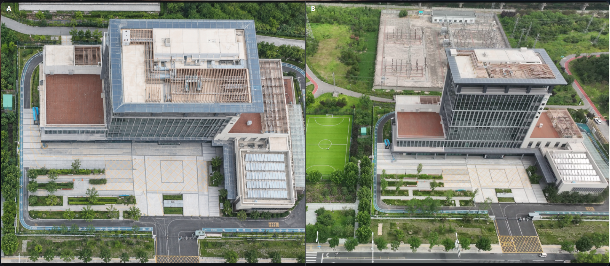


## （作用低）航拍图环境变化(光照/季节/天气)

### 时间线 （第二时刻 →单时刻)


#### 01 黎明日出

```
PROMPT = "航拍俯视图，无人机视角，保持原图构图和建筑布局不变，日出时分，黄金时刻，柔和温暖的橙色光线，长长的影子延伸在地面上，粉金色的天空，地平线上的晨雾，写实风格，高清细节，锐利对焦，逼真光照，高质量"
```

 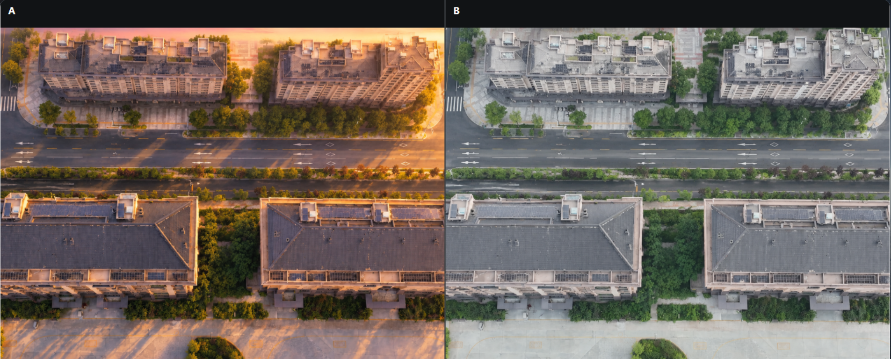

#### 02 正午

```
PROMPT = "航拍俯视图，无人机视角，保持原图构图和建筑布局不变，正午时分，头顶直射阳光，极短的阴影，高对比度，色彩饱和，晴朗蓝天，清晰锐利，写实风格，高清细节，锐利对焦，逼真光照，高质量"
```

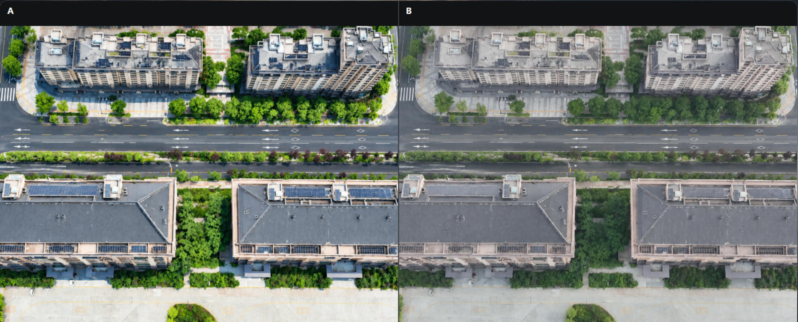


#### 03 午后

```
PROMPT = "航拍俯视图，无人机视角，保持原图构图和建筑布局不变，午后时分，温暖的金色调，柔和的斜射阴影，温暖的色调渲染，宁静安详的氛围，写实风格，高清细节，锐利对焦，逼真光照，高质量"
```

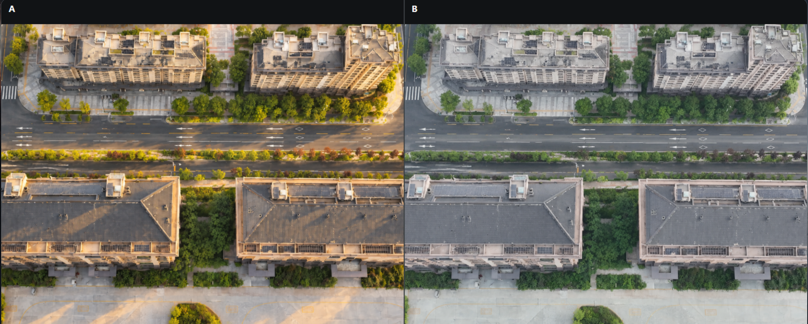

#### 04 黄昏日落

```
PROMPT = "航拍俯视图，无人机视角，保持原图构图和建筑布局不变，日落黄昏，黄金时刻，戏剧性的橙红色天空，温暖的琥珀色光线洒满大地，长而戏剧性的影子，剪影边缘效果，写实风格，高清细节，锐利对焦，逼真光照，高质量"
```

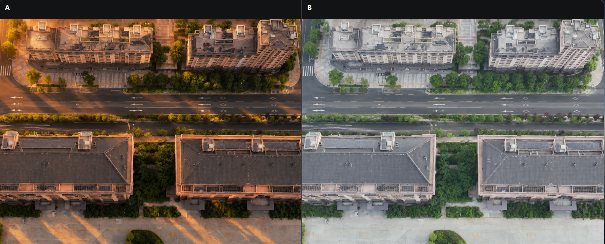

### 季节线

#### 05 早春

```
PROMPT = "航拍俯视图，无人机视角，保持原图构图和建筑布局不变，早春季节，残留的积雪正在融化，树木刚长出嫩芽，淡绿色新芽冒出，棕绿相间的地面，季节交替过渡，清凉新鲜的空气感，写实风格，高清细节，锐利对焦，逼真光照，高质量"
```

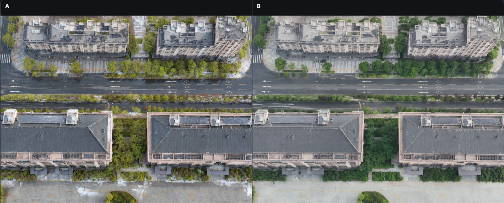

#### 06 春

```
PROMPT = "航拍俯视图，无人机视角，保持原图构图和建筑布局不变，春天季节，鲜嫩翠绿的植被，樱花树和开花树木点缀其间，远处轻薄的薄雾，新生生长的气息，明亮愉悦的氛围，写实风格，高清细节，锐利对焦，逼真光照，高质量"
```

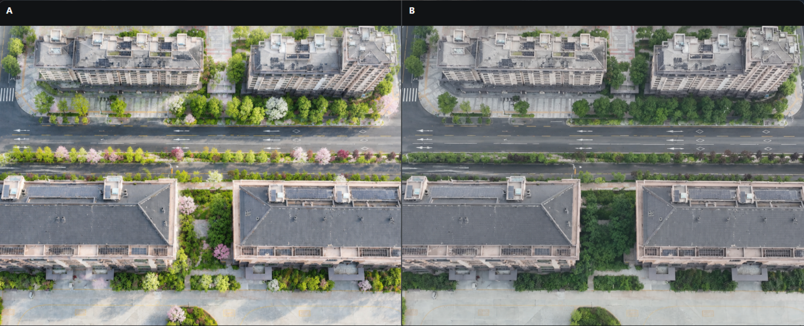

#### 07 夏

```
PROMPT = "航拍俯视图，无人机视角，保持原图构图和建筑布局不变，夏天季节，茂密浓郁的绿色植被，完整的树冠层，饱和的深绿色彩，充满生机的健康景观，明亮阳光下的氛围，写实风格，高清细节，锐利对焦，逼真光照，高质量"
```

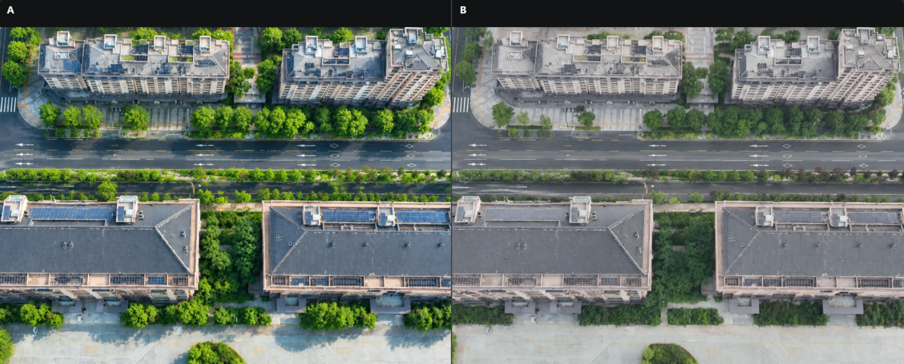

#### 08 初秋

```
PROMPT = "航拍俯视图，无人机视角，保持原图构图和建筑布局不变，初秋季节，树叶开始变成金黄和橙色，绿色与黄色植被混合，温暖的秋日光线，丰收季节的氛围，写实风格，高清细节，锐利对焦，逼真光照，高质量"
```

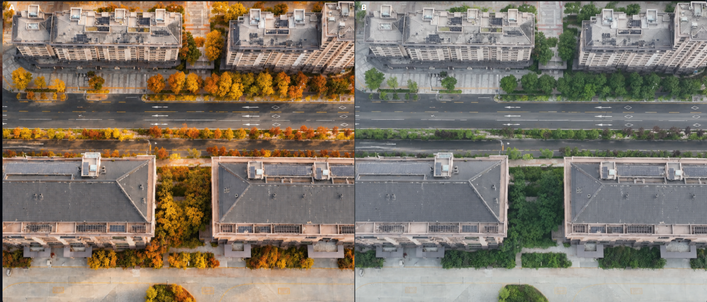

#### 09 深秋

```
PROMPT = "航拍俯视图，无人机视角，保持原图构图和建筑布局不变，深秋季节，大部分树木已经落叶，残留的金褐色和锈色树叶，地面覆盖着落叶，柔和的大地色调，忧郁深沉的氛围，写实风格，高清细节，锐利对焦，逼真光照，高质量"
```

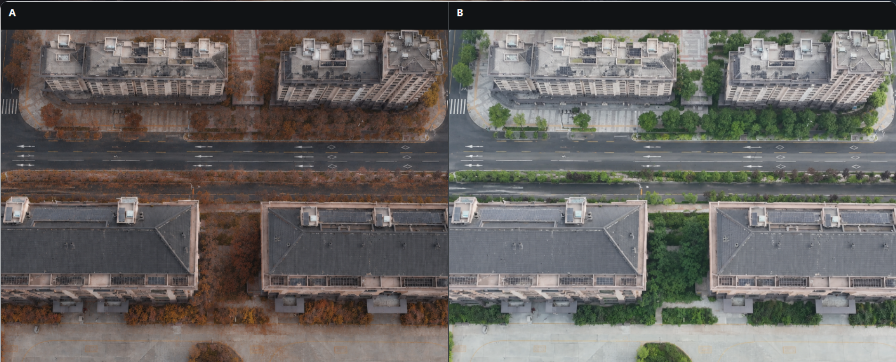

#### 10 冬

```
PROMPT = "航拍俯视图，无人机视角，保持原图构图和建筑布局不变，冬天季节，地面和屋顶覆盖着积雪，光秃秃的树枝，冷白色和蓝色的色调，冰冻的景观，干净极简的白色场景，写实风格，高清细节，锐利对焦，逼真光照，高质量"
```

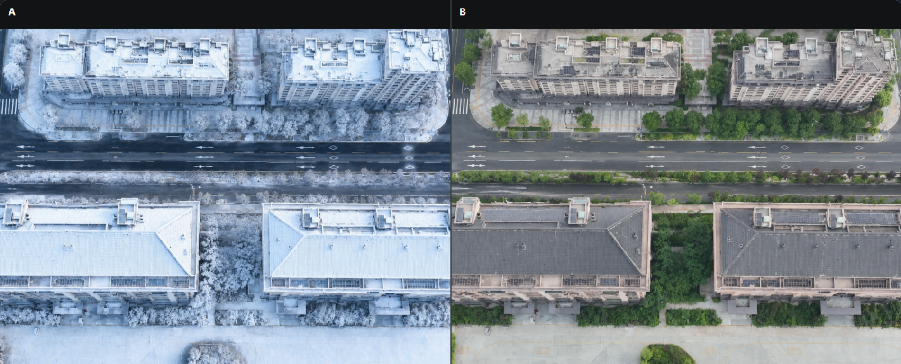

### 天气线

#### 11 晴天

```
PROMPT = "航拍俯视图，无人机视角，保持原图构图和建筑布局不变，晴朗的晴天，蓝天，高能见度，清晰的阴影，锐利的细节，鲜艳自然的色彩，完美的天气，写实风格，高清细节，锐利对焦，逼真光照，高质量"
```

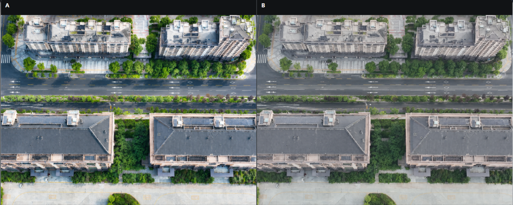

#### 12 多云

```
PROMPT = "航拍俯视图，无人机视角，保持原图构图和建筑布局不变，多云天气，柔和的漫射光透过云层，轻柔的阴影，云影散落在地面上，宜人温和的氛围，写实风格，高清细节，锐利对焦，逼真光照，高质量"
```

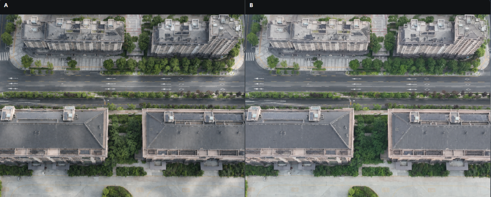

#### 13 雾天

```
PROMPT = "航拍俯视图，无人机视角，保持原图构图和建筑布局不变，大雾天气，低能见度，浓雾覆盖景观，柔和的雾霾，远处物体渐渐消失在灰白色中，神秘安静的氛围，柔和的色调，写实风格，高清细节，锐利对焦，逼真光照，高质量"
```

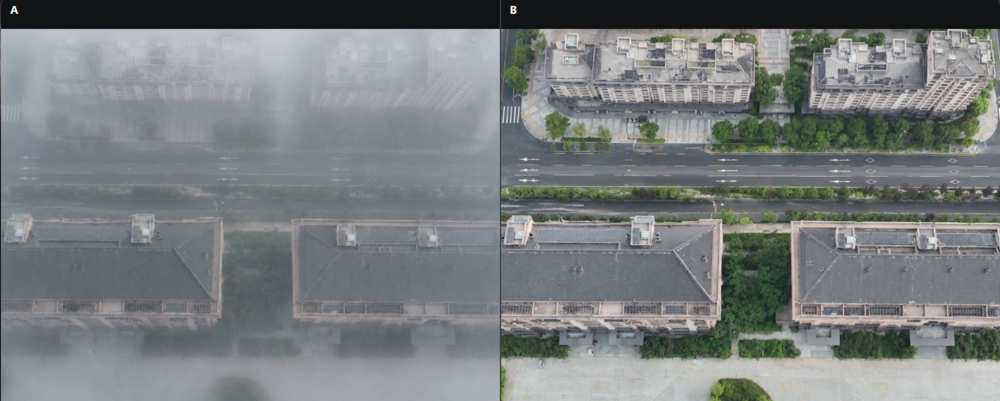

#### 14 雨天

```
PROMPT = "航拍俯视图，无人机视角，保持原图构图和建筑布局不变，雨天，湿润的表面反射光线，可见的雨丝，道路和地面上的水坑，灰色的天空，湿润闪亮的人行道，清新的雨天氛围，写实风格，高清细节，锐利对焦，逼真光照，高质量"
```

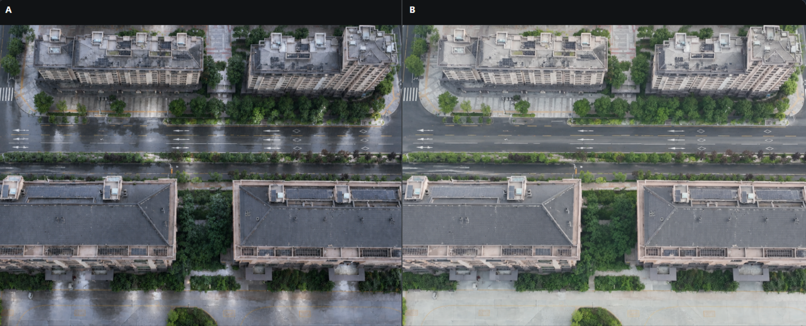

#### 15 雪天

```
PROMPT = "航拍俯视图，无人机视角，保持原图构图和建筑布局不变，下雪中，空气中可见飘落的雪花，地面和屋顶上积雪正在积累，灰白色的天空，柔和的漫射光，寒冷的冬季氛围，写实风格，高清细节，锐利对焦，逼真光照，高质量"
```

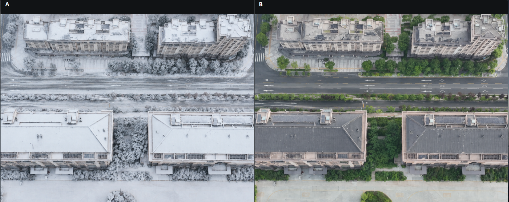


### 二阶组合

#### 16 秋日黄昏

```
PROMPT = "航拍俯视图，无人机视角，保持原图构图和建筑布局不变，秋天的日落，黄金时刻，橙色和红色的树叶，温暖的琥珀色光线，长而戏剧性的影子，飘落的树叶在空中，怀旧温暖的氛围，写实风格，高清细节，锐利对焦，逼真光照，高质量"
```

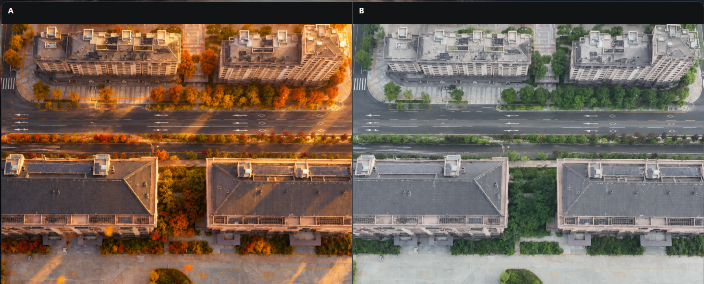


#### 17 春日晨雾

```
PROMPT = "航拍俯视图，无人机视角，保持原图构图和建筑布局不变，春天的清晨薄雾，柔和的金色光线穿透薄雾，樱花树在雾气中若隐若现，空灵梦幻的氛围，温柔的暖白色调，写实风格，高清细节，锐利对焦，逼真光照，高质量"
```

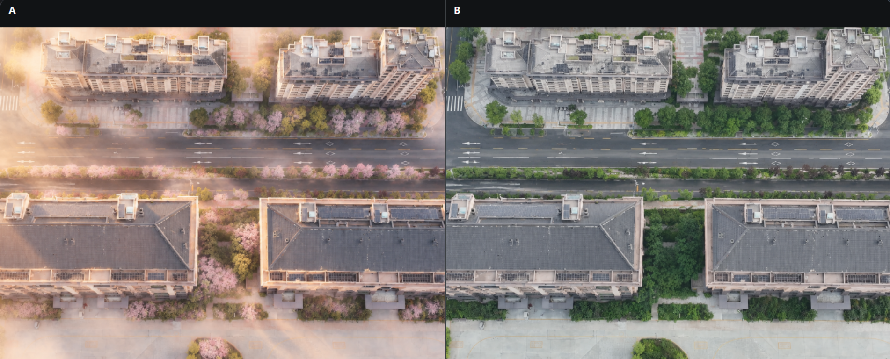

#### 18 冬季日落

```
PROMPT = "航拍俯视图，无人机视角，保持原图构图和建筑布局不变，冬季日落，金橙色光线反射在积雪覆盖的地面上，光秃的树枝剪影映衬在彩色天空前，雪地上的长影，寒冷空气中温暖光线的对比，写实风格，高清细节，锐利对焦，逼真光照，高质量"
```

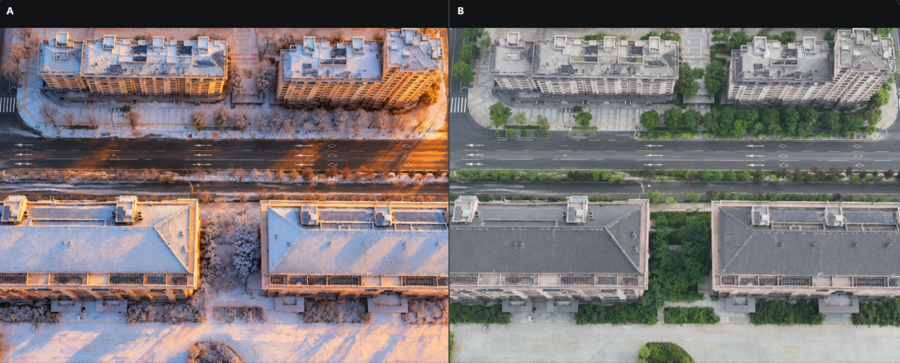

#### 19 雨后彩虹

```
PROMPT = "航拍俯视图，无人机视角，保持原图构图和建筑布局不变，雨后彩虹，天空放晴云层散开，湿润的地面反射光线，鲜艳的彩虹弧线跨过景观，清新干净的空气感，充满希望明亮的心情，写实风格，高清细节，锐利对焦，逼真光照，高质量"
```

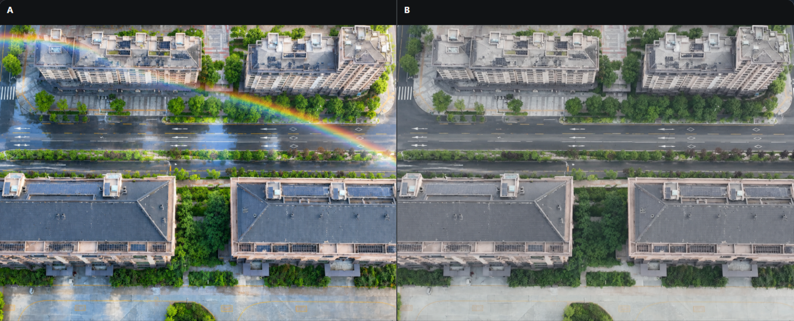
